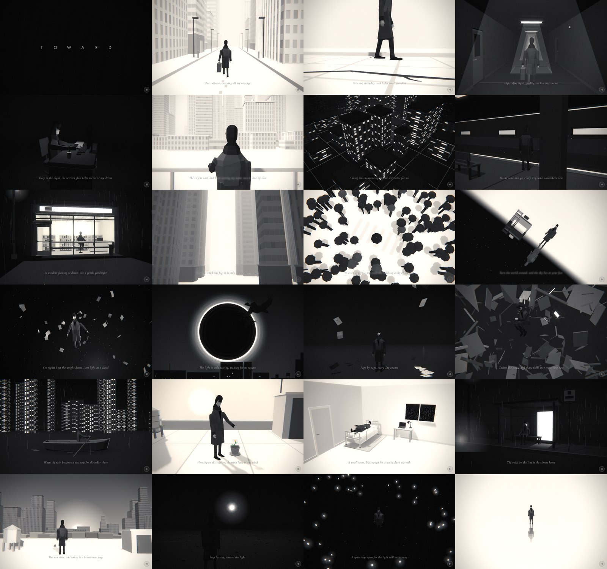

# Toward the Light

A scroll-driven 3D short story in the browser. One person, one suitcase, and a city slowly getting to know him: 24 scenes, from the first snowy day in town, past late-night desks, rain, fog and a flooded street he rows across, to a sunrise and a walk toward one light.

一個人、一只行李箱、一座正在認識他的城市。24 個場景，用滾動推進時間，陪他一步一步走向光。（網站上的文字全部是英文。）

- **Tech:** plain HTML + CSS + JavaScript, [three.js r128](https://cdnjs.cloudflare.com/ajax/libs/three.js/r128/three.min.js) from cdnjs. No framework, no bundler, no assets: every model, texture and sound is generated in code.
- **Output:** one self-contained HTML file (`dist/index.html`, ~185 KB).
- **Look:** black-and-white low-poly film. A post-processing pass adds grain, glow, vignette and a silver tone curve.
- **Text:** English only, hopeful and poetic, set in Cormorant Garamond italic. No scene numbers on screen.
- **Models:** every set piece is a designed low-poly sculpture after the reference film (v41 model polish, see [docs/model-polish](docs/model-polish/README.md)); the hero is a faceless faceted figure with five-finger hands.



## Quick start

```bash
./build.sh                 # src/ -> dist/index.html, dist/artifact.html, dist/test.html
open dist/index.html       # or serve the folder with any static server
```

Optional tooling (headless screenshots and video), which needs Node 18+ and Playwright:

```bash
npm install
npm run shots -- 3.5 14.6  # screenshots at scroll positions (scene index + fraction) -> out/shots/
npm run contact            # one shot per scene + a contact sheet -> out/contact.jpg
npm run video              # frame-by-frame capture + ffmpeg -> out/toward-the-light.mp4
```

## Repository map

| Path | What it is |
|---|---|
| `src/head.html` | `<title>` and Google Fonts links |
| `src/style.css` | all CSS (intro, loader, hint, captions, ending, About panel) |
| `src/body.html` | DOM layers: intro, loader, scroll hint, caption, ending, sound toggle, About |
| `src/app.js` | everything else: captions, renderer, film shader, character rig, scene builders, render loop, loader, audio |
| `build.sh` | concatenates `src/` into `dist/` |
| `tools/` | screenshots, contact sheet, video, pose sandbox (`pose.html`) and walk-cycle sheet (`gait.html`) |
| `docs/` | design and engineering notes for whoever (human or model) continues this |
| `assets/` | reference images: `storyboard.jpg` (all 24 scenes, current) and `daisy.png` (the owner's daisy reference) |

## Docs

Start with **[AGENTS.md](AGENTS.md)** (also the CLAUDE.md). Then read:

1. [docs/ARCHITECTURE.md](docs/ARCHITECTURE.md): how the page works, from the render loop and scene contract to the film pass and loader
2. [docs/SCENES.md](docs/SCENES.md): all 24 scenes, with caption, staging, camera and known weaknesses
3. [docs/CHARACTER.md](docs/CHARACTER.md): the low-poly hero, his rig API and poses
4. [docs/ART-DIRECTION.md](docs/ART-DIRECTION.md): the look, the owner's taste and the feedback history (what was rejected and why)
5. [docs/WORKFLOW.md](docs/WORKFLOW.md): building, verifying with screenshots, recording video, publishing
6. [docs/ROADMAP.md](docs/ROADMAP.md): known issues and the highest-value improvements
7. [docs/CHANGELOG.md](docs/CHANGELOG.md): every published version and what changed, with the owner's words

## Credits

Inspired by the scroll-story format of "Through the Dark". All code, models and copy here are original. The About page credits PEACEMINUSONE as an inspiration; no official logos or brand assets are used. Check rights before any public or commercial release.
