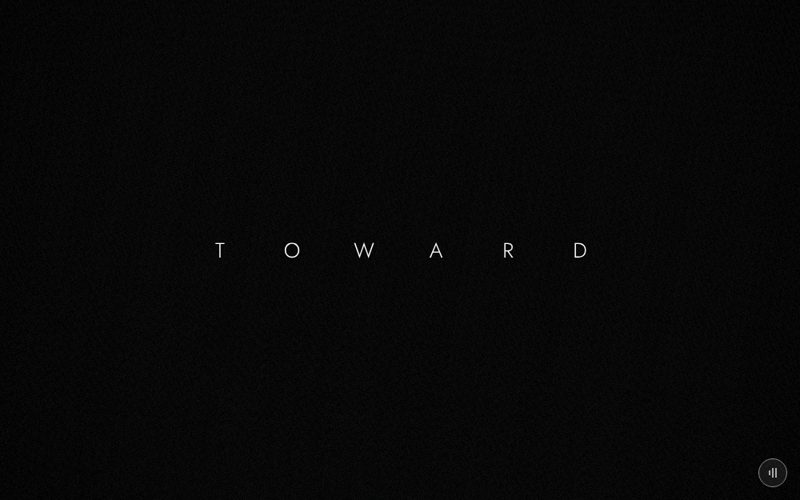

# 00 · title



> (no caption)
> Source: `src/app.js`, banner `/* 0 — title: TOWARD / THE LIGHT letters */` · group: none (no 3D models; not part of the v41 model polish) · before/after: none

**There is no 3D content in this scene.** The Three.js scene is empty: `update()` only sets `scene.background`. The title is DOM text in `#bigTitle`, which sits above the canvas and is animated letter by letter from `update(t)`. Everything a viewer sees here is CSS plus the film pass (grain, vignette) over a flat colour.

## At a glance
| | |
|---|---|
| Setting | Void: a flat colour behind DOM letters. Black for t < .5, near-white for t ≥ .5 |
| Tone | `bg:'#000'`, `dark:t=>t<.5`. `scene.background` is `0x000000` for t < .5 and `0xfafafa` for t ≥ .5 (a hard switch, no blend). In the dark half, the film pass uses full grain (.05) and vignette (.5), and `audioMood` puts the drone's low-pass filter at 380 Hz. In the light half: grain .035, vignette .35, filter 1400 Hz |
| Hero | Absent |
| Motion | `lt` (0..1 inside each half) fades the letters in, in a fixed shuffled order, each rising 10 px. First half: `TITLE_A` "TOWARD" in white plus the `PRESENTS` line ("For everyone making it alone in the city"), which fades out by lt .45. Second half: `TITLE_B` "THE LIGHT" in black |
| Camera | Not set. `update()` never touches `camera`. Nothing is drawn, so it does not matter, but see Editing notes |
| Budget | scene 0 tris (v40 0) · hero 0 · 0 meshes · 0 instanced · 0 lights · 0 materials (inventory, both versions) |

## Models
| Model | Built with | Geometry | Tone | Placement / contact | Notes |
|---|---|---|---|---|---|
| Background | `scene.background = new THREE.Color(half?0x000000:0xfafafa)`, set every frame | — | `#000000` / `#fafafa` | full frame | It allocates a new `Color` every frame (harmless). The `#fafafa` half is not the dip colour: the dip to scene 1 goes to `#eeeeee` |
| Title letters | DOM: `mk(w)` wraps each character of the word in a `<span>` (a space becomes `&nbsp;`); written into `#bigTitle.innerHTML` once per half (`mode` 'a'/'b') | 6 spans for "TOWARD", 9 for "THE LIGHT" (the space is a span) | `#fff` on black, `#000` on white (`bt.style.color`) | centred by flex. Each span is an inline-block `width: clamp(26px,9vw,110px)`, which spreads the letters | Font: `#bigTitle` = `300 clamp(18px,4.2vmin,40px) var(--font-display)` (Jost, per ART-DIRECTION). The film pass does not touch it: it is DOM above the canvas (`z-index:2`) |
| Presents line | DOM `<small style="top:calc(50% + 4em)">${PRESENTS}</small>`, first half only | — | `#bbb`, 10 px, letter-spacing .6em (`#bigTitle small` in `style.css`) | below the word | opacity `1 - smooth(.1,.45,lt)` |
| Dip overlay | `#fade` (in `frame()`, not in this block) | — | fades to `SCENES[1].bg` = `#eeeeee` for t ∈ [.9, 1] | full screen, under `#bigTitle` (`z-index:1`) | No dip-in: scene 0 is the first scene |

## Lights and atmosphere
- No lights, no fog, no particles. The inventory lists 0 lights.
- Film pass: `dark` uniform 1 for t < .5 and 0 after. That drives grain (.05 / .035), vignette (.5 / .35) and glow strength (×1 / ×.15; there is nothing bright to glow). Grain and vignette are the only texture in the frame.
- Sound: `audioMood(dark)` sweeps the drone's filter between 380 Hz (first half) and 1400 Hz (second half).

## Animation (`update(t, time)`)
- `half = t < .5`; `lt = half ? t·2 : (t − .5)·2`.
- **Swap, once per half:** when `mode` changes, `#bigTitle.innerHTML` is rebuilt (`TITLE_A` + the `<small>` line, or `TITLE_B`) and the text colour flips.
- **Each letter k:** `o = order[k]/n·.7`, `a = smooth(o, o+.25, lt·1.15)`, then `opacity = a` and `transform = translateY((1−a)·10px)`.
  - `order` is `[3,0,5,2,6,1,4]` in the first half and `[4,0,7,2,5,1,6,3]` in the second; `n` is the number of spans.
  - With `lt·1.15`, the last-ordered letter finishes when `lt·1.15` reaches `o+.25`: "TOWARD" (max order 6, o = .7) is complete at lt ≈ .83 (t ≈ .41); "THE LIGHT" (max defined order 7, o ≈ .54) at lt ≈ .69 (t ≈ .85).
- **Presents line:** fades out over lt .1–.45 (t .05–.225).
- **Scroll-driven only.** `time` is unused.
- **Outside `update`:** `frame()` sets `#bigTitle.hidden = i !== 0` whenever the scene index changes. Before the first scroll (`started` false), `frame()` draws nothing and `update` never runs, so `#bigTitle` is still empty while the `#hint` overlay ("Scroll down / walk with him toward the light") shows.

## v40 → v41
- **No change.** The scene block is byte-identical in `app_v40.js` and `src/app.js`, and it has no 3D models, so the model polish did not touch it. Inventory: 0 → 0 tris.

## Editing notes
- **Bug (present in v40 and v41): the last letter of "THE LIGHT" does not animate.**
  - "THE LIGHT" makes 9 spans, but the second `order` array has 8 entries.
  - For span 8 (the final "T"), `order[8]` is `undefined`, so `o` and `a` are `NaN`.
  - Chromium ignores `style.opacity = NaN` and `translateY(NaNpx)` (checked in the repo's headless Chromium: the property stays `""`). That span therefore shows at full opacity, unshifted, from the first frame of the second half, while the other eight fade in.
  - The first array has 7 entries for the 6 letters of "TOWARD" (one unused, harmless).
  - The lengths 7 and 8 suggest the arrays were written for an earlier title of 7 + 8 characters ("THROUGH" and "THE DARK" with its space fit exactly); the site was renamed from "Through the Dark" (ART-DIRECTION feedback history).
  - **Fix:** build the order from `n` (e.g. a fixed permutation per length, or `rng`-shuffled `[...Array(n).keys()]`), or keep each array's length equal to the span count of its word. Check both halves in a screenshot.
- **Text rules:**
  - `TITLE_A`, `TITLE_B` and `PRESENTS` live in the `Editable` banner at the top of `app.js`. Change them there, not in this block.
  - They must stay English, hopeful, and free of flower wording (ART-DIRECTION).
  - If a title's length changes, the `order` arrays must change with it (see the bug above).
- **No scene counter.** The owner removed the "03 — 24" numbers. Don't add one here either.
- **If you ever add 3D objects here,** set `camera` in `update()` every frame (`position.set` + `lookAt`):
  - Today the camera keeps whatever the previous frame left.
  - `frame()` adds the handheld drift (`camera.position.x/y +=`, `camera.rotation.z +=`) after every `update`. In a scene that never resets the camera, that drift accumulates frame after frame.
  - Scene 1 resets the camera, so nothing leaks today.
- **Shadows and materials:** none. `buildAll()` has nothing to traverse; `renderer.compile` on an empty scene is cheap.
- **Dip colours:** the dip out of this scene goes `#fafafa` → `#eeeeee` (scene 1's `bg`). If you change the second-half background, keep it close to `#eeeeee` so the cut into the snowy street stays soft.
- **Caption band:** `CAPTIONS.title` is `""`, so no caption shows. The only other text is the `PRESENTS` line just below the centre (`top: calc(50% + 4em)`), visible until t ≈ .225.

## Check it
```bash
NODE_PATH=/opt/node-tools/node_modules WAIT=9000 node tools/shots.js 0.1 0.3 0.45 0.6 0.88 0.95
```
- **0.1:** "TOWARD" on black, with the first letters still fading in and the `PRESENTS` line under the word.
- **0.3:** `PRESENTS` gone; the last letters of "TOWARD" still fading in.
- **0.45:** "TOWARD" complete on black.
- **0.6:** "THE LIGHT" on `#fafafa`, fading in. **Look at the final T:** with the bug above it is already fully opaque while the others are faint.
- **0.88:** "THE LIGHT" complete (all letters are done by t ≈ .85).
- **0.95:** the dip toward `#eeeeee`.
- `shots.js` scrolls to at least 5 px, so t = 0 itself cannot be shot.
- The page eases toward the scroll target, so a shot shows a slightly earlier t than requested. The committed key image `assets/scenes/00-title.jpg` (requested at .5) still shows the first half for that reason: the eased position had not yet crossed .5.
- The title is DOM, so it appears in Playwright page screenshots but not in a canvas-only capture.
