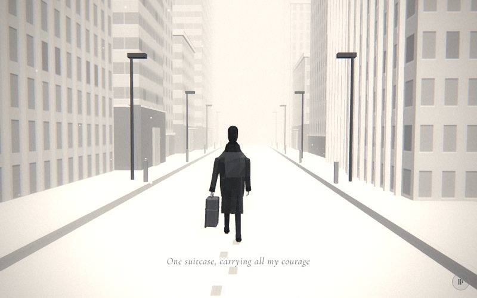

# 01 · arrive

> "One suitcase, carrying all my courage"
> Source: `src/app.js`, banner `/* 1 — arriving in the city with one suitcase */` · group: city · before/after: [sheet](../../assets/model-polish/city.jpg)

## At a glance
| | |
|---|---|
| Setting | Exterior, day, snowing. A straight white avenue between two rows of office towers. The road is about 5.7 wide between the kerbs (kerb centres at x ±2.9), with a raised pavement, lamp posts and bollards on each side. Everything comes from `street(scene,{seed:2})`, the only caller of `street()` |
| Tone | Light. `bg:'#eeeeee'`; `scene.background` and the fog are both `0xeeeeee`. `dark:()=>false` for the whole scene, so the caption is black with a white halo and the film pass uses light-scene grain and vignette. Dips: the scene opens out of `#eeeeee`, and for t > .9 it fades to crack's `#e9e9e9` |
| Hero | Stroll, walking in place, seen from behind. `makePerson()` uses the default tones (trousers `0x2a2a2a`, coat `0x3a3a3a`) and has `rotation.y = π`, so he faces −z. `suitcase(me)` hangs the cabin case from his **left** hand (index 1, screen left from this camera) and closes the fist with `grip(1)`. Every frame calls `me.userData.stroll(d,{amp:.3, carry:true, gaze:.1})`. `carry` keeps the left arm almost still, and `gaze .1` tips the head slightly down |
| Motion | Walk in place. `d = t*22`, `world.position.z = d`, so the street slides 22 units toward the camera. The stroll phase comes from the same `d`, so planted feet move with the ground. Footprints appear one per step as `d` grows. Snow falls on `time` and is not in the world group |
| Camera | Position `(sin(3t)·.3, 1.75, lerp(5,7.5,t))`, `lookAt(0,1.3,-4)`. That gives (0, 1.75, 5) at t=0, (.30, 1.75, 6.25) at t=.5 and (.04, 1.75, 7.5) at t=1: it sways a little and pulls back 2.5 units at a constant height. Default fov (45°, 62° portrait), plus the global handheld drift from `frame()` |
| Budget | scene 2454 tris (v40 314) · hero 1749 (v40 1129; both counts include the suitcase) · 193 meshes, 60 of them hero + case · 8 instanced (92 instances) · 3 lights · 1600 snow points. The footprint mesh has count 0 at build time, so the inventory omits it; at t→1 it adds up to 38 × 12 = 456 tris |

## Models
Building counts come from replaying `street()`'s `rng(2)` / `rng(102)` draws. The totals (2454 tris, 8 instanced meshes, 92 instances) match `docs/data/inventory-v41.json` exactly.

| Model | Built with | Geometry | Tone | Placement / contact | Notes |
|---|---|---|---|---|---|
| Ground / road | `ground(0xf2f2f2)` (size 400) | `PlaneGeometry`, 2 tris | `0xf2f2f2`, `M`, FrontSide | y = 0. The road between the kerbs is just this plane | Inside the world group. Receives shadows from the key light (hero, suitcase) |
| Office towers ×26 (13 per side) | `street()` → `building(w,h,d,false,{front:[-sd,0], setback, roof, piers, lobby:near})` | facade box, 12 tris, plus children | day facade tiles (wall `#d9d9d9`, 4 windows × 4 floors per 2.8 × 4.4 units), untinted (`col` null). Variants 0/1/2 = 11/8/7 buildings | x = ±(4.2 + w/2 + 0–1.2), so the street faces are at \|x\| 4.2–5.4. The rows run z 12 → −90 with .4–1.9 gaps. Sizes: w 3.3–7.7, d 4.1–9.8, h 8.5–33.4. Base on y = 0 (`building()` sets y = h/2) | Same sizes and positions as v40: `r` keeps the old draw sequence, and the new options draw from `r2 = rng(seed+100)`. `front:[-sd,0]` puts the door and fins on the face toward the road |
| Parapet lips ×34 | `building()` lip (26 towers + 8 setback blocks) | box `(w+2o) × min(.35,.08h) × (d+2o)`, `o ≤ .12` | `cityTones` lip = `0xeaeaea` | Top edge, 40 % of its height above the roof | `renderOrder 1` |
| Podium + cap strip ×12 | `building()` `band` (only where `lobby` is set, i.e. loop z > `detail` −50: 17 towers, 12 of which get a podium) | box `(w+.2) × band × (d+.2)`, band 1.65–2.94; cap `(w+.3) × .1 × (d+.3)` | podium `0x8c8c8c` / `0x999999` / `0xa5a5a5` (seeded), cap `0xeaeaea` | Base at y = 0, 10 cm proud of the facade. The pavement box (top .14) runs into the podium base | `renderOrder 1`. About one in four near towers has no podium (seeded `s2 ≤ .25`) |
| Doors ×11 (9 double with canopy, 2 single) | `building()` | box `1.8 × dh × .12` (double, front width > 5) or `1 × dh × .12`, `dh = min(2, band−.25)`; canopy `(dw+.6) × .08 × .5` | door `0xc6c6c6` (FrontSide), canopy `0xeaeaea` | On the road face. The back face is 1 cm in front of the podium face; the door bottom is at y 0, so the pavement hides its lowest 14 cm | `renderOrder 2`. Doors are skipped when `dh < 1.4` or `min(w,d) < 2.2` |
| Setback blocks ×8 | `building(w*.62, setback, d*.62, …, {lobby:false})` as a child | box + its own lip | same facade variant | On the roof, offset `(+.08w, −.06d)`. `setback = h·(.2–.45)` on towers taller than 21 (`tall`), with a 55 % chance | The roof furniture moves up onto the setback |
| Roof furniture: 3 masts, 1 tank | `building()` `roof` (only for loop z > −65, inside the fog) | mast: box .3³ + open 4-sided `CylinderGeometry(.04,.05,mh,4,1,true)` (8 tris), `mh` 1.5–5; tank: box `1.1×.25×1.1` + open 6-sided `CylinderGeometry(.42,.46,.7,6,1,true)` (12 tris) | mast `0x7f7f7f`; tank plinth `0x8c8c8c`, drum `0xeaeaea` | Off-centre on the top block: mast at `(+.3w, −.25d)`, tank at `(−.2w, +.15d)` | `renderOrder 2`. The tubes are open-ended because their tops are never seen |
| Facade fins ×32 (4 `InstancedMesh`es of 11/7/7/7) | `building()` `piers` → `finGeo(h−band)` | 8 tris each, `.14 × (h−band) × .14`, open back | `0xeaeaea` | On the road face's tile joints, from the podium top to the roof | Near towers only, with w > 4 and `r2 < .45`. They are the inventory's `Buffer` rows: 8 tris per instance, 88 or 56 tris per mesh |
| Pavement ×2 | `street()` `box(2.8,.14,102)` | box | `0xdadada` | x ±4.3 (spans \|x\| 2.9–5.7), top y .14, z 12 → −90 | At least 10 % darker than the road so the step reads |
| Kerb ×2 | `street()` `box(.1,.17,102)` | box | `0xbdbdbd` | x ±2.9, at the pavement's road edge; top y .17, 3 cm above the pavement | |
| Lamp posts ×18 | `street()` `InstancedMesh(CylinderGeometry(.045,.055,4.2,6,1,true))` | open 6-sided tube, 12 tris | `0x4e4e4e` | x ±3.7, every 11 m from z 7 to −81. Base on the pavement top (.14), top end at 4.34 | Open ends: the top one is hidden in the head |
| Lamp heads ×18 | `street()` `InstancedMesh(BoxGeometry(.6,.14,.26))` | box | `0x4e4e4e` | x ±3.5 (20 cm road-side of the post, spanning \|x\| 3.2–3.8, so still above the pavement), y 4.34 | |
| Bollards ×24 | `street()` `InstancedMesh(BoxGeometry(.12,.7,.12))` | box | `0x8e8e8e` | x ±3.1 (20 cm in from the kerb), every 8 m from z 9.5 to −78.5, standing on the pavement (y .14–.84) | The heaviest single row in the inventory (288 tris) |
| Footprints (80, ≤ 38 shown) | local `InstancedMesh(BoxGeometry(.11,.008,.24), B(0xc9c9c9), 80)` | box | `0xc9c9c9`, unlit | x ±.08 alternating (the hip spacing), y .005 (top at .009), z = −STEP/2 − j·STEP + .04 with `STEP = 2·sin(.3) = .591` | Inside the world group. `fm.count = min(80, floor(d/STEP)+1)`, so each print appears under the landing heel and slides back toward the camera |
| Hero | `makePerson()` | hero rig, 1561 tris + case | trousers `0x2a2a2a`, coat `0x3a3a3a` | Origin (0, 0, 0), facing −z. `stroll()` drops the figure so the lower sole is at y = 0 | Kept out of the world group (`worldGroup(scene,[me])`) |
| Suitcase | `suitcase(me)` (void-objects helper) | chamfered 8-sided loft shell `.2 × .46 × .34`, rib ring, bar handle on two posts, two 6-sided wheels, two caps; about 190 tris (inventory: 1749 − 1561 = 188) | shell `0x454545`, rib, handle and caps `0x5a5a5a`, wheels `0x2a2a2a` | A child of the left elbow; the bar sits in the closed fist. The void-objects notes measure its lowest point over the stroll at y .175 | Also used by scene 3 (office) |
| Snow | local `THREE.Points` (1600) | `PointsMaterial({color:0xffffff, size:.05})`, size attenuation on | white, fogged | Initial box x ±15, y 0–12, z ±20, around the hero | Added **after** `worldGroup()`, so it falls in place instead of sliding with the street |
| Background | `scene.background = Color(0xeeeeee)` | — | `0xeeeeee` | — | Same as the fog colour, so the far street melts into it |

## Lights and atmosphere
- `lights(scene)` uses the defaults:
  - `HemisphereLight(0xffffff, 0x777777, .9)`
  - key `DirectionalLight(0xffffff, .7)` from (3,6,4), normalised × 20 = (7.68, 15.36, 10.24). It casts shadows (camera ±14, 1536 px map), which covers the hero at the origin.
  - rim `DirectionalLight(0xffffff, .315)` at (−3, 3.6, −8)
- **Shadows** (assigned in `buildAll()`): only meshes with a bounding radius < 1.2 cast them. Here that is the hero, the suitcase, the two single doors, the two shortest double doors (1.8 × 1.45 and 1.8 × 1.51; radius ≈ 1.16–1.18) and the roof furniture (a mast tube only if it is shorter than about 2.4). Towers, podiums, pavement, canopies and the other seven double doors do not cast. `buildAll()` skips instanced meshes, so the posts, heads, bollards, fins and footprints neither cast nor receive.
- `Fog(0xeeeeee, 6, 55)`: the avenue whites out within about 55 units, so the far rows and the street's end at z −90 never show.
- **Snow:** 1600 points of size .05, falling at .6 units/s.
- **Film pass:** light mode for the whole scene. There is no glow source.

## Animation (`update(t, time)`)
- **Scroll-driven:**
  - `d = t*22`, `world.position.z = d`: the ground, buildings, street furniture and footprints slide +z.
  - `me.userData.stroll(d, …)`: the gait phase is `d / (2·STEP)`, so one step equals one footprint spacing.
  - `fm.count = min(80, floor(d/STEP)+1)` reveals the prints.
  - The camera formula above.
- **Time-driven:** `snow.position.y = -(time*.6 % 12)`. The whole 12-unit-tall cloud drops as one block and snaps back up every 20 s. Late in each cycle most points are below y = 0, so the upper frame thins out. This follows from the code and is not checked in a shot.
- After `update()`, `frame()` adds the handheld drift: x ±.025, y ±.018, roll ±.004.

## v40 → v41
- **The scene block itself is unchanged** (byte-identical to v40). Every change comes through the helpers: `street()`, `building()`, `facadeTex()`/`facades()`, `cityTones`, `finGeo` (city group); `suitcase()` (void-objects); `makeHero()` (hero group). See [model-polish/city.md](../model-polish/city.md).
- **Facades:**
  - Hero-scale floors: one floor is 1.1 units. v40 had 8 window rows per 2.4-unit tile, one every .3.
  - Three tile variants (punched, ribbon, narrow piers), chosen per building by a seed from its size.
  - A parapet lip on every block.
- **`street()` gained:**
  - the pavement step and kerb
  - 18 lamp posts with heads, and 24 bollards (all instanced)
  - podiums with doors and canopies, setbacks, masts and a tank, and fins on the near towers
- **Round 0 → round 1 cuts.** Round 0 was 6747 tris (notes' count, which includes the hero). Round 1 cut it by:
  - limiting podium, door and fins to `detail` (loop z > −50) and roof furniture to z > −65
  - open-ended tubes for the posts and masts
  - 8-tri open-backed `finGeo` instead of 12-tri boxes
  - bollards every 8 m
- **Z-fighting fix** (round 1 blocker): every trim child is drawn after the facade (`renderOrder` 1–2) and stands ≥ 10 cm proud. The door's back face is 1 cm in front of the podium face, and the door uses `FrontSide`.
- **Podium variety** (round 1 minor): height seeded 1.6–3.0, three tones (±8 %), double door with canopy on fronts wider than 5. The pavement is `0xdadada` and the kerb `0xbdbdbd`.
- **Triangles:** scene 314 → 2454 (7.8×; v40 was 26 bare boxes). Hero 1129 → 1749, which includes the suitcase growing from 36 to about 190. The notes' table gives 1443 → 3583 because it adds the v40 hero (1129) to both numbers.
- **Suitcase** (void-objects): a `.13×.44×.32` slab with a 3 cm handle became the cabin case above, hung from the bar inside the fist.

## Editing notes
- **Walk in place.** Anything that should slide with the street must be added to `scene` **before** `const world=worldGroup(scene,[me])`, or added to `world` afterwards. Anything added after it stays fixed in the frame, as the snow does on purpose. Never translate the hero; the owner rejected that, and `walk()` too.
- **`d`, `STEP` and the prints are coupled.** If you change `AMP` (.3) or the 22-unit walk, check that the prints still land under the heels: `STEP` is computed from `AMP`, and the print x of ±.08 matches the hip spacing.
- **Street extent:** z 12 → −90 (`z0`, `z1`).
  - With `d ≤ 22` and the camera at z ≤ 7.5, the far end stays ≥ 75 units away, beyond fog far (55).
  - The near end at z 12 is always behind the camera.
  - If the walk gets longer, extend `z1` or the end of the street will show.
- **`street()` serves only this scene**, so street-furniture changes affect nothing else. `building()` is shared with scenes 5, 6, 9, 16, 17 and 20. Keep `b.material` (the facade) and `b.geometry` (the box): grid clones the material, and flood reads it for its reflections.
- **Don't reset y after `building()`.** It already stands the box on y = 0 (centre at h/2); `b.position.set(x,0,z)` would bury half of it. Set only x and z.
- **Same layout:** `r` must keep its draw order. New per-building options go on `r2`, and its short-circuit draws (`tall&&r2()…`, `w>3.5&&r2()…`) are part of the sequence.
- **16-bit depth:**
  - Trim must draw after the facade (`renderOrder`) **and** stand clear of it. One depth step is about 3 cm at 10 m and 27 cm at 30 m, so beyond about 18 m only the draw order separates the 10 cm podium offset.
  - The footprints sit only 9 mm above the road. At 5–7.5 m from the camera that is less than one depth step (about 1–1.7 cm), so they depend on draw order. They look clean in the t=.5 shot. If they ever stripe, give `fm` `renderOrder = 1`.
- **Caption band** (t .12–.75, lower middle): at t=.5 the caption sits on the empty road below his feet, over the prints. Keep the road between the kerbs (\|x\| < 2.9) free of props.
- **Ground must stay visible** under the buildings: the owner rejected buildings that look like they float.
- **Open ideas, not done:**
  - REFERENCE-STYLE.md suggests 2-triangle kite footprints with vertex colours (`#d4` near half, `#c8` far half), toe-out ±.12 and x ±.09. They are still boxes.
  - A contact-shadow plane under the suitcase.
  - Snow that wraps per point instead of dropping as one block.

## Check it
- Shots, with 1.1 as the lead-in (the notes used WAIT=12000):
  `NODE_PATH=/opt/node-tools/node_modules WAIT=12000 node tools/shots.js 1.1 1.35 1.65 1.85`
- What to look at:
  - the suitcase stays clear of the coat and the fist closes on the bar
  - feet flat on the road while planted
  - a print appears under each heel
  - the lamp heads and bollards stand on the pavement, not the road
  - podiums are solid grey with no stripes (zoom the bottom of the facades)
  - nothing lands in the caption area
- **Gait:** `tools/gait.html`, served from the repo root after `./build.sh`. It shows `stroll()` from the side and from behind.
- **Budget:** `node tools/inventory.js`, then compare the `arrive` row with `docs/data/inventory-v41.json`.
