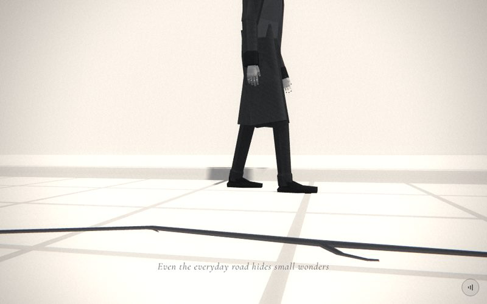

# 02 · crack



> "Even the everyday road hides small wonders"
> Source: `src/app.js`, banner `/* 2 — a small daisy in a crack of the pavement; his steps pass by */` · group: water-ground · before/after: [sheet](../../assets/model-polish/water-ground.jpg)

## At a glance
| | |
|---|---|
| Setting | Exterior, day. A ground-level view of a pale slab pavement: five rows of square slabs, a kerb behind his path and a darker road beyond it. A small daisy grows out of a crack that runs across the pavement between him and the camera. The low lens frames him from the feet to about the chest |
| Tone | Light. `bg:'#e9e9e9'`. `scene.background` and the fog are both `0xe9e9e9`. `dark:()=>false` for the whole scene, so the caption is black with a white halo and the film pass uses light-scene grain and vignette. Dips: for t < .1 the scene fades in from its own `#e9e9e9`; for t > .9 it fades to office's `#000` |
| Hero | Stroll (walk in place), seen side-on. `makePerson()` with the default tones, `rotation.y = π/2` (faces +x, so he walks toward screen right), at (0, 0, −1.1). Every frame calls `me.userData.stroll(t*9,{amp:.3, gaze:.18})`. He holds nothing. He is added **after** `worldGroup()`, so he stays out of the sliding group |
| Motion | Walk in place. `world.position.x = lerp(4.5,-4.5,t)`: the pavement, crack, kerb and daisy slide 9 units toward −x. The stroll distance is the same `t*9`, so planted feet move with the slabs. The daisy passes x = 0 (in front of him) at t = .5. Time drives only the daisy's sway |
| Camera | Position `(lerp(.5,.2,t), lerp(.3,.24,t), lerp(1.5,1.1,t))`, `lookAt(0,.25,-.4)`. That is (.5, .3, 1.5) at t=0, (.35, .27, 1.3) at t=.5 and (.2, .24, 1.1) at t=1: a lens about 25–30 cm above the slabs that creeps 40 cm closer and a little lower. Default fov (45°, 62° portrait), plus the handheld drift from `frame()` |
| Budget | scene 3514 tris (v40 3656, 0.96×) · hero 1561 (v40 1093) · 84 meshes incl. the hero's 51 (v40 137) · 1 instanced (200 slabs) · 3 lights · 0 points · 17 materials (v40 51). The daisy alone is 2850 tris (81 % of the scene) |

## Models
Counts, widths and branch positions of the crack come from replaying `rng(12)` / `rng(13)` exactly as the block draws them; the triangle totals (128 and 98) match `docs/data/inventory-v41.json`.

| Model | Built with | Geometry | Tone | Placement / contact | Notes |
|---|---|---|---|---|---|
| Joint base | `ground(0x7a7a7a)`, `base.position.y = -.004` | `PlaneGeometry(400,400)`, 2 tris | `0x7a7a7a`, `M`, FrontSide | 4 mm under the slab tops. It shows only in the .04 joints, as soft dark lines | In the world group. Receives shadows (`buildAll`). Deliberately much darker than the slabs: under this light a `#ac` base saturated to white and the joints vanished (round 3) |
| Pavement slabs ×200 | local `InstancedMesh(sg, M(0xe2e2e2,{side:FrontSide}), cols*rows)`; `sg = PlaneGeometry(P-.04,P-.04)` with `rotateX(-π/2)`, `P = .72`, `cols = 40`, `rows = 5` | flat quads, 2 tris each (400 in all) | `0xe2e2e2` × a per-slab instance colour `.94 + r()*.08` (`rng(12)`, the first 200 draws) | Centres x = (i − 19.5)·.72 (±14.04), z = −1.35 + j·.72 (−1.35, −.63, .09, .81, 1.53). Tops at y = 0: **this is the walking surface**. He walks on row 0 (z −1.69…−1.01) | In the world group. `receiveShadow = true` is set by hand, because `buildAll()` skips instanced meshes; they cast no shadow. Flat quads have no side faces, so a joint is only the dark base and never a lit bevel |
| Kerb | `box(30,.12,.28,M(0xc8c8c8),0,.04,-1.85)` | box, 12 tris | `0xc8c8c8` | y −.02….10, z −1.99…−1.71, about .6 behind his path | Gives the horizon an edge. In the world group |
| Kerb top plate | `box(30,.012,.22,M(0xdadada),0,.103,-1.86)` | box | `0xdadada` | y .097–.109, 9 mm proud of the kerb top | The lighter top edge |
| Road | `box(30,.01,9,M(0xbcbcbc),0,-.007,-6.5)` | box | `0xbcbcbc` | top at −.002, z −11…−2, beyond the kerb | |
| Crack ribbon | local `ribbon(pts,y,k)` over `nodes`, each of `branches` and each of `hair`, merged by local `merge()` into one `BufferGeometry`; material `cm = B(0x484848)` | flat mitred ribbon, one quad (2 tris) per segment: 31 main segments + 6 branches × 3 + 15 hairlines = 128 tris | `0x484848`, unlit | y .003. 32 nodes from x −7.5 to 7.68; node z −.083….36; forced through (0, .27) under the daisy | In the world group. Node width = `wAt(x)` × (.65–1.1, from `rng(13)`), × 1.15 at x = 0, and .02 for the two nodes at each end. `wAt` tapers from .072 at x 0 to .04 at \|x\| ≥ 6, with a `1+.14·sin(7.3x)` ripple. The mitre can widen a kink by up to 1.5×. The edge toward the camera is clamped by `zl(x)`: .4 for x ≤ .5, .275 for .5 < x ≤ 3, .245 for x > 3 |
| Crack core | `ribbon(nodes,.005,.45)` + `ribbon(branch,.005,.45)`, material `core = B(0x363636)` | 31 + 18 segments = 98 tris | `0x363636`, unlit | y .005 (2 mm above the main ribbon), .45 of its width | Main chain and branches only; no core on the hairlines |
| Side branches ×6 | local `branch(x,z,a,3,w)`, called when `n%5==2` | 3 segments each; width × .72 per segment | in the two ribbons above | They start at x −5.89, −2.97, −.64, 1.39, 4.36 and 6.39 (replayed). z is clamped to −.2….38 for x ≤ 0, ≤ .27 for 0 < x ≤ 3 and ≤ .24 for x > 3 | They angle away from the camera when the node's z > .25 |
| Hairline forks ×15 | `hair`, one off every other node (not the first or last) | one tapering segment each (node width × .35 → .004), length .06–.16 | in the main ribbon | z clamped to −.15…`zl(x)` − .01 | Angle and length are drawn from `rng(13)` |
| Daisy | `makeDaisy({r:.09, stem:.16})` at (0, .16, .25), `head.rotation.x = .35` (tips toward the camera) | 21 petals (`petalGeo`, 80 tris each), a domed centre (`centerGeo`, 462), calyx (126), a stem `TubeGeometry(curve,28,r*.065,7)` (392) and two leaves (`leafGeo`, 95 each): 2850 tris | petals `0xf1f1ec`, centre `0xe79a14` (emissive `0x7a4a00`), stem, calyx and leaves `0x1d7a2c`. Smooth shading (`flatShading:false`) | The stem base is at about (.01, 0, .245): on the slab top, at the crack node forced through (0, .27) | In the world group. It casts a shadow (bounding radius < 1.2). It is the only smooth object, and the geometry is untouched since v40 (owner-approved) |
| Hero | `makePerson()` | hero rig, 1561 tris | trousers `0x2a2a2a`, coat `0x3a3a3a`, shoes derived (darker) | (0, 0, −1.1), facing +x. `stroll()` drops the figure so the lower sole is at y ≈ 0 | Not in the world group. He casts a shadow onto the slabs and the kerb |
| Background / fog | `scene.background = Color(0xe9e9e9)`, `Fog(0xe9e9e9,3,18)` | — | `0xe9e9e9` | — | The far road and the slab rows melt into the background |

## Lights and atmosphere
- `lights(scene,{dir:[0xffffff,.8,[2,5,3]]})`:
  - `HemisphereLight(0xffffff, 0x777777, .9)` (the default)
  - key `DirectionalLight(0xffffff, .8)` from (2,5,3), normalised × 20 = (6.49, 16.22, 9.73). It casts shadows (camera ±14, 1536 px map). His shadow falls toward −x/−z, onto the slabs behind his feet and the kerb.
  - rim `DirectionalLight(0xffffff, .36)` at (−2, 3, −7)
- **Shadows:** the hero and the daisy cast. The slabs receive (set by hand). The base, kerb, plate and road receive (via `buildAll`). The crack ribbons are `MeshBasicMaterial`, so `buildAll()` skips them.
- `Fog(0xe9e9e9, 3, 18)`.
- No snow, glow or particles. The v40 white "snow patches" were removed in round 2.
- **Film pass:** light mode for the whole scene.

## Animation (`update(t, time)`)
- **Scroll-driven:**
  - `world.position.x = lerp(4.5,-4.5,t)`: everything built before `worldGroup()` slides 9 units toward −x.
  - `me.userData.stroll(t*9,{amp:.3,gaze:.18})`. With `amp .3` one step is `2·sin(.3) = .591`, so 9 units is about 7.6 gait cycles (about 15 steps). `gaze .18` tips his head down.
  - The camera formula above.
- **Time-driven:**
  - The daisy sways: `d.rotation.z = sin(time*1.3)*.06`. The daisy group's origin is its **head** (`makeDaisy` hangs the stem below it), so the sway pivots at the head and the stem base slides about ±1 cm on the slab. That is invisible at this size, but keep it in mind before making the sway bigger.
  - Its head turns slowly: `d.userData.head.rotation.y = time*.15` (one turn in about 42 s).
- After `update()`, `frame()` adds the handheld drift: x ±.025, y ±.018, roll ±.004.

## v40 → v41
Source: [model-polish/water-ground.md](../model-polish/water-ground.md) ("2 crack" and fix rounds 1–3). Audit priority MEDIUM ([audit](../model-polish/audit.md)). The audit's problems were a 3 cm crack that read as a hair, white planks as "snow", and nothing that said "pavement".
- **v40:**
  - `ground(0xdedede)` as the whole pavement
  - the crack as 27 `box(len,.004,.03,B(0x9a9a9a))` segments from x −6 to 6, with no clamp toward the camera
  - 40 "snow patches": `box(.25–.85,.01,.18–.48,M(0xf7f7f7))`, each with its own material, scattered over x ±5, z ±3
  - the same daisy, hero, slide, stroll and camera
- **Round 0:**
  - slabs, a wider and darker box crack forced through the daisy's spot
  - 15 small six-sided snow lofts
  - the kerb and road
- **Round 1:**
  - Blocker: the feet were sunk in the thick slabs. The walking surface was set back to y = 0.
  - The chain became mean-reverting so it stays between the kerb and the caption band.
  - The snow was replaced by mounds.
- **Round 2:**
  - The snow was deleted (a round-2 blocker). Since then nothing white sits in the foreground or under the caption.
  - The crack tone and width were varied, and its late stretch (x > 3) was clamped.
- **Round 3:**
  - Slabs became flat instanced quads over a `0x7a7a7a` base raised to −.004, so the joints read with no lit bevel.
  - The box crack became the flat mitred ribbon with a darker core, branch ribbons and hairline forks: 128 + 98 tris, down from about 950.
  - The caption clamp `zl(x)` was added to the ribbon's near edges.
- **Untouched:** the daisy geometry and position (only its y went .16 → .18 → .16 across rounds; the final value is v40's), the slide direction, `stroll` and the camera.
- **Triangles:** 3656 → 3514 scene tris (0.96×, inventory). Materials 51 → 17 and meshes 137 → 84, because the snow boxes had one material each. The group notes quote 4749 → 4607, which includes the v40 hero (1093). The hero itself went 1093 → 1561 in the hero group (its notes describe a heel block, a flat toe and a cuff on the shoe for this close-up).

## Editing notes
- **Walk in place.** `worldGroup(scene)` (no keep list) moves every non-light child into the sliding group. The hero is added *after* that call, so he stays put. Anything new that should slide must be added before `const world=worldGroup(scene)` or added to `world`. Never translate the hero, and never use `walk()`; the owner rejected both.
- **Slide and stride are coupled.** `world.position.x` spans 9 units and `stroll` gets `t*9`. Change both together, or the planted feet will skate.
- **The walking surface is y = 0** (the slab quads). Round 1's blocker was feet sunk into raised slabs. The soles dip to −.016…−.024 when planted; that is the rig's baseline ([hero.md](../model-polish/hero.md) calls it inherent: hip .98 with a .94 leg and a .06 shoe), and the slab tops in front of the feet hide it from this low lens. Do not lift the slabs or the hero to "fix" it.
- **Caption band** (t .12–.75, lower middle): the crack lies right above it. The node clamps (`late ? .22 : mid ? .24 : .36`), the branch clamps and the ribbon edge clamp `zl(x)` keep it there. Round 3 projected every ribbon edge inside the caption's column (\|x\| < .45 NDC) in 1000×625 shots. The lowest crack pixel was 508/509/489/506/513/518 px at t .12/.2/.35/.5/.65/.75, against the band line at 525 px. Moving nodes toward +z (toward the lens) or widening the ribbon will put it under the text. At t .85 there is no caption, and the crack sits at 522 px.
- **rng order matters.** `r = rng(12)` first draws the 200 slab tones, then the path and branch draws. `r2 = rng(13)` draws the widths and hairlines. Adding draws to `r` anywhere before the chain reshuffles the whole crack and every value quoted above.
- **The widest node is not the daisy's.** The code comment says "the daisy's node stays the widest", but the replay gives .078 at x −.64 and .060 at x 0 (after the 1.15 boost). To make the daisy's spot the widest, set its width explicitly.
- **Depth (16-bit target, about 3e-4·z² per step, see ARCHITECTURE.md):**
  - The ribbons are 3 mm and 5 mm above the slabs. The visible stretch of crack is only 1–2 units from the lens, where one step is at most about 1.2 mm, so the offsets hold. If you move the crack farther from the camera (beyond about 2.5–3 units), they will start to tie.
  - The base is 4 mm under the slabs. Beyond about 3.6 units one depth step is larger than that, so the far pavement relies on draw order (the base is created first). The t=.5 shot is clean. If dark speckle appears in the distant slabs, lower the base (the joints are seen from above, so a lower base still reads as a joint).
- **Feet overlap in projection** at mid-stride, because the camera looks almost along his walking line. In 3D they are 12 cm apart ([hero.md](../model-polish/hero.md), "Concerns"). A wider stance looks bow-legged.
- **Extent:** the chain spans x −7.5…7.68 in the group, so its tapered ends are at world x −3.0 (t = 0) and +3.18 (t = 1). At the crack's depth the frame is only about ±1 unit wide, so the ends stay out of frame (approx.). Slabs and kerb span about ±14–15, far beyond the ±4.5 slide.
- **Owner rules:**
  - The daisy is an owner-approved prop. Don't restyle it, and never mention flowers in the caption or any site text. Daisies appear only in scenes 2, 4 and 17.
  - Don't bring back flat white plates (the old "snow"). The round-2 review made the snow plates a blocker.
- **Open:** the crack still reads as a dark line laid on the slabs rather than a fracture (model-polish/README.md "Still open", ROADMAP §2, SCENES.md weak spots). Ideas from the ROADMAP: one dark tone, ragged width, and jogs along the slab joints. Keep any new crack inside the clamps above.

## Check it
```bash
NODE_PATH=/opt/node-tools/node_modules WAIT=9000 node tools/shots.js 1.9 2.12 2.35 2.5 2.65 2.85
```
- 1.9 is a lead-in. Without it, the first 2.x shot lags into the dip.
- **2.12–2.35:** feet flat on the slabs while planted, no sinking, and his shadow on the slabs and kerb. The joints should be soft dark lines with no white bevel.
- **2.5:** the daisy's stem base sits on the slab inside the crack, and the head tips toward the lens.
- **2.35–2.65:** no part of the crack under the caption text.
- **2.85:** no dark bar along the bottom edge.
- The stride phase at a given position varies between runs (scroll residual), so two shots at 2.65 can show different steps.
- **Gait:** `tools/gait.html` (serve the repo root after `./build.sh`).
- **Budget:** `node tools/inventory.js`, then compare the `crack` row with `docs/data/inventory-v41.json`.
