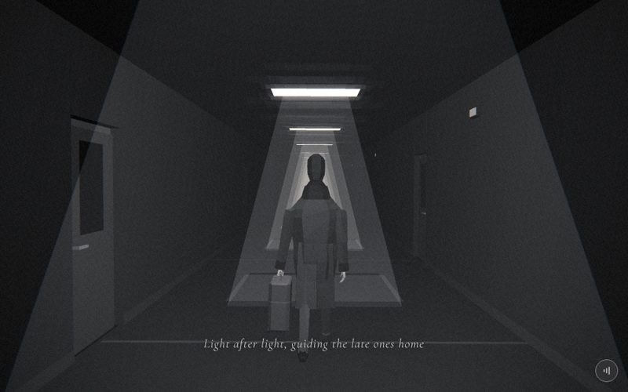

# 03 · office

> "Light after light, guiding the late ones home"
> Source: `src/app.js`, banner `/* 3 — the office corridor after the last train */` · group: interiors · before/after: [sheet](../../assets/model-polish/interiors.jpg)

## At a glance
| | |
|---|---|
| Setting | Interior, night. A straight office corridor 4.3 wide (wall faces at x ±2.15) and 3.0 high, with a recessed ceiling lamp every 5 m and a door every 5 m, alternating left and right. 15 bays from z 6 to z −64. No windows, no exterior |
| Tone | Dark. `bg:'#000'`, `scene.background = Color(0)`, `Fog(0, 6, 48)`, `dark:()=>true` for the whole scene (white caption with a dark halo, strong grain and vignette). Dips: crack fades into `#000`; for t > .9 this scene fades to desk's `#050505` |
| Hero | Stroll, walking in place, seen from behind. `makePerson({body:0x3a3a3a, jacket:0x2c2c2c})` (trousers `0x3a3a3a`, coat `0x2c2c2c`, so the coat is darker than the trousers here; shoes derive to `0x101010`), `rotation.y = π` (faces −z), `position (0,0,5.5)`. `suitcase(me)` hangs the cabin case from his **left** hand (index 1, world −x, screen left). Every frame: `me.userData.stroll(t*30, {amp:.27, carry:true, gaze:.2})`. `amp .27` is the smallest stride of the four walk scenes (the others use .3); `gaze .2` tips the head down |
| Motion | Walk in place. `world.position.z = t*30`: the corridor slides 30 units (6 bays) toward the camera per scene. `stroll()` gets the same distance, so planted feet move with the floor: step = 2·sin(.27) = .534, about 28 gait cycles per scene. Nothing is time-driven |
| Camera | Fixed: `position (0, 1.6, 10)`, `lookAt(0, 1.3, 0)`, straight down the corridor axis, 4.5 units behind the hero. Default fov (45°, 62° portrait), plus the global handheld drift from `frame()` |
| Budget | scene 1922 tris (v40 830) · hero 1749 incl. suitcase (v40 1129) · 107 meshes (60 of them hero + case) · 15 instanced (209 instances) · 2 lights · 0 points |

## Models
All repeated parts go through the local `inst(geo, mat, places)`: it makes one `InstancedMesh` per part, sets one translation per place and adds it to `scene` **before** `worldGroup()`, so every part slides with the corridor. `PX(w,h)` is a `PlaneGeometry` turned to face ±x (`rotateY(π/2)`), `PY(w,d)` one turned to face down (`rotateX(π/2)`); `DS = {side: DoubleSide}`. `bays = [6, 1, −4, …, −64]` (15). `doors[i] = [z, i%2 ? 1 : −1]`: even bays have their door on the left wall (x < 0), odd bays on the right. `blanks` is the opposite wall of each bay. `DW = 1.1`, `DH = 2.2`, `XF = 2.25`.

| Model | Built with | Geometry | Tone | Placement / contact | Notes |
|---|---|---|---|---|---|
| Floor | `box(4.4,.1,90, M(0x101010), 0,−.05,z0)`, `z0 = −35` | box, 12 tris | `0x101010` | top at y 0, x ±2.2 (ends under the walls), z −80 → 10 | In the world group |
| Ceiling | `box(4.4,.1,90, M(0x080808), 0,3.05,z0)` | box, 12 tris | `0x080808` | underside at y 3.0 | |
| Wall beside a door ×15 | `inst(BoxGeometry(.2,3.1,5−DW))` at `[s·2.25, 1.55, z]` | box `.2 × 3.1 × 3.9`, 12 tris each | `wall = M(0x1a1a1a)` | x 2.15–2.35 (inner face ±2.15), y 0–3.1 (top inside the ceiling), z from z+1.95 to z−1.95 | The door opening fills the rest of the bay, z−1.95 → z−3.05 |
| Blank wall ×15 | `inst(BoxGeometry(.2,3.1,5))` at `[s·2.25, 1.55, z−.55]` | box, 12 tris | `wall` | the full 5 m bay, z+1.95 → z−3.05, on the wall opposite the door | Each wall reads door / blank / door |
| Lintel ×15 | `inst(BoxGeometry(.2,3.1−DH,DW))` at `[s·2.25, 2.65, z−2.5]` | box `.2 × .9 × 1.1` | `wall` | over the opening, y 2.2–3.1 | |
| Skirting (door side ×15, blank side ×15) | `inst(PX(5−DW,.12))` / `inst(PX(5,.12))` at x `s·2.14`, y .06 | plane, 2 tris | `M(0x262626)` (DoubleSide by default) | 1 cm in front of the wall face, y 0–.12. Stops at the door opening | |
| Door frame plate ×15 | `inst(BoxGeometry(.04,DH,DW))` at `[s·(XF+.045), DH/2, z−2.5]` | box `.04 × 2.2 × 1.1` | `M(0x3a3a3a)` | x ±2.275–2.315, at the back of the recess; fills the whole opening | Shows as a .05 border at the sides and .08 at the top of the slab |
| Door slab ×15 | `inst(BoxGeometry(.04,DH−.08,DW−.1))` at `[s·XF, (DH−.08)/2, z−2.5]` | box `.04 × 2.12 × 1.0` | `M(0x2a2a2a)` | front face x ±2.23, **.08 behind the wall face**; bottom on the floor | Recessed door: the jambs are the wall boxes' ends |
| Door glass ×15 | `inst(PX(.5,.9), B(0x050505,DS))` at `[s·(XF−.022), 1.55, z−2.5]` | plane | `0x050505`, unlit | 2 mm in front of the slab, y 1.1–2.0 (under the slab top 2.12) | Round 2 moved it up to 1.55 so a .09 strip of leaf separates it from the handle |
| Lever handle ×15 (two parts) | stub `inst(BoxGeometry(.07,.024,.024))` at `[s·(XF−.05), 1.0, z−2.1]`; bar `inst(BoxGeometry(.026,.026,.18))` at `[s·(XF−.085), 1.0, z−2.17]` | 2 boxes, 24 tris per door | `hm = M(0x6e6e6e)` | stub runs 6.5 cm out of the slab; the bar runs along the corridor (z−2.26 → z−2.08). Lock side = the door edge nearer the camera (+z) | The lightest lit part of the set, so it catches the point light (a bright speck on far doors). 360 tris in total: as many as two wall rows |
| Floor seam ×15 | `inst(PY(4.3,.06), M(0x2a2a2a))` at `[0, .002, z+2.5]` | plane | `0x2a2a2a` | 2 mm above the floor, across the corridor, midway between two lamps (level with the door centres) | Widened to .06 and lifted to `0x2a` in round 1 so it reads |
| Lamp trough ×15 | `inst(loftGeo([[0,1.44,.9,.03],[.06,1.44,.9,.03]],{sides:8,caps:false}), M(0x141414))` at `[0, 2.94, z]` | open 8-sided band, 16 tris | `0x141414` | hangs from the ceiling: y 2.94–3.0, 1.44 across × .9 along the corridor | Replaced v40's white box glued to the ceiling |
| Lamp lens ×15 | `inst(PY(1.32,.78), B(0xffffff,DS))` at `[0, 2.985, z]` | plane facing down | white, unlit | 1.5 cm below the ceiling, 4.5 cm up inside the trough | Emits no light (see below) |
| Wall sign ×7 | box `inst(BoxGeometry(.06,.14,.3), M(0x111111))` + face `inst(PX(.26,.1), B(0x777777,DS))` | box + plane | box `0x111111`, face `0x777777` unlit | odd bays only (`odd = bays.filter((_,i)=>i%2)`), right wall: box x 2.09–2.15 at y 2.55, z+.9; face 2 mm in front of it (x 2.088) | No text |
| Beam cone ×15 | `Mesh(CylinderGeometry(.6,1.6,3,4,1,true), beamMat)`, `rotation.y = π/4` | open 4-sided frustum, 8 tris | white, `MeshBasicMaterial`, `opacity .06`, `AdditiveBlending`, `depthWrite:false`, DoubleSide | y 0–3 under each lamp; square half-width .42 at the top, 1.13 at the floor | Shared `beamMat`. Not instanced (plain meshes in a loop) |
| Floor pool ×15 | `Mesh(PlaneGeometry(2.4,1.8), MeshBasicMaterial({color:0xffffff, transparent, opacity:.07, depthWrite:false}))` | plane | white, normal blending | y .01 under each lamp | One material per pool |
| Hero | `makePerson({body:0x3a3a3a, jacket:0x2c2c2c})` | hero rig, 1561 tris | as above | origin (0, y from `stroll`, 5.5); `stroll` sets `position.y = drop − 1` so the lower sole touches y 0 | Added **after** `worldGroup()`, so he stays put |
| Suitcase | `suitcase(me)` (void-objects helper) | cabin case, 188 tris | shell `0x454545`, rib/handle/caps `0x5a5a5a`, wheels `0x2a2a2a` | child of the left elbow; the bar sits in the closed fist (`grip(1)`); `arms[1].rotation.z = .2` pushes the case clear of the coat | Also used in scene 1. Lowest point over the stroll ≈ y .175 (void-objects notes) |

Triangle split (1922): wall boxes, lintels, frame plates, slabs and handle boxes 180 each (1260), lamp troughs 240, beam cones 120, sign boxes 84, all the 2-triangle planes 194, floor + ceiling 24.

## Lights and atmosphere
- `HemisphereLight(0x888888, 0x111111, .35)` and one `PointLight(0xffffff, 1.2, 14)` at (0, 2.6, 7): 1.5 behind the hero and 2.6 up, so it lights his back and the corridor around him. It is a light, so `worldGroup()` leaves it in the scene; it never moves.
- **The lamps emit nothing.** Each "pool of light" is the unlit lens, the additive cone and the translucent floor plane. Real lighting on the hero and the nearby doors is constant while the lamps slide past.
- No shadows: neither light casts them (`castShadow` is only set by `lights()`, which this scene does not call).
- `Fog(0, 6, 48)` turns the far bays black. The last bay ends at z −67.05; at t = 1 that is 47 units from the camera, just inside fog far (48), so it is already fogged out.
- Film pass in dark mode all scene. The white lenses are above the pass's .8 glow threshold, so they bloom.

## Animation (`update(t, time)`)
- **Scroll-driven only:** `world.position.z = t*30`; `me.userData.stroll(t*30, {amp:.27, carry:true, gaze:.2})`; the camera is set to the same fixed pose every frame.
- `stroll` with `carry:true` keeps the left (suitcase) arm almost still: shoulder swing × .12 and the elbow at −.05.
- `time` is unused. After `update()`, `frame()` adds the handheld drift (x ±.025, y ±.018, roll ±.004).

## v40 → v41
From [model-polish/interiors.md](../model-polish/interiors.md), sections "3 — office", round 1 and round 2:
- **Walls:** two 90-long `.1` slabs at x ±2.2 became bays of `.2`-thick wall with a real door opening and a lintel. Doors alternate sides (round 1), so the other side of each bay is one 5 m blank wall.
- **Doors:** v40 had flush `.05 × 2.3 × 1.4` slabs (`0x2a2a2a`) at x ±2.14 on **both** walls every 5 m. Now each door is recessed .08 into the opening, with a lighter `0x3a3a3a` frame plate behind it, a dark glass panel in the upper half and a two-box lever handle at `0x6e6e6e`. Round 2 moved the glass up (centre 1.5 → 1.55) and the handle down (1.05 → 1.0) so they no longer touch.
- **Lamps:** v40's `box(1.3,.03,.8, B(0xffffff))` glued to the ceiling became an open dark trough with the lens set up inside it. Cones and pools unchanged.
- **New:** skirting on both walls, a floor seam per bay (`.06`, `0x2a2a2a` after round 1), a small lit sign every other bay on the right wall.
- **Instancing:** every repeated part is one `InstancedMesh` (15 of them). Meshes 135 → 107, materials 81 → 40.
- **Extent:** bays now stop at z −64 (v40 looped to z > −75) because the far ones never leave the fog.
- **Triangles:** scene 830 → 1922 (2.3×, scene only). The notes' table says 1959 → 3051 (1.56×) because it adds the v40 hero + suitcase (1129) to both numbers. The hero and the suitcase themselves went 1129 → 1749 through the hero and void-objects groups.
- Untouched (audit "do not touch"): `stroll(t*30, …)`, the point light, the camera axis.

## Editing notes
- **Walk in place.** Anything that should slide with the corridor must be added to `scene` before `const world=worldGroup(scene,[pl])` (as `inst()` does), or added to `world` afterwards. Never move the hero along z; the owner rejected that, and the old `walk()` gait too.
- **Corridor length is tied to the walk.** The walk is 30 units and the last bay ends 47 units from the camera at t = 1. If you lengthen the walk (`t*30`) or the fog (`48`), extend `bays` (`z > −65`), or the end of the corridor appears.
- **Instanced meshes are never frustum-culled.** In r128 `InstancedMesh` sets `frustumCulled = false`, and its bounding sphere ignores the instances. Leave it that way: every base geometry sits at the world-group origin, which leaves the frustum from t ≈ .3 on (measured: at t = .5, with culling on, all 15 meshes would be culled and the corridor would vanish).
- **16-bit depth.** Several flat parts are closer than the 3 cm rule: glass 2 mm in front of the slab, sign face 2 mm in front of its box, skirting 1 cm off the wall, floor seams 2 mm above the floor, pools 1 cm above it. The v41 reviews reported no stripes at 3.35 and 3.65 (the camera is 4.5+ units away and far bays are fogged). If one starts to stripe, move it ≥ 3 cm proud or give its `InstancedMesh` a higher `renderOrder`.
- **Doors and signs follow the bay index.** Door side = `i%2 ? right : left`. Signs sit only on odd bays (the right wall, same wall as that bay's door) at z+.9. `doors`, `blanks` and `odd` all derive from the bay index; change them together.
- **Light budget.** The scene has one real light. A new prop that should read needs a lit tone of `0x2a`–`0x6e` near the hero, or an unlit `B()` face. Parts at `0x111111` or darker barely separate from the `0x1a1a1a` walls (the sign boxes read only through their lit face).
- **Caption band** (t .12–.75): with the fixed camera, the caption sits on the floor between the walls and crosses the hero's shins and the bottom of the suitcase (see the t = .5 shot). It stays readable (white text, dark halo, dark legs). Keep the floor near the bottom of the frame free of new props.
- The hero's coat panels follow the legs at 50 % while walking (`userData.walking`). After any rig change, check the back view here: this is where a split line or a broken coat shows first (SCENES.md, "Walk scenes").
- Idea from ROADMAP §3, not done: a room tone for this scene in the generated audio.

## Check it
- Shots, with 2.9 as the lead-in (the polish used a 3.0 warm-up):
  `NODE_PATH=/opt/node-tools/node_modules WAIT=9000 node tools/shots.js 2.9 3.35 3.65 3.85`
- What to look at:
  - the door nearest the camera: frame border, glass above the handle with leaf between them, lever standing out of the slab
  - no stripes on the glass, the skirting or the sign faces
  - the lamp lens sits inside the dark trough, not on the ceiling
  - the suitcase clears the coat and the fist closes on its bar
  - feet flat on the floor while planted, and the coat reads as one piece from behind
  - the caption over his shins stays legible
- **Gait:** `tools/gait.html` (serve the repo root after `./build.sh`): eight `stroll()` phases from the side and from behind.
- **Budget:** `node tools/inventory.js`, then compare the `office` row with `docs/data/inventory-v41.json`.
