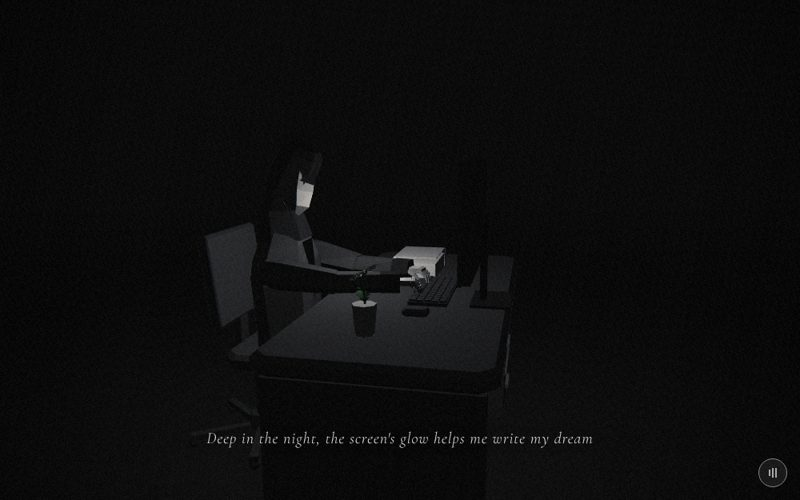

# 04 · desk

> "Deep in the night, the screen's glow helps me write my dream"
> Source: `src/app.js`, banner `/* 4 — late night at the desk */` · group: interiors · before/after: [sheet](../../assets/model-polish/interiors.jpg)

## At a glance
| | |
|---|---|
| Setting | Interior void at night: one office desk on a near-black floor, nothing else (no walls). Desk with a drawer pedestal, a monitor on a hidden stand, keyboard, mouse, a paper stack, a cup with a tiny daisy; an office chair on a five-arm base |
| Tone | Dark. `bg:'#050505'`, `scene.background = Color(0x050505)`, `Fog(0x050505, 4, 14)`, `dark:()=>true` all scene. Dips: office fades into `#050505`; for t > .9 this scene fades to skyline's `#e6e6e6` |
| Hero | **Sit, typing.** `makePerson()` (default tones: trousers `0x2a2a2a`, coat `0x3a3a3a`), `sit()`, `rotation.y = π` (faces −z, toward the monitor), `position (0, −.48, .62)`. Then arms, elbows, hands and head are set by hand (exact values in "Hands on the keyboard" below). No props held |
| Motion | Camera only. The set and the hero are static; the screen flickers on `time` |
| Camera | Orbit and push-in: `a = lerp(2.5, .55, ease(t))`, `r = lerp(3.2, 1.1, t)`, position `(sin(a)·r + .3, lerp(1.7,1.05,t), cos(a)·r)`, `lookAt(lerp(0,.6,t), lerp(1,.95,t), lerp(0,.08,t))`. t=0 (2.22, 1.7, −2.56): behind the monitor on his right; t=.5 (2.45, 1.38, .10): side-on from +x; t=1 (.88, 1.05, .94): just behind his right shoulder, close on the cup, the daisy and the glowing screen. Default fov |
| Budget | scene 4530 tris (v40 3902) · hero 1561 (v40 1093) · 118 meshes (51 hero) · 1 instanced (71 instances) · 2 lights · 0 points |

## Models
World axes: the hero sits at z .62 facing −z; **world +x is his right** (index 0), −x his left (index 1). The desktop surface is at **y .765**, and everything on the desk rests on it.

| Model | Built with | Geometry | Tone | Placement / contact | Notes |
|---|---|---|---|---|---|
| Floor | `ground(0x0c0c0c)` | plane 400, 2 tris, FrontSide | `0x0c0c0c` | y 0 | |
| Desk top | local `bevelBox(1.8,.07,.8,.02, dm, 0,.695,0)` | 8-sided chamfered loft, 64 tris | `dm = M(0x303030)` | y .695–.765, x ±.9, z ±.4 (front edge toward him at z .4). The flat top face spans z ±.38; the .02 chamfer drops to .745 at the edge | v40 was `box(1.8,.05,.8)` at .74; the top surface did not move |
| Drawer pedestal | `box(.42,.69,.72, dk, −.64,.345,0)` | box | `dk = M(0x262626)` | under his **left** side: x −.85…−.43, y 0–.69, z ±.36 | Top at .69: a 5 mm air gap under the desk top (.695) |
| Drawer seams ×2 | `box(.4,.012,.012, M(0x484848), −.64, y, −.364)`, y .23 / .46 | box | `0x484848` | on the pedestal's **−z** face (z −.36), front face 1 cm proud: three drawer fronts 0–.23, .23–.46, .46–.69 | On the far face because the orbit starts behind the desk (until t ≈ .45) |
| Drawer handles ×3 | `box(.16,.018,.02, M(0x4a4a4a), −.64, y, −.368)`, y .115 / .345 / .575 | box | `0x4a4a4a` | centred on each drawer front, 1.8 cm proud | |
| Near side panel | `box(.06,.69,.72, dk, .85,.345,0)` | box | `0x262626` | x .82–.88, y 0–.69 (same 5 mm gap) | The panel the t=.5 camera looks at |
| Mouse | `bevelBox(.06,.03,.1,.008, M(0x2e2e2e), .36,.765,−.05, .3)` | loft, 64 tris | `0x2e2e2e` | on the desk at x .36, right of the keyboard; y .765–.795 | Not held |
| Keyboard base | group `kb` at (0, .765, −.07); `box(.46,.014,.16, M(0x1c1c1c), 0,.007,0)` | box | `0x1c1c1c` | world x ±.23, y .765–.779, z −.15…+.01 | Added in v35 on owner request (「加上鍵盤」) |
| Keys | `InstancedMesh(BoxGeometry(.026,.008,.026), M(0x2e2e2e), 80)`, `count = 71` | box, 12 tris × 71 = 852 | `0x2e2e2e` | 5 rows × 14: x `−.2 + c·.031 + (r%2)·.008` (odd rows staggered .008), y .018 (key tops at world .787), z `−.062 + r·.031` (row 4 is nearest him). Space bar = one more instance at (0, .018, .07) scaled ×6 in x (.156 wide) | 19 % of the scene. The space bar overlaps row 4 for \|x\| < .078 and pokes 3 mm past the base's near edge; no review has flagged it |
| Monitor panel | `box(.7,.42,.03, M(0x111111), .1,1.12,−.25)` | box | `0x111111` | x −.25 to .45, y .91–1.33, z −.265…−.235 | 10 cm to his right of the keyboard centre |
| Monitor frame ×4 | `bz = M(0x242424)`: top/bottom `box(.74,.03,.016)` at y 1.335 / .925, sides `box(.03,.38,.016)` at x −.255 / .455; all at z −.227 | box ×4, 48 tris | `0x242424` | on the panel front, 1.6 cm proud (z −.235 → −.219) | Leaves the screen inset behind a thin dark inner bezel (panel tone). New in v41 |
| Screen | `PlaneGeometry(.64,.36)`, `B(0xe8e8e8)` | plane | unlit; colour animated to .83–.87 grey | centre (.1, 1.13, −.233): y .95–1.31, 2 mm in front of the panel, 1.4 cm behind the frame face | The brightest object in the scene; the film-pass glow blooms around it |
| Monitor neck | `box(.07,.36,.025, M(0x111111), .1,.95,−.285)` | box | `0x111111` | y .77–1.13, z −.2975…−.2725: **behind** the panel (7.5 mm air between them), its top hidden behind the panel | The stand. Nothing of it is in front of the screen |
| Monitor foot | `box(.24,.012,.16, M(0x111111), .1,.771,−.32)` | box | `0x111111` | on the desk (y .765–.777), z −.4…−.24: from the desk's back edge to 5 mm behind the panel's front face | The neck's bottom (.77) sits inside it |
| Paper stack (5 boxes) | `box(.3, .03+r()·.08, .22, M(0xd0d0d0), −.55+r()·.15, .79+i*.0, .05+r()·.1)` with `r = rng(19)` | box ×5 | `0xd0d0d0` | heights .035/.091/.082/.096/.076, x −.53…−.40, z .08–.11, all centred at y .79 (`i*.0` adds nothing). The union spans y .742–.838: the bottoms sink up to 2.3 cm into the desktop, the uneven tops read as a stack | Left of the keyboard. Light grey like the cup, so it catches `glowL` |
| Cup | `CylinderGeometry(.045,.035,.11,7)`, `M(0xdddddd)` | 7-sided, capped, 28 tris | `0xdddddd` | (.62, .82, .08): y .765–.875, standing on the desk to his right | |
| Daisy | `makeDaisy({r:.06, stem:.13})` at (.62, .98, .08), `userData.head.rotation.x = .5` | 21 petals (22, one missing) × 80 tris, centre 462, calyx 126, stem `TubeGeometry` 392, 2 leaves × 95: **2850 tris, 63 % of the scene** | petals `0xf1f1ec`, centre `0xe79a14` (emissive `0x7a4a00`), stem/leaves `0x1d7a2c`; smooth shading | the stem runs down into the cup (bottom at y .85, under the cup's top cap at .875) | A prop allowed in scenes 2, 4 and 17; never mention it in text |
| Chair group | `chair` at (0, 0, .62), `cm = M(0x2a2a2a)`, `cd = M(0x1c1c1c)` | — | — | under the hero | |
| · seat cushion | `bevelBox(.5,.07,.47,.02, cm, 0,.425,0, .25)` | loft, 64 tris | `0x2a2a2a` | y .425–.495, world z .385–.855 | |
| · spine | `box(.08,.17,.04, cd, 0,.52,.25)` | box | `0x1c1c1c` | y .435–.605 at world z .87: joins the seat to the back, leaving the lumbar gap | |
| · backrest | `bevelBox(.46,.42,.05,.015, cm, 0,0,0, .25)`, `position (0,.6,.245)`, `rotation.x = .12` | loft, 64 tris | `0x2a2a2a` | bottom at y .6, top ≈ 1.02 (shoulder height); leans **away** from him: world z .84–.94 | His back reaches z .741, so ≥ 10 cm of air between spine and backrest (round 1 fixed a backrest that leaned into him) |
| · gas column | `CylinderGeometry(.03,.03,.34,6)` at (0,.27,.16) | 6-sided, 24 tris | `0x1c1c1c` | y .10–.44, world z .78 (behind the coat's seat piece) | Top inside the cushion, bottom inside the hub |
| · hub | `CylinderGeometry(.06,.075,.07,6)` at (0,.085,.16) | 24 tris | `0x1c1c1c` | y .05–.12 | |
| · base arms ×5 | `box(.04,.03,.34, cd)`, angle `a = i·2π/5 + π/5`, centre at radius .17 from the column, `rotation.y = a` | box ×5 | `0x1c1c1c` | y .04–.07, reaching radius .34 | Below the coat's lowest point and clear of his feet |
| · castors ×5 | `SphereGeometry(.03,6,4)` at radius .32, y .03 | 36 tris each, 180 total | `0x1c1c1c` | touch the floor | The castors cost more than the rest of the base |
| Hero | `makePerson()` + `sit()` + hand pose | 1561 tris, 51 meshes | default | see below | Seated coat: the panels hide and the lap pieces + knee flaps show (thighs past −.6 rad) |

Triangle split (4530): daisy 2850, keys 852, chair 428, desk with pedestal, panel, seams and handles 148, monitor 86, mouse 64, papers 60, cup 28, keyboard base 12, floor 2.

### Hands on the keyboard (owner-corrected, keep exactly)
Set in `build()` right after `sit()`. `sit()` also sets arms −.5 and elbows −.7, which these lines override. World values were measured by building the scene in node (see "Check it").

| Joint | Code | Result (world) |
|---|---|---|
| Body | `me.position.set(0,−.48,.62)`, `rotation.y = π` | hip pivots at y .50, z .62 |
| Thighs / knees | `sit()`: legs −1.5, knees 1.45 | thighs point at the desk; knees at (±.096, .465, .12), under the desk top; ankles at y .025 |
| Shoulders | `arms.forEach((a,i)=>a.rotation.set(−1.42, 0, i ? −.2 : .2))` | pivots at y .876 / .883, z .62. Upper arms ~8.6° below horizontal, turned slightly in so both hands land on the keys |
| Elbows | `elbows.forEach(e=>e.rotation.x = −.15)` | elbows at y .833 / .838, z .329, over the desk (front edge z .4). Lowest point of upper arm and forearm over the desk: y .779–.788, i.e. **1.4–2.3 cm above the desktop** (.765): resting above it, not in it |
| Hands | `hands?.forEach(h=>{h.rotation.y = 0; h.userData.grip(.35)})` | palms down (`rotation.y = 0` instead of the default `side·π/2`), fingers lightly curled. Wrist pivots at (.127, .835, .079) right and (−.114, .838, .079) left. The fingers' lowest and frontmost points are at y .779–.784, z −.021…−.029: over the two nearest key rows (world z −.039 and −.008), level with the keyboard base top (.779) and up to 8 mm below the key tops (.787), so the fingers sit down among the keys. The palms are over the desk in front of the keyboard (hand z up to .119) |
| Head | `me.userData.head.rotation.x = .35` | looks down at the keys and screen; skull spans y 1.07–1.39 (z .42–.72) |

Monitor vs eyes: the screen spans y .95–1.31 (centre 1.13); its top edge lies within his head's height (skull y 1.07–1.39), and the head is pitched .35 down toward the screen and keys. That is the "at eye height" the owner asked for (v36, 「螢幕要有高度」).

## Lights and atmosphere
- `HemisphereLight(0x666666, 0x080808, .3)`: a faint base light. Anything not facing `glowL` falls to near black.
- `glowL = PointLight(0xffffff, 1.1, 4)` at (.1, 1.13, .25): 48 cm in front of the screen, between the screen and his face. It lights every face turned toward it within 4 units: his face and front, hands, keys, papers, cup and the desk top. There are no shadows, so it also reaches the chair's front faces through him. Faces turned away (the back of the monitor, the pedestal's −z face with the drawers) get only the hemisphere light, which is why the drawer seams and handles are `0x48`/`0x4a`.
- No shadows (no shadow-casting light in this scene).
- `Fog(0x050505, 4, 14)`: the camera starts ~3.8 units from the origin and moves in, so the set is at most lightly fogged at the start (fog begins at 4); the far floor fades into the background.
- Film pass in dark mode. The screen (≈ .85 grey before the pass) blooms.

## Animation (`update(t, time)`)
- **Time-driven:** `screen.material.color.setScalar(.85 + sin(time·7)·.02)`: a soft flicker between .83 and .87, period ≈ .9 s.
- **Scroll-driven:** only the camera (formula above). The orbit angle is eased (`ease(t)`); the radius, height and target are linear in t.
- Nothing else moves. The hero is posed once in `build()`.

## v40 → v41
From [model-polish/interiors.md](../model-polish/interiors.md), "4 — desk", round 1 and round 2:
- **Desk:** `box(1.8,.05,.8)` on two `.05` side panels → a `.07` chamfered top (surface still at .765), a drawer pedestal (`.42 × .69 × .72`) with drawer seams and handles, a `.06` near panel, a mouse. Round 1 moved the seams and handles to the −z face the orbit actually sees; round 2 made the seams `.012` and `0x484848` so they read. Tones lifted one step (top `0x30`, pedestal/panel `0x26`).
- **Monitor:** a `0x242424` frame .016 proud of the panel, so the screen sits inset behind a thin bezel. Panel, neck, foot and screen positions unchanged.
- **Chair:** v40 was two `0x1a1a1a` slabs (seat `box(.5,.05,.45)` at y .47, back `box(.5,.55,.05)` at z .86) with no legs. Now a chamfered cushion (top still .495), a spine, a backrest, a 6-sided gas column, a hub and a five-arm base on castors. Round 1: the backrest tilt went from −.12 to **+.12** (it leaned into him) and the back from .5 to .42 tall.
- **Unchanged on purpose** (audit "do not touch"): monitor height and stand, keyboard, the hand/forearm pose and `grip(.35)`, cup and daisy, camera.
- **Triangles:** scene 3902 → 4530 (1.16×). The notes' 4995 → 5623 adds the v40 hero (1093) to both. The hero went 1093 → 1561 through the hero group; that change also replaced the coat block under the chair with lap pieces and knee flaps.

## Editing notes
- **Owner history for this exact set-up** (CHANGELOG v34–v36, ART-DIRECTION): hands sank into the desk (「手埋進桌子了」) → forearms rest above it; then a keyboard under the hands (「加上鍵盤」); a visible monitor stand was rejected (「支架太長 螢幕不該有支架」), then the screen needed height (「螢幕要有高度」) and a stand (「需要支架」) → monitor at eye height on a slim neck **behind** the panel, nothing in front of the screen. Do not move the monitor, the neck or the foot forward, and do not put the hands back on the desktop.
- **The desktop surface is the shared datum (y .765).** Keyboard, mouse, monitor foot, papers and cup all rest on it, and the arm angles are solved against it. If the desk height changes, move all of them and re-solve the arms.
- **Known issue: thighs inside the seat.** Measured: thigh underside y .42 against the seat top .495, so the thighs and the coat's lap pieces (lowest .424) pass through the whole 7 cm cushion (.425–.495). ROADMAP says "raise the hero ~.07", but that lifts the shoulders and hands .07 off the keys and makes the feet float. Untried but cheaper: lower the chair instead. Move the seat, spine and backrest down .075 and shorten the column (`.34 → .265`, centre `.27 → .2325`) so the base stays on the floor. Hands, screen and feet then stay put.
- **Feet below the floor.** With `sit()` and y −.48, the soles are at y ≈ −.035 (ankles .025, sole .06 below the ankle). They are under the desk and in the dark, and the polish notes do not mention them. Any fix that raises the hero must re-check them.
- **Small gaps and overlaps that are invisible today:** a 5 mm gap between the pedestal or side panel (top .69) and the desk top (underside .695); the monitor neck 7.5 mm behind the panel; paper boxes sunk into the desktop; the space bar overlapping key row 4. Close them if a new camera angle or more light reveals them.
- **Light budget:** one point light. A new prop behind the monitor or on the pedestal's far face reads only if it faces `glowL` or has a lighter tone. Keep desk and chair tones at `0x26`–`0x30` (the v41 step) so they separate from the `0x0c` floor.
- **Budget hot spots:** the daisy is 63 % of the triangles (flower head with 80-triangle petals, 22-segment centre, 28 × 7 tube stem), the keys 19 %. Idea, not tried: build the head from `daisyGeo()` (16-triangle petals, 10-segment centre) and keep the stem. Changing the daisy's look needs the owner's OK; it is one of the three allowed daisy props.
- **`bevelBox` is a local copy.** Seven scene blocks define their own (4, 7, 8, 11, 17, 18, 19) because helpers were frozen during the polish. The interiors version (4, 11, 18) takes a 10th argument `c` (corner chamfer for all four rings, default .12); the others use a fixed .1/.3. Each call is an 8-sided loft of 64 tris with its base at `y`. Hoist one shared version into the helpers only if you update every caller.
- **Caption band** (t .12–.75): at t=.5 the caption sits over the desk's near half and side panel (dark, calm). The camera ends behind his right shoulder; keep the lower middle free of new props.
- **No shadows here**: `buildAll()` sets `castShadow` on small meshes, but no light in this scene casts.

## Check it
- Shots, with 3.9 as the lead-in (the polish used a 3.0 warm-up):
  `NODE_PATH=/opt/node-tools/node_modules WAIT=9000 node tools/shots.js 3.9 4.2 4.35 4.65 4.85`
- What to look at:
  - **4.2–4.35** (behind the desk): drawer fronts and handles on the pedestal; the back of the monitor, where the neck and foot are the only visible stand
  - **4.65–4.85** (behind his right shoulder): hands on the keys with fingers attached to the palms, forearms above the desktop with a sliver of air, the frame around the screen and nothing of the stand in front of it, air between his back and the backrest, the cup and daisy
  - the chair base under him with no part through the coat
- **Close-ups:** crop the PNG with PIL at 2–3× around the hands. `tools/pose.html` can show the pose alone (put `U.sit()` and then the arm, elbow, hand and head lines into `POSE`), but it has no desk or keyboard, so contact must be checked in the scene shots.
- **Numbers without a browser:** load `tools/vendor/three.min.js` in node, define stub `document`/`matchMedia` objects, then evaluate the `utilities`, `materials & helpers`, `characters`, `city helpers` and `daisies` sections plus the `SCENES` array (skip the renderer section; define your own `camera`). `SCENES[4].build()` then runs headless, and world positions can be read with `getWorldPosition` and `Box3`. The table above was measured that way.
- **Budget:** `node tools/inventory.js`, then compare the `desk` row with `docs/data/inventory-v41.json`.
