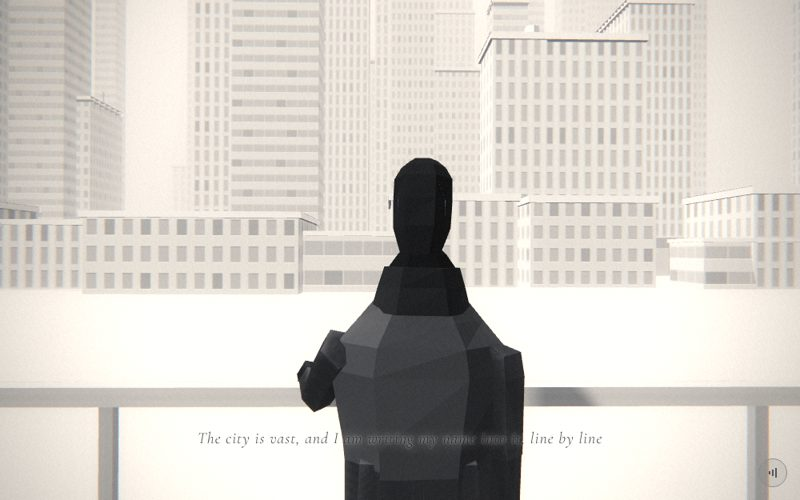

# 05 · skyline

> "The city is vast, and I am writing my name into it, line by line"
> Source: `src/app.js`, banner `/* 5 — over the shoulder: a city nobody knows you in */` · group: city · before/after: [sheet](../../assets/model-polish/city.jpg)

## At a glance
| | |
|---|---|
| Setting | Exterior, day, hazy. Over-the-shoulder view from behind a railing ("the overpass") toward a wide skyline. The hero, the railing and the city all stand on one ground plane at y 0: there is no deck and no drop. A row of low blocks forms the foreground, with towers behind them and six slender towers at the back |
| Tone | Light. `bg:'#e6e6e6'`, the same as the fog colour. `scene.background = gradTex('#f3f3f3','#d8d8d8')` (top to bottom). `dark:()=>false`, so the caption is black with a white halo. Dips: the scene opens out of `#e6e6e6` (after the dark desk scene), and for t > .9 it fades to grid's `#151515` |
| Hero | Stand, with the **left hand resting on the rail**. `makePerson()` uses the default tones, at (−.1, 0, 0) with `rotation.y = π` (facing −z, toward the city). The pose is set once in `build()`: `arms[1].rotation.set(-.845,0,.32)`, `elbows[1].rotation.x = -.78`, `hands[1].rotation.set(.454,0,0)`, `hands[1].userData.grip(.06)`; the thumb is `hands[1].children[5]` with `rotation.x = 0` and its distal joint `children[1].rotation.x = .05`. The right arm keeps the rest pose. Nothing is held |
| Motion | Almost static. Scroll moves only the camera; `time` drives a slow idle sway, `me.rotation.y = π + sin(time*.5)·.03` (a period of about 12.6 s) |
| Camera | Position `(lerp(-.8,.7,t), lerp(1.55,1.75,t), lerp(1.9,1.5,t))`, `lookAt(.3,1.7,-20)`. That gives (−.8, 1.55, 1.9) at t=0, (−.05, 1.65, 1.7) at t=.5 and (.7, 1.75, 1.5) at t=1. It crosses from behind his left shoulder (screen left, the side with the hand on the rail) to behind his right, rising .2 and pushing in .4. Default fov |
| Budget | scene 3232 tris (v40 494) · hero 1561 (v40 1093) · 305 meshes, 51 of them hero · 1 instanced (25 instances) · 3 lights |

## Models
The counts below come from replaying the `rng(33)` / `rng(34)` loops. The totals match `docs/data/inventory-v41.json` (3232 tris).

| Model | Built with | Geometry | Tone | Placement / contact | Notes |
|---|---|---|---|---|---|
| Ground | `ground(0xeeeeee)` (size 400) | `PlaneGeometry`, 2 tris | `0xeeeeee` | y = 0, under everything | |
| Ground strip | local `Mesh(PlaneGeometry(200,30), M(0xd8d8d8,{side:FrontSide}))`, `rotation.x = -π/2` | 2 tris | `0xd8d8d8` | (0, .05, −38), spanning z −23 to −53 and x ±100 | `renderOrder 1`. It is 5 cm above the ground, far less than the 16-bit depth step at 25–55 m (about .2–.9), so it wins only by draw order. It darkens the ground under the low blocks and the near towers |
| Low-rise blocks ×16 | `building(w,h,d,false,{lobby:false, variant:i%3})` | box + lip (24 tris each) | day facade, untinted; the variants cycle 0/1/2 | x = −42 + 5.6i + 0–2 (−41.3 to 42.2), z −24.4 to −32.5. w 4–9, h 2.26–4.49 (2–4 floors), d 3–7 | No podium, door or roof furniture. Neighbours interpenetrate (w up to 9 on a 5.6 pitch). They replaced the round-0 "crates" |
| City towers ×40 | `building(w,h,d,false,{lobby:z>-52, setback:h>32&&r2()<.6?h*.25:0, roof:r2()<.45?(r2()<.5?'mast':'tank'):null})` | facade box + children | day facade, untinted. Variants 18/6/16 | w 3–8.7, h 10.9–52.9, d 3–9. x −43.5 to 45, z −30.6 to −89.4. Only x and z are set after `building()` | The default `front [0,1]` puts doors on the +z face, toward the camera |
| Podiums ×13, doors ×13 (10 double with canopy) | `building()` lobby, on the 14 towers with z > −52 | as in `building()`: podium `(w+.2) × band × (d+.2)`, cap strip, door `.12` deep | podium `0x8c8c8c` / `0x999999` / `0xa5a5a5`, cap and canopy `0xeaeaea`, door `0xc6c6c6` | Ground level, about 32–54 m from the camera, behind the low-rise band | `renderOrder` 1 and 2. At this distance they are small in frame |
| Setback blocks ×8 | `building()` setback (`h·.25` on 8 of the 20 towers over 32) | box + lip | same facade variant | On the roof, offset `(+.08w, −.06d)` | |
| Roof furniture: 15 masts, 9 tanks | `building()` roof | mast: box .3³ + open 4-sided tube (8 tris), `mh = min(5, .12h)` (at least 1.5); tank: plinth box + open 6-sided drum (12 tris) | mast `0x7f7f7f`; plinth `0x8c8c8c`, drum `0xeaeaea` | On the top block | `renderOrder 2` |
| Slender towers ×6 | `building(2+r2()*1.2, 44+r2()*16, 2+r2()*1.2, false, {roof:'mast', lobby:false})` | box + lip + 5-unit mast | day facade | w 2.2–3.2, h 45.6–58.1; x −36 to 34.9, z −62.5 to −77.4 | Only x and z are set: round 0's `position.set(x,0,z)` buried them halfway |
| Parapet lips ×70 | `building()` (40 + 8 setbacks + 6 slender + 16 low) | box `(w+2o) × min(.35,.08h) × (d+2o)` | `0xeaeaea` | Roof edge | `renderOrder 1` |
| Railing base | `box(30,.42,.3, M(0xc4c4c4), 0,.21,RZ)` | box | `0xc4c4c4` | y 0–.42, centred on `RZ = -.48` (48 cm in front of him), x ±15 | Concrete upstand |
| Railing posts ×25 | local `InstancedMesh(BoxGeometry(.05,.7,.05), M(0xa8a8a8), 25)` | 12 tris each (300 total, the heaviest row) | `0xa8a8a8` | x = −14.4 + 1.2i, y .42–1.12 (standing on the base, top ending inside the rail), z = RZ | Instanced, so no shadows |
| Top rail | `box(30,.07,.1, M(0xb8b8b8), 0,RY,RZ)` with `RY = 1.12` | box | `0xb8b8b8` | Top face at 1.155, far face at z −.53. Hip-high on the 1.75 hero, and above the caption band for the whole .12–.75 window | His left palm touches the top face |
| Hero | `makePerson()` | hero rig, 1561 tris | trousers `0x2a2a2a`, coat `0x3a3a3a` | Feet on y 0 at (−.1, 0, 0). Left palm on the rail top | Back view, large in frame (head and shoulders fill the centre) |
| Sky | `gradTex('#f3f3f3','#d8d8d8')` as `scene.background` | canvas texture | `#f3` top to `#d8` bottom | — | Not fogged (it is the background) |

## Lights and atmosphere
- `lights(scene,{dir:[0xffffff,.9,[-3,4,2]]})`:
  - `HemisphereLight(0xffffff, 0x777777, .9)`
  - key `DirectionalLight(0xffffff, .9)` from (−3,4,2), normalised × 20 = (−11.14, 14.86, 7.43). That is up, to the left and behind the camera. It casts shadows (±14 box around the origin, which covers the hero and the railing).
  - rim `DirectionalLight(0xffffff, .405)` at (3, 2.4, −6), from the city side
- **Shadows:** the hero's parts cast. The railing base, rail and buildings are too big (bounding radius ≥ 1.2), and the instanced posts are skipped. The small roof furniture (mast boxes, masts shorter than about 2.4, tank plinths and drums) and the 3 single doors also have `castShadow` set, but they stand 30–90 m away, far outside the ±14 shadow box, so they cast nothing visible.
- `Fog(0xe6e6e6, 10, 110)`: the towers at 30–90 m are partly to mostly washed out, and the slender towers at 62–77 m read as pale shapes. The haze is what separates the planes.
- No particles, sprites or glows. The film pass runs in light mode.

## Animation (`update(t, time)`)
- **Scroll-driven:** only the camera (the formula above).
- **Time-driven:** `me.rotation.y = π + sin(time*.5)·.03`. The whole hero turns ±.03 rad about his origin. The hand is roughly .5–.6 from that axis, so the palm slides about ±1.5 cm, mostly along the rail; its height on the rail does not change (approx.).
- After `update()`, `frame()` adds the handheld drift.

## v40 → v41
See [model-polish/city.md](../model-polish/city.md): round 0, then round 1 blockers 2, 3 and 4 and the minors.
- **Railing:**
  - v40 had one solid bar, `box(30,.9,.4, M(0xcfcfcf))` at z −1.2, which read as a grey wall.
  - Now it is a base, 25 instanced posts and a top rail at z −.48.
  - The rail first sat at .95, where it crossed the caption at t .12–.35. It was raised to 1.12.
- **Hand on the rail:**
  - v40 only pushed the left arm out (`arms[1].rotation.z = .25`).
  - The final pose came from a vertex-level grid search. A straight arm put the cuff, which is thicker than the palm, on the rail; only a flat palm with a bent elbow gave clean contact.
  - Measured result: palm contact 0.000 (the lowest palm vertex over the rail is exactly at the rail top), no clipping, fingertips at z −.575 (4.5 cm past the far face, hanging in the air).
- **Towers:**
  - Same 40 sizes and positions (`rng(33)` keeps its draw order).
  - New options draw from `rng(34)`: setbacks, roof masts and tanks, and podiums with doors only for z > −52 ("beyond 50 m they are a few pixels").
- **New pieces:**
  - **Six slender masted towers.** Round 0 buried them with `position.set(x,0,z)`; fixed by setting only x and z.
  - **The ground strip.** Round 0 used a coplanar box; it is now a plane at y .05 with `renderOrder 1`.
  - **16 low-rise `building()` blocks.** Round 0 had 30 blank instanced "crates".
- **Hero** (hero group): sloped shoulders, a collar ring that hides the neck, the hair shell. This scene is the main back view of the shoulders.
- **Triangles:** scene 494 → 3232 (6.5×; v40 was 40 bare boxes plus one bar). Round 0 was 5811 and round 1 is 4325 in the notes' count, which adds the v40 hero (1093). Hero 1093 → 1561.

## Editing notes
- **The hand contact is measured, not eyeballed.** Changing any of these breaks it: `RY`, `RZ`, the rail's height or depth (`.07 × .1`), the hero position (−.1, 0, 0), the arm, elbow or hand angles, or the arm and hand proportions in `makeHero()`.
  - Re-check against the measured values: lowest palm vertex = rail top (1.155), nothing below the top while over the rail, fingertips just past the far face (z −.53).
  - `hands[1].rotation.set(.454,0,0)` also zeroes the hand's default `rotation.y = π/2`, which turns the palm down. `children[5]` is the thumb group because the palm is child 0 and the fingers are 1–4.
- **Caption band** (t .12–.75, lower middle):
  - The rail stays above it for the whole window.
  - The posts and the hero's dark coat cross it. In the t=.5 shot, the words that land on the coat ("…am writing my name into it…") are hard to read, because the caption is dark text on the dark coat. Open; nothing has been decided.
- **Don't set y after `building()`**, and keep the draw order of `r` and `r2`. The low blocks and slender towers draw from `r2`; adding a draw before them reshuffles them.
- **Podiums only for z > −52.** Moving that threshold back adds 24–48 tris per tower (podium and cap 24, door 12, canopy 12) for detail that is a few pixels tall.
- **Keep the low blocks low** (2.26–4.49 now) and in front of the towers. They hide the towers' feet and stop the city floating in the haze, as the owner requires (ground visible under buildings). Much taller, and they would cover the skyline the caption talks about.
- **Composition:** SCENES.md's weak-spot list groups `skyline` with `towers` ("the hero is small or absent; they could use stronger composition"). In v41 the hero is large in frame here, so the open point is composition, not his size. The ROADMAP's spine and standing-idle items would help here (a slump, breathing). No trembling: the idle sway is a slow ±.03 rad turn, and anything added must stay as calm.
- **Shoe soles:** the city group's bounding-box dump found the hero's lowest vertices at y −.02 / −.03 under his origin. That was measured on the city branch before the hero rebuild was merged, so re-check it with the v41 rig. It is a rig property, not this scene's.

## Check it
- Shots, with a lead-in from the end of scene 4:
  `NODE_PATH=/opt/node-tools/node_modules WAIT=12000 node tools/shots.js 4.9 5.15 5.35 5.65`
- What to look at:
  - the left palm sits on the rail top, with no fingers through the rail and no gap
  - at 5.15 and 5.65 the rail is above the caption, and the caption can be read
  - the slender towers and low blocks stand on the ground, with nothing floating
  - the podiums are solid, with no stripes
- **Hand close-up:** crop the PNG around the rail on the left of the coat with PIL at 3–4×. `tools/pose.html` shows the hero alone without the rail, so it can only check the arm shape. The vertex test script from the polish (`r1/measure1.js`) was not committed.
- **Budget:** `node tools/inventory.js`, then compare the `skyline` row with `docs/data/inventory-v41.json`.
