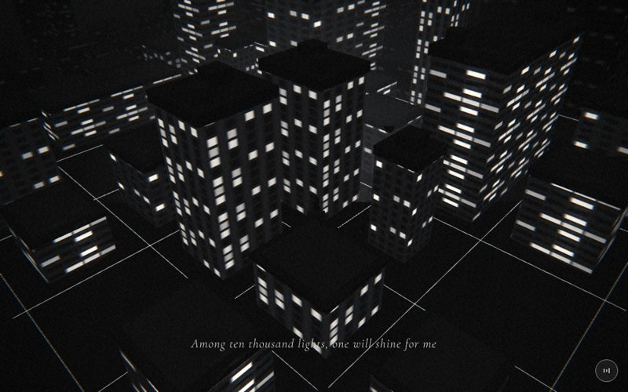

# 06 · grid



> "Among ten thousand lights, one will shine for me"
> Source: `src/app.js`, banner `/* 6 — the city lights up, block by block */` · group: night-city · before/after: [sheet](../../assets/model-polish/night-city.jpg)

## At a glance
| | |
|---|---|
| Setting | Exterior, night. A 13 × 13 cell city seen from above: night `building()` blocks on a 4-unit grid, white street lines on a dark ground |
| Tone | Dark. `bg:'#151515'`, `scene.background` 0x151515, `dark:()=>true` for the whole scene (white caption, strong grain and vignette). Dips: starts from `#151515`, and for t > .9 fades to subway's `#0c0c0c` |
| Hero | Stand. `makePerson({body:0x555555,jacket:0x444444})` at (2, 0, 2), `rotation.y = -2.4`, no rig calls, nothing held. He stands on the street crossing at x = z = 2. Tiny from this camera; the v40 audit lists him as invisible, and he can't be seen in the t=.5 screenshot |
| Motion | Scroll-driven reveal outward from the centre. The street lines draw in by distance and each block's windows switch on when the reveal radius passes it. Nothing translates; `time` is unused |
| Camera | Orbits and rises around the origin: `a = lerp(.4,1.4,t)`, position `(sin a·lerp(9,26,t), lerp(4,22,t), cos a·lerp(9,26,t))`, `lookAt(0,0,0)`. That is (3.50, 4, 8.29) at t=0, (13.71, 13, 10.88) at t=.5 and (25.62, 22, 4.42) at t=1, so 9.9 → 34 units from the centre. Default fov |
| Budget | scene 5078 tris (v40 1754) · hero 1561 · 358 meshes · 4 instanced (116 instances) · 1 light (hemisphere) · 1 `LineSegments` (398 segments) · 1 sprite |

## Models
| Model | Built with | Geometry | Tone | Placement / contact | Notes |
|---|---|---|---|---|---|
| Ground | `ground(0x1c1c1c)` | `PlaneGeometry(400,400)`, 2 tris | `0x1c1c1c`, `M`, FrontSide | y = 0 | The required ground under the buildings. Receives shadows, but the scene has no shadow light |
| City blocks (151 boxes) | local `place()` / `put()` → `building(w,h,d,true)` | Box, 12 tris each, plus a parapet-lip child box (12 tris) | night facade `MeshStandardMaterial`: `map` = `emissiveMap` = night tile (variant `s%3`, seeded by size), emissive 0xffffff. Material is **cloned per block**, `emissiveIntensity` starts at 0 | Base at y = 0 on cell centres `(gx*4, gz*4)`, gx and gz from −6 to 6. 18 cells are skipped (`r()<.15`) | The seed is `rng(41)`. Kinds in this seed: **76 singles** `2.2–2.8 × h × 2.2–2.8`; **22 doubles** `2.6 × h × 6.6` at `z+2`, covering the cell and its +z neighbour; **22 L-plans** (44 wing boxes, see the next row); **9 slender towers** `1.5 × (1.5h+1) × 1.5`. `h = 1+r()*r()*9`. Heights run .86–11.16 |
| L-plan wings | `place()` twice, inside the `k<.28` branch | 2 boxes | as above | If `hB ≥ h`: wing A `1.4×h×1.2` at `(x+.6, z-.7)` and wing B `1.2×hB×2.6` at `(x-.7, z)`. Otherwise A is `2.6×h×1.2` at `(x, z-.7)` and B is `1.2×hB×1.4` at `(x-.7, z+.6)`. `hB = h·(.7–1.3)` | **Butt-joined**: the taller wing owns the corner and the shorter one stops at its wall, so the boxes never overlap. Both wings share one `dist`, so they light together |
| Parapet lip | inside `building()` (city group) | Box `(w+2o) × lipH × (d+2o)`, `lipH = min(.35, .08h)`, `o = min(.12, .03w, .03d)` | `T.lip` = `M(0x1e1e1e)`, `renderOrder 1` | Box centre at `h − .1·lipH`, so the top face is at `h + .4·lipH` | Every block has one. Night buildings get no podium, door or roof furniture from `building()`. See **Editing notes** for how it buries the roof deck |
| Roof deck | `mk(plate, M(0x2c2c2c))` | `InstancedMesh` of a unit `BoxGeometry` scaled `(w−.3, .1, d−.3)`, 12 tris × 70 | `0x2c2c2c` | Inner blocks only (`|gx|,|gz| ≤ 4`, 70 blocks), y from `h+.01` to `h+.11` | Meant to be a lighter deck inset .15, with the darker roof edge reading as a parapet. Hidden on half the blocks (see Editing notes) |
| Lift heads | `mk(lift, M(0x202020))` | instanced unit box `.7 × .45 × .7`, 33 instances | `0x202020` | Inner blocks with `h > 3.6`. y from `h+.11` to `h+.56`, in one corner quadrant (`sx`, `sz` from `R.u`, `R.v`), at least .4 of the way out | Placed by `place()` from the `roofDraws` values |
| Water tanks | `mk(tank, M(0x262626), CylinderGeometry(.32,.32,.5,6,1))` | 6-sided cylinder, 24 tris, 5 instances | `0x262626` | The quadrant opposite the lift head, at `(x−sx(w/2−.5), h+.36, z−sz(d/2−.5))` | Only when `h > 5`, 50 % chance, **and** the footprint is ≥ 2.2 × 2.2, so the .32 radius stays on the deck. L-plan wings never get one |
| Masts | `mk(mast, M(0x303030))` | instanced box `.06 × 1.4 × .06`, 8 instances | `0x303030` | One of the two free corners, inset .3; y from `h+.11` to `h+1.51` | `h > 6`, 60 % chance |
| Street grid | `THREE.LineSegments` + `LineBasicMaterial({color:0xffffff, transparent, opacity:.75, fog:true})` | 398 segments, each 4 units long, at y .03 | white, 75 % | Lines along x = 4i+2 and z = 4i+2 (i from −7 to 7), spanning −26…30 | Sorted by `Math.hypot(i,j)` so `setDrawRange` reveals them outward. **The segment under each double block is skipped** (`merged` set): 420 → 398 |
| Centre glow | `glow(18,.25)` | additive sprite | white, opacity .25 | (0, .5, 0) | Constant opacity; a soft pool at the centre, where the reveal starts |
| Hero | `makePerson({body:0x555555,jacket:0x444444})` | hero rig, 1561 tris | trousers `0x555555`, coat `0x444444` (lighter than the default `0x2a2a2a`/`0x3a3a3a`) | Standing on the street crossing at (2, 0, 2), facing `rotation.y = -2.4` | Default rest pose. Cells (0,0), (0,1), (1,0) and (1,1) all hold blocks, so he stands in the gap between four buildings |

Triangle split (v41 inventory): facades 151 × 12 = 1812 · lips 151 × 12 = 1812 · instanced roof parts 840 + 396 + 120 + 96 = 1452 · ground 2.

## Lights and atmosphere
- `lights(scene,{hemi:[0x888888,0x111111,.5],dir:null})`: one `HemisphereLight` (sky `0x888888`, ground `0x111111`, .5). There is **no directional light, so no shadows and no rim**. The facades read only through the hemisphere light and their emissive windows.
- `scene.fog = Fog(0x151515, 10, 60)`: the outer ring of blocks fades into the background colour. The lines use `fog:true`.
- The windows are the light source: each block's cloned facade material has `emissiveMap` = its night tile, and `emissiveIntensity` animates 0 → .9.
- The film pass runs in dark mode the whole scene (strong vignette and grain). Window pixels above the pass's .8 brightness threshold feed its glow taps (see ARCHITECTURE.md, "Film pass").

## Animation (`update(t, time)`)
- `g = ease(clamp(t*1.2))` reaches 1 at t ≈ .83. The reveal radius is `R = g*11` (cell units).
- Lines: `lg.setDrawRange(0, floor(segs.length*g)*2)`. The segments are pre-sorted by distance, so the grid grows outward from the centre.
- Blocks: each block stores `d = Math.hypot(gx,gz) + r()*1.5` (0 to ≈ 10). Its windows run `emissiveIntensity = smooth(d−1, d, R)*.9`, so each block fades in over one cell of radius, and all are on by t ≈ .83.
- Camera: the orbit and rise from the table above. Then the global handheld drift is added in `frame()`.
- Nothing depends on `time`. The scene is fully deterministic in `t`.

## v40 → v41
Source: [model-polish/night-city.md](../model-polish/night-city.md) (sections "6 grid" and "Round 1") and [city.md](../model-polish/city.md) for `building()`.
- **v40:** about 146 identical `building(2.6,h,2.6,true)` cubes in a perfect lattice. v40 `building()` was a single textured box with one night tile. The group notes called it "a perfect lattice of 2.6 × h × 2.6 boxes with identical roofs" (the audit: "the city is a perfect lattice").
- **Footprints (night-city):** 16 % doubles over two cells, 12 % L-plans, 8 % slender towers at 1.5× height, and jittered 2.2–2.8 footprints for the rest (counts in this seed: 22 / 22 / 9 / 76).
- **Roof furniture (night-city):** an inset deck on the inner 9 × 9 cells, lift heads on blocks over 3.6, tanks over 5, masts on the tallest. All instanced. The outer ring stays plain because instanced parts are not frustum-culled and the ring is in fog anyway.
- **Round 1 fixes:**
  - The L-plan wings were overlapping and z-fought (a blocker). They are now butt-joined.
  - Roof pieces were taken from quadrants, which cut interpenetrations from 6 to 0.
  - Tanks are only placed on footprints ≥ 2.2 (7 → 5).
  - The street segment under each double block is dropped (420 → 398).
- **Layout preserved:** `roofDraws` takes the rng draws in the same order and number as before and `place()` applies them, so the 151-block layout is identical to round 0.
- **Emissive lookup:** `building()` output is traversed for `emissiveMap` materials, so the light-up keeps working even though the helper now returns a mesh with children.
- **`building()` changes (city group, shared helper):**
  - three night facade variants (punched / ribbon / piers), seeded by size
  - a parapet lip (`0x1e1e1e`, `renderOrder 1`) on every building
  - night buildings get the lip only
- **Triangles:** 1754 → 5078 (2.9×, hero excluded). That is +1812 from the city group's lips, +1452 from the instanced roof parts and +60 from the 5 extra boxes (146 → 151). The group notes measured 2847 → 4361 static (including the old 1093-tri hero, 1.53×) before the lip existed. Per frame at 6.35 / 6.65 they measured 1891 / 2128 → 3461 / 3725.
- **Tried and rejected:**
  - Podiums: invisible from both camera positions, and they cost 1.9k tris.
  - The audit's finer-window suggestion was skipped; it would mean rewriting the UVs that `building()` sets.

## Editing notes
- **Open issue: the roof deck is buried under the lip on 35 of the 70 inner blocks.**
  - Why: the deck's top is at `h+.11`, and the lip's top face (it is a solid box over the whole roof) is at `h + .4·min(.35,.08h)`. That is above the deck whenever `h > 3.44`; at `h ≥ 4.375` the lip top is `h+.14`, .03 above the deck. This includes every block with a lift head (`h > 3.6`).
  - Evidence: the t=.5 screenshot shows uniformly dark roofs with no lighter inset deck on the tall blocks; only the lift heads stand out.
  - Fix options (untested):
    - Pass `{lip:false}` to `building()` for inner blocks; the deck design assumed no lip.
    - Lift the deck, lift heads, tanks and masts by `.4·lipH`.
  - Either way, keep the gap ≥ the depth step at 20–36 units (≈ .1–.4).
- **Don't change the rng order.** `r = rng(41)` drives cell skips, heights, kinds, footprints, distances and the roof draws, in that order. Adding or removing an `r()` call anywhere in the loop (including inside `roofDraws`) reshuffles the whole city. New per-block randomness belongs in a separate `rng(seed2)`.
- **Light-up contract:** a block is lit through the materials collected by `b.traverse(... o.material.emissiveMap ...)`.
  - Each facade material is cloned so blocks light independently.
  - Any part with an `emissiveMap` added in `building()` will be picked up automatically.
  - A non-emissive part (lip, roof furniture) stays dark.
- **16-bit depth:** the camera is ≈ 10–34 units from the centre. With a depth step of ≈ 3e-4·z² (ARCHITECTURE.md), that is ≈ .03 at 10 units and ≈ .35 at 34. Never stack coplanar or near-coplanar boxes; this is why the L-plan is butt-joined, not overlapped (an earlier .02/.04 inset was discarded).
- **Instanced parts are not frustum-culled**, so they are drawn every frame wherever they are. Keep instanced roof parts to the inner 9 × 9 cells.
- **Street lines vs doubles:** the `merged` key is the lower cell `gx,gz`, and the skip test `merged.has((j+1)+','+i)` maps it to the horizontal segment at `z = 4·gz+2`, `x = 4·gx−2 … 4·gx+2`. Keep the mapping if you change the grid pitch.
- **Do not touch** (audit): the block-by-block lighting order, the line reveal, the glow and the camera.
- **Caption band** (t .12–.75, lower middle): blocks and street lines sit under the caption all the time. It reads because the scene is dark and the caption is white with a dark halo. Don't add bright geometry (lit signs, white roofs) in the lower-middle of the frame.
- **Hero:** he is effectively decorative here. Moving him into view would need a closer camera, and the camera is on the do-not-touch list.

## Check it
```bash
NODE_PATH=/opt/node-tools/node_modules WAIT=9000 node tools/shots.js 5.9 6.35 6.65 6.85
```
- **6.35:** low orbit; the reveal radius is ≈ 3.9 cells, so only the centre is lit. Look at the L-plan joins (no stripes), the lift head, tank and mast positions on roofs, and the line reveal edge.
- **6.65:** the reveal is nearly done. Look at the roof decks (see the open issue), the doubles with no street line through them, and fog on the outer ring.
- **6.85:** the far camera (~30 units), where z-fighting shows first.
- For close-ups, crop the PNG as in `docs/model-polish/brief.md`. The group's close-ups were taken obliquely at (−3, 3) and (−2, 4) with a custom camera (not in the repo).
- Re-measure triangles with `node tools/inventory.js` (writes `out/inventory.json`). The current numbers are in `docs/data/inventory-v41.json`.
