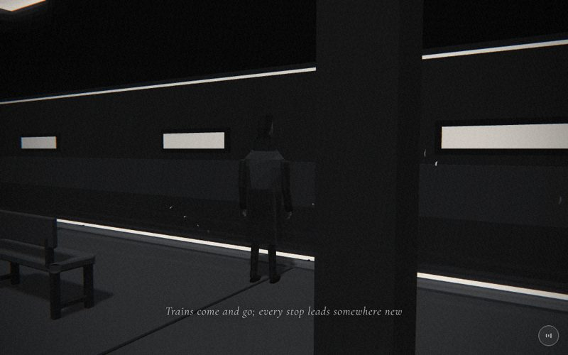

# 07 · subway



> "Trains come and go; every stop leads somewhere new"
> Source: `src/app.js`, banner `/* 7 — the platform: trains rush past, nobody stops */` · group: night-city · before/after: [sheet](../../assets/model-polish/night-city.jpg)

## At a glance
| | |
|---|---|
| Setting | Interior, an underground station at night. Platform, track bed, far tunnel wall, ceiling, pillars and a bench, with a six-car train looping past |
| Tone | Dark. `bg:'#0c0c0c'`, `scene.background` 0x0c0c0c, `dark:()=>true` all scene. Dips: starts from `#0c0c0c` (grid's end fades into it), and for t > .9 fades to store's `#060606` |
| Hero | Stand. `makePerson()` with the default tones, at (0, 0, .2), `rotation.y = π+.25` (facing the tracks, turned slightly). No rig calls, nothing held. He stands 1.15 behind the white edge line |
| Motion | Time-driven: the train loops along +x (`time*22`, a 5 s period) and the petals drift. Scroll only drives the camera |
| Camera | Position `(lerp(3.2,1.6,t), lerp(1.4,1.6,t), lerp(4.5,3.4,t))`, `lookAt(lerp(-.5,0,t), 1.1, -.8)`. Low, three-quarter from behind his right, pushing in. Default fov |
| Budget | scene 3548 tris (v40 1284) · hero 1561 · 137 meshes · 13 instanced (217 instances) · 4 lights (hemi, key, rim, point) · 1 sprite |

## Models
All boxes are `box(w,h,d,mat,x,y,z)` (centre position) unless noted. "Inst" means `inst(geo, mat, list, parent)`, the scene-local helper that makes an `InstancedMesh` with identity rotation.

### Station
| Model | Built with | Geometry | Tone | Placement / contact | Notes |
|---|---|---|---|---|---|
| Platform slab | `box(60,.4,4,…,0,-.2,1)` | Box, 12 tris | `M(0x343434)` | Top at y = 0, z −1…3, x ±30 | Lifted from v40's `0x2a2a2a` so the dark hero reads on it |
| Tactile strip | `box(60,.03,.3,…,0,.015,-.58)` | Box | `M(0x4a4a4a)` | y 0….03, z −.73…−.43 | Raised .03 (the depth rule) |
| Edge line | `box(60,.02,.12,…,0,.01,-.95)` | Box | `B(0xdddddd)`, unlit | y 0….02, z −1.01…−.89, at the slab's front edge | Unchanged since v40 (audit: do not touch) |
| Floor seams | Inst `BoxGeometry(.03,.01,3.9)` | 13 × 12 tris | `M(0x1c1c1c)` | x = −30…30 every 5, y 0….01, z centre 1.05 | Only .01 proud, below the ≥ .03 rule. Raise them to ≥ .03 if they stripe far down the platform |
| Track bed (ballast) | `box(60,.2,4,…,0,-1,-3)` | Box | `M(0x141414)` | y −1.1…−.9, z −5…−1 | Hidden behind the platform edge from the scene camera (so there are no sleepers) |
| Rails | `box(60,.1,.07,…,0,-.85,-2.5±.72)` × 2 | Box | `M(0x6a6a6a)` | y −.9…−.8: they sit on the ballast top | Visible only from a low/cab view |
| Far tunnel wall | `box(60,4.6,.3,…,0,1.3,-5.25)` | Box | `M(0x242424)` | y −1…3.6, front face z −5.1 | What fills the frame when no train is present |
| Dado band | `box(60,1.1,.08,…,0,.65,-5.07)` | Box | `M(0x363636)` | y .1…1.2, .07 proud of the wall | The lighter band behind his legs in the screenshot |
| Wall strip light | `box(60,.06,.08,…,0,3.42,-5.07)` | Box | `B(0xcfcfcf)` | y 3.39…3.45, along the top of the wall | The long white line across the upper frame |
| Name boards × 4 | `box(2.6,.7,.08,M(0x111111),x,1.75,-5.06)` + `box(2.3,.44,.06,B(0xc4c4c4),x,1.75,-4.99)` | 2 boxes each | dark frame `0x111111`, lit pane `0xc4c4c4` | x = −14, −6, 2, 10; pane .06 proud of the frame | **Blank, no text** (the site's text rules). The board at x = 2 can hide behind the foreground pillar |
| Ceiling | `box(60,.12,9.4,…,0,3.66,-.9)` | Box | `M(0x161616)` | y 3.6…3.72, z −5.6…3.8; meets the wall top at 3.6 | |
| Pillar shafts | Inst `BoxGeometry(.36,3.3,.36)` | 12 × 12 tris | `M(0x262626)` | `px = range(-28,28,5)` (x = −28, −23 … 27), z 2.3, y .12…3.42 | Between the camera and the hero: the pillar at x = 2 is the dark foreground column on the right of the frame |
| Plinths | Inst `BoxGeometry(.56,.12,.56)` | 12 | `M(0x343434)` | y 0….12 (on the slab) | |
| Capitals | Inst `BoxGeometry(.56,.18,.56)` | 12 | `M(0x343434)` | y 3.42…3.6, touching the ceiling | |
| Light troughs | Inst `BoxGeometry(2,.12,.42)` | 12 | `M(0x0e0e0e)` | (px, 3.55, 1): y 3.49…3.61, tucked into the ceiling | Replace v40's floating light bars at 3.95 |
| Lenses | Inst `BoxGeometry(1.8,.05,.28)` | 12 | `B(0xffffff)` | y 3.45…3.5, hanging .04 below the trough | The near one shows at the top left of the frame |
| Sign boxes × 2 | `box(.3,.16,.07,M(0x111111),x,2.4,2.515)` + `box(.26,.1,.012,B(0xb4b4b4),x,2.4,2.556)` | 2 boxes each | `0x111111` box, `0xb4b4b4` pane | On the fronts of the two pillars nearest him (x = 2, −3), y 2.4 | Raised and dimmed in round 1 so no white slab sits near the lens. Above the frame at .35. Blank |
| Bench | `bench` group at (−1.6, 0, 1.9): seat `bevelBox(1.5,.08,.44,.015,M(0x3c3c3c),0,.42,0)`, back `bevelBox(1.5,.26,.05,.01,M(0x363636),0,.64,.2)` | 2 lofted bevel boxes (8-sided `loft`, 64 tris each) + 8 boxes | seat `0x3c3c3c`, back `0x363636`, frames `0x1e1e1e` | Seat .42….50, back .64….90 on the +z side, so it faces the tracks. Each end (x ±.66) has two posts `.06×.42×.06` reaching the floor, a stretcher `.06×.04×.38` at y .1 and a back post `.05×.26×.05` | Lower left of the frame, behind him and out of the caption band. 224 tris |

### Train (`train` group, `position.z = -2.5`, `position.x` animated)
| Model | Built with | Geometry | Tone | Placement / contact | Notes |
|---|---|---|---|---|---|
| Car bodies × 6 | `prism(prof, 9.4, 7)`, one shared geometry | 10-point profile `[y,z]` extruded along x: flat sides z ±1.3, bevelled roof shoulders (y 1.95 → 2.5) and skirt (y −.12 → −.35). Non-indexed, 40 tris | `M(0x5a5a5a,{vertexColors:true})`, per-face tone jitter ±5 % | Car `c` at `cx = c·9.7` (pitch `P = 9.7`, 9.4 long, so a .3 gap). Body y −.35…2.5. The platform-side face is at world z −1.2, .2 from the edge | `prism()` is local to the scene. Body raised from v40's `0x3a3a3a` so it doesn't vanish in the fog |
| Window frames × 30 | Inst `frameGeo(.96,.86,.05,.06)` | hollow frame, 24 tris: front lip + inner and outer side walls, .06 deep | `M(0x161616)` | 5 per car at dx −4, −1.2, 0, 1.2, 4; y 1.3; on the side face (local z 1.3…1.36) | The lit outer side walls give the frames depth; they were kept for that reason |
| Window panes × 30 | Inst `PlaneGeometry(.86,.76)` | 2 tris | `B(0xf0f0f0)` (`wm`) | local z 1.328: recessed behind the frame front, .028 off the body | The bright white rectangles |
| Door pockets × 12 | Inst `PlaneGeometry(1.4,1.88)` | 2 tris | `M(0x121212)` | dx ±2.5, y .02…1.9, local z 1.325 | A plane, not a box (round-1 budget). Ends below the roof shoulder (1.95) |
| Door leaves × 24 | Inst `BoxGeometry(.64,1.82,.05)` | 12 tris | `M(0x484848)` | dx ±2.5 ± .34, y .04…1.86, local z 1.32…1.37 | A .04 centre gap shows the dark pocket |
| Door panes × 24 | Inst `PlaneGeometry(.4,.5)` | 2 tris | `wm` | y 1.4, local z 1.405 (.035 in front of the leaf) | |
| Roof units × 12 | Inst `BoxGeometry(1.9,.2,1.2)` | 12 tris | `M(0x3c3c3c)` | dx ±2.4, y 2.5…2.7, on the roof | |
| Bogies × 12 | Inst `BoxGeometry(2,.48,1.8)` | 12 tris | `M(0x141414)` | dx ±3.1, y −.8…−.32: on the rail tops (−.8), overlapping the skirt (−.35) | Mostly hidden by the platform |
| Gangways × 5 | `box(.5,2.3,1.7,M(0x1c1c1c),cx+P/2,1.1,0)` | Box | `0x1c1c1c` | Between cars, overlapping each car end by .1 | |
| Cab front | `box(.05,.95,1.9,M(0x141414),fx+.025,1.55,0)` windscreen + `box(.06,.2,.9,B(0xd8d8d8),fx+.03,2.2,0)` display | 2 boxes | `0x141414`, `0xd8d8d8` | At `fx = (N−1)·P + 4.7 = 53.2`, the +x (leading) end of the last car | The display is **blank** (no text) |
| Headlights / tail lights | `box(.06,.14,.22,B(0xffffff),fx+.03,.5,±.75)` / `box(.05,.08,.16,B(0x999999),-4.725,.5,±.75)` | 4 boxes | white / `0x999999` | Headlights at the cab, tail lights at the −x end of car 0 | |
| Headlight glow | `glow(1.6,.7)` | sprite | white additive, opacity .7 | (fx+.2, .5, 1.32): at the near body edge | The scene's only sprite |

Train total ≈ 1800 tris (6 × 40 bodies, 1428 instanced, 60 gangways, 72 cab and lights).

### Other
| Model | Built with | Geometry | Tone | Placement / contact | Notes |
|---|---|---|---|---|---|
| Hero | `makePerson()` | hero rig, 1561 tris | default trousers `0x2a2a2a`, coat `0x3a3a3a` | Feet on the slab top (y 0) at (0, 0, .2) | Default rest pose (arms down) |
| Drifting daisy petals × 24 | `petalGeo(.08,.011,{seg:4,cross:2})` shared by 24 separate meshes | indexed curved strip, 16 tris each (384 total) | `M(0xf4f4f2,{flatShading:false})`: lit, smooth | They float in front of him, between him and the track: x −3…5.4, y ≈ −.1…2.2, z −1…−.2. At the start of each loop (x ≈ −3) a petal can dip up to .1 below the platform top | **Open item, owner decision pending** (see Editing notes). Not instanced. `petalGeo` is also used by the daisies, so deleting the petals leaves no dead helper |

Inventory check (v41): the station is 1364 tris, the train 1800 and the petals 384, total 3548.

## Lights and atmosphere
- `lights(scene,{hemi:[0x999999,0x111111,.6],dir:[0xffffff,.5,[2,6,4]]})`:
  - a hemisphere light (sky `0x999999`, ground `0x111111`, .6)
  - a shadow-casting key light from `normalize(2,6,4)·20`, .5
  - the automatic rim light (.225) from (−2, 3.6, −8)
  - The levels were raised from .45 / .35 in v40 so the train body sits at about `#30` after the film pass.
- **Point light `tl`:** `PointLight(0xffffff, 0, 7)` at (−1, 1.6, −.9), between him and the track. Its intensity follows the train: `smooth(-56,-51,x)·(1−smooth(2,7,x))·.9`. It ramps to .9 while a car is in front of him, so the passing windows rim-light him. It is 0 at build time, which is why the inventory reads "Point 0.00".
- `scene.fog = Fog(0x0c0c0c, 6, 40)`. The far ends of the platform and the train fade.
- **Shadows:** small lit meshes (bench parts, sign boxes, the cab windscreen, hero parts, petals) cast; the slab, wall and ceiling are too big to (the `buildAll` radius < 1.2 rule). Instanced meshes cast nothing.
- Emissive look comes from `B` materials only: window and door panes, lenses, the strip light, name and sign panes, the edge line, the headlights, the tail lights and the destination display. Two point lights on the far wall were tried and removed (no visible effect, and they halved the headless frame rate).

## Animation (`update(t, time)`)
- **Train (time-driven):** `train.position.x = ((time*22) % 110) − 80`, so it moves +x at 22 units/s with a 5 s period. The train spans `x−4.7 … x+53.2`, so it is in front of the hero (x = 0) for x ∈ (−53.2, 4.7): about 2.6 s of every 5 s. A screenshot may or may not contain it (the t=.5 key image has no train: wall, boards and strip light only).
- **Point light:** follows the train x as above.
- **Petals (time-driven):** for each petal, `k = (time·s + o) % 6` with `o = i·1.7` and `s = .5 + (i%5)·.2`. Position `(−3 + 1.4k, .3 + .4·sin(2·time + o) + .25k, −.6 + .4·sin o)`, rotation `(3·time + o, 2·time, o)`. They drift +x with the train and rise, then wrap.
- **Camera (scroll-driven):** the lerp from the table above, plus the global handheld drift.
- The hero does not move.

## v40 → v41
Source: [model-polish/night-city.md](../model-polish/night-city.md) ("7 subway" and "Round 1"). Priority HIGH in the [audit](../model-polish/audit.md).
- **v40:** six plain `box(9.4,2.6,2.6,M(0x3a3a3a))` cars with 7 flush window planes each, a slab with a line, 12 bare pillars (`.35×4×.35`, `0x222222`) with floating light bars at y 3.95, and a track-bed slab. The audit said it "reads as a wall with holes"; the group notes add that the train "vanished into the fog".
- **Platform:**
  - slab lifted to `0x34`, raised tactile strip, floor seams
  - pillars rebuilt with plinth and capital, all instanced
  - a ceiling with recessed troughs and lenses
  - a track bed with rails
  - a far wall with dado, strip light and four blank lit name boards
  - a bevelled bench
  - two small lit sign boxes
- **Train:**
  - one bevelled 10-point profile for all six cars
  - inset framed windows (instanced, standing .06 proud)
  - two door pairs per car, roof units, gangways, bogies on the rails
  - a cab with a windscreen, blank display, headlights and glow; tail lights
- **Light:** hemi .45 → .6, key .35 → .5, and the new train-following point light.
- **Round 1:**
  - sign boxes raised to y 2.4 and dimmed to `0xb4`
  - door pocket made a plane (y .02–1.9) and the leaves .04–1.86, both below the roof shoulder
  - bench end panels replaced by open post-and-stretcher frames, and the bench moved from x −1.3 to −1.6
  - sleepers dropped, rails lowered onto the ballast (−.85), bogies made .48 tall, floor seams set every 5 units
- **Bug found:** the 16-bit depth target made panels .01–.02 proud z-fight at 5–10 units (dotted door panes). Every proud panel was moved to ≥ .03.
- **Triangles:** 1284 → 3548 (2.76×, hero excluded; the train is ~1800 of it, the petals stay at 384). The group's own count including the old hero was 2377 → 4643 static (1.95×). Per frame at 7.35 with a car in view: 4145, still ~2.6× because instanced meshes are not frustum-culled (the reviewer accepted this). Draw calls went 139 → 177 in round 0.
- **Untouched on purpose:** the hero stance, camera, edge line and petals.

## Editing notes
- **Petals = open owner decision.**
  - The owner pulled the flower motif back everywhere except the daisy props in scenes 2, 4 and 17 (ART-DIRECTION: "不要花瓣 / 不要花"). The audit, SCENES.md and ROADMAP flag the subway petals.
  - To remove them, delete the `PN/pm/pg/petals` lines in `build()` and the `petals.forEach(...)` line in `update`. That saves 384 tris and 24 meshes.
  - Never mention petals or flowers in the caption or About.
- **Depth rule:**
  - Every new proud panel must stand ≥ .03 in front of the face behind it **and** draw after it.
  - Current near-misses to know about: the floor seams (.01 tall), the sign pane (.012 in front of its box), the door pocket plane (.025 off the body).
  - The depth step is ≈ 3e-4·z² (ARCHITECTURE.md): ≈ .0075 at 5 units but ≈ .07 at 15 units. So the far cars and the far floor can tie (approx.); the fog from 6 to 40 hides most of it.
  - In the first polish pass, the dotted door panes were caused by exactly this.
- **Train is time-driven, not scroll-driven.** Don't tie it to `t` (the scene would freeze when scrolling stops), and keep `update` otherwise deterministic. To shoot a known phase, the group snapped page time to 3.5 s, which puts the train at x = −3 (`scratchpad/snap.js`, not in the repo).
- **Train group z:** the car side is .2 from the platform edge (world z −1.2 vs −1.01). If you widen the profile or add proud parts on the platform side (> .19), they will cut into the platform edge and the white line.
- **Instanced meshes are never frustum-culled.** All 144 train instances render even when the train is off-screen. Adding more instanced detail to the train costs every frame.
- **Caption band** (t .12–.75, lower middle) shows over the platform floor between the bench and the pillar. Keep the bench at the lower left (it moved to x −1.6 for this) and the sign boxes above the frame (y 2.4). Don't put bright objects on the floor in the middle.
- **Hero:** the stance, position and camera are on the audit's do-not-touch list. The point light at z −.9 is what lifts his front when a train passes. Without a train he is a dim silhouette against the dado band (see the screenshot).
- **Blank signage:** the name boards, sign panes and cab display stay blank. Any text would have to be English, and adding text is an owner decision.
- **Budget:** the scene is already 2.76× v40 (hero excluded). New detail should replace something rather than add.

## Check it
```bash
NODE_PATH=/opt/node-tools/node_modules WAIT=9000 node tools/shots.js 6.9 7.35 7.65
```
- **7.35:** the pillar at the right, the bench at the lower left and the hero at the edge line. If a train is in frame, check the window frames, door leaves and panes for z-fighting stripes and the bogies on the rails.
- **7.65:** the closer camera. Check the caption over the floor, the petals in front of him and the far wall (boards and strip light) when no train is present.
- Whether a train is visible is random per shot (5 s loop). Shoot twice, or change `WAIT` by ~2500 ms to catch the other phase.
- The hero has no rig calls here (default rest pose). `tools/pose.html` is only needed if `makeHero()` changes.
