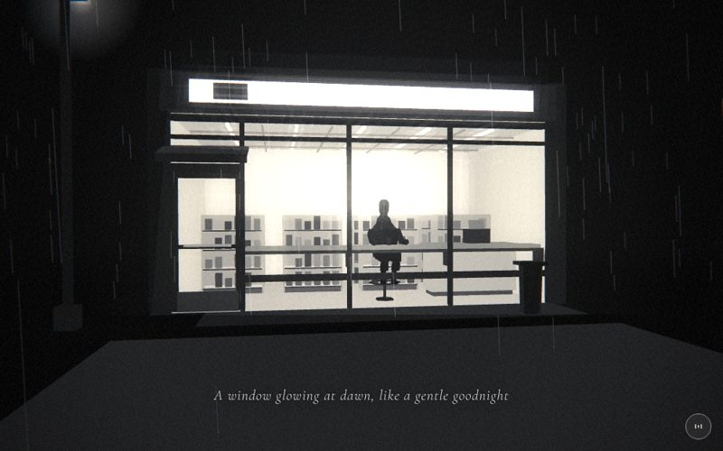

# 08 · store



> "A window glowing at dawn, like a gentle goodnight"
> Source: `src/app.js`, banner `/* 8 — 3 a.m. convenience store: the brightest window in the city */` · group: street-props · before/after: [sheet](../../assets/model-polish/street-props.jpg)

## At a glance
| | |
|---|---|
| Setting | Exterior at night: a dark rainy street seen from across the road, looking into a lit open-front convenience store (Hopper staging). The shop is a self-lit box behind mullions; there is no glass mesh |
| Tone | Dark. `bg:'#060606'`, `scene.background` 0x060606, `dark:()=>true` for the whole scene (white caption, strong grain and vignette). Dip: subway fades into `#060606` for its t > .9 and this scene fades out of it for t < .1; for t > .9 it fades to towers' `#f5f5f5` (black-to-white dip) |
| Hero | Sit, as a pure silhouette at the window counter, facing +z (toward the street and camera). `makePerson()` at (.4, −.04, −.68), `sit()`, then both `arms` x −.97, both `elbows` x −.6, both `knees` x 2.0, both `ankles` x −.5, `head` x .15. Forearms on the window counter, heels on the stool's footrest ring. Holds nothing; a cup stands on the counter in front of him |
| Motion | Scroll drives only the camera dolly. Time drives the rain, a slow cup spin and an occasional sign flicker. The hero is static |
| Camera | `k=ease(t)`. Position `(lerp(-2.4,1.1,k), lerp(1.6,1.35,k), lerp(10,4.6,k))`, `lookAt(lerp(-.2,.4,k), lerp(1.5,1.2,k), -.6)`. A dolly in from across the street, ending a little right of centre. Default fov |
| Budget | scene 4036 tris (v40 2366, 1.71×) · hero 1561 (v40 1093) · 210 meshes incl. the hero's 51 (v40 241) · 1 instanced (163 products) · 1 light (hemi) · 2 sprites · 1 `LineSegments` (rain) · 59 materials (v40 197) |

## Models
`box(w,h,d,mat,x,y,z)` takes the centre position. `bevelBox(w,h,d,b,mat,x,y,z)` is **scene-local** (identical copies sit in `subway`, `rooftop` and `call`): a 4-ring, 8-sided `loft` from y to y+h with chamfer b, 64 tris. Its `y` is the **bottom**, not the centre.

The shop interior and front are children of the group `sh`, which sits at `position.y = PV = .12` (on the pavement). For `sh` children, world y = local y + .12. Everything added straight to `scene` (stool, hero, cup, bin, lamp, pavement spill) adds `PV` by hand; the road spill sits on the road at y .012.

Nearly every set piece is `B()` (unlit `MeshBasicMaterial`). The only lit (`M`) meshes are the ground, pavement, kerb, cup and hero, and the only light is a weak hemisphere light. This is what keeps the outside and the hero dark against the self-lit interior.

### Street
| Model | Built with | Geometry | Tone | Placement / contact | Notes |
|---|---|---|---|---|---|
| Road | `ground(0x101010)` | Plane 400 × 400, 2 tris | `0x101010`, lit (`M`, FrontSide) | y 0 | The road between the camera and the kerb |
| Pavement | `box(W+2.6,PV,5,M(0x1a1a1a),0,PV/2,-1.2)` | Box 8.6 × .12 × 5 | `0x1a1a1a`, lit | x ±4.3, y 0–.12, z −3.7…1.3 | The shop floor stands on it |
| Kerb stone | `box(W+2.6,PV+.01,.13,M(0x2e2e2e),0,PV/2+.005,1.245)` | Box | `0x2e2e2e`, lit | y 0–.13, z 1.18–1.31 | .01 taller and .01 proud of the pavement front, so no coplanar faces |
| Road spill | `PlaneGeometry(W+1,4.6)` | Plane 7 × 4.6 | `B(0xffffff)`, opacity .14, `depthWrite:false` | Flat at y .012, z 1.3…5.9 (in front of the kerb) | The shop's light on the wet road |
| Pavement spill | `PlaneGeometry(W-.4,1.2)` | Plane 5.6 × 1.2 | `B(0xffffff)`, opacity .1, `depthWrite:false` | Flat at y .124 (.004 above the pavement top), centre (.3, .62) | Added in v41 |
| Window glow | `glow(9,.22)` | additive sprite | white | (0, 1.6, .6), just in front of the shop front | Blooms the whole window |
| Street lamp | `lamp` group at (−4.1, PV, 1.0): plinth `box(.26,.3,.26,B(0x161616))`, post `box(.1,4.1,.1,B(0x121212),0,2.2,0)`, head `box(.34,.12,.22,B(0x1e1e1e),.1,4.3,0)` | 3 boxes | `0x161616` / `0x121212` / `0x1e1e1e` | Plinth x −4.23…−3.97 on the pavement (edge at −4.3), outside the left pilaster. Post reaches world y 4.37 | v40 had a bare `.08` post at x −4.5 on the road. Round 1 moved the group from x −4.4 to −4.1 so the plinth no longer hangs off the pavement |
| Lamp glow | `glow(1.6,.6)` | sprite | white | (−3.9, 4.37, 1.0), under the lamp head | The bright spot at the top left of the frame |
| Bin | `CylinderGeometry(.17,.15,.72,6)` + lid `box(.38,.05,.38)` | 6-sided cylinder, 24 tris + box | both `B(0x121212)` | (2.3, y .12–.84, .9), in front of the right window bay near the kerb; lid y .84–.89 | One tone on purpose, so the lid never reads as a lit slab. Silhouetted against the glass for the whole dolly |
| Rain | `rain(700,18,12)`, `position.z = 3` | `LineSegments`, 700 strokes | white, opacity .25 | 18 × 18 area centred on z 3 | Not a mesh; counted under "lines" |

### Shop shell (in `sh`; y values local)
| Model | Built with | Geometry | Tone | Placement / contact | Notes |
|---|---|---|---|---|---|
| Back wall | `box(W,H,.1,B(0xdcdcd8),0,H/2,-D)` | Box 6 × 3 × .1 | `0xdcdcd8` | z −3.6 | The brightest step of the tone ladder |
| Side walls × 2 | `box(.1,H,D,B(0xc8c8c4),±W/2,H/2,-D/2)` | Box | `0xc8c8c4` | x ±3, z −3.6…0 | Middle step |
| Ceiling slab | `box(W,.1,D,B(0xb0b0ac),0,H,-D/2)` | Box | `0xb0b0ac` | y 2.95–3.05 | Darkest step |
| Floor | `box(W,.02,D,B(0xb4b4b0),0,.01,-D/2)` | Box | `0xb4b4b0` | y 0–.02 (world .12–.14), on the pavement top | |
| Ceiling tubes × 5 | `box(.05,.06,D-.6,B(0xffffff),x,H-.07,-D/2)` | Box | `0xffffff` | x = −2.2…2.2 every 1.1, y 2.90–2.96 | |
| Ceiling grid × 7 | 4 bars `box(.03,.03,D-.3,B(0x8a8a86),x,H-.115,-D/2)` at x ±.55, ±1.65; 3 bars `box(W-.3,.03,.03,…)` at z −.9, −1.8, −2.7 | Box | `0x8a8a86` | y 2.87–2.90, just under the tubes | Round 1 moved them out of the slab |

### Interior fittings (in `sh`)
| Model | Built with | Geometry | Tone | Placement / contact | Notes |
|---|---|---|---|---|---|
| Gondolas × 8 | per gondola: back panel `box(1.1,1.5,.04,pb,x,.75,z-.19)`, two sides `box(.03,1.5,.42,pb,x±.55,.75,z)`, kick `box(1.08,.1,.38,pk,x,.05,z)` | 4 boxes each | `pb` `0xa0a09c`, `pk` `0x505050` | Rows at z −3.3 and −2.1; x = −2.25, −.75, .75, 2.25 | Visible behind him through the window bays |
| Shelf boards × 32 | `box(1.08,.03,.42,ps,x,y,z)` + edge strip `box(1.08,.025,.03,pe,x,y,z+.225)` | 2 boxes each | `ps` `0xc8c8c4`, `pe` `0x3a3a3a` | 4 per gondola at y .12, .48, .84, 1.2 | The edge strip is .03 deep and stands .03 proud of the board front (depth rule) |
| Products | `InstancedMesh(BoxGeometry(.12,1,.1), B(0xffffff), 163)`, scaled per instance to height h | 12 tris × 163 = 1956 (the heaviest item in the scene) | per-instance `setColorAt` from `0x3a3a3a`, `0x525252`, `0x6a6a6a`, `0x848484` | 6 slots per board at `x-.45+k*.18`, 82 % filled; h ∈ {.16, .21, .26}; bottom on the board top; z+.05 | Replaces v40's 163 separate product boxes, each with its own material. Driven by `rng(31)` (see Editing notes) |
| Cash counter | body `box(1.6,.8,.6,B(0xa8a8a4),2.1,.5,-1.2)`, top `box(1.7,.06,.7,B(0x7a7a76),2.1,.93,-1.2)`, kick `box(1.5,.1,.5,B(0x404040),2.1,.05,-1.2)` | 3 boxes | `0xa8a8a4` / `0x7a7a76` / `0x404040` | Right of the room, body y .1–.9, top .9–.96 | Kick exposed under the body (round 1) |
| Register + screen | `box(.42,.26,.3,B(0x202020),2.25,1.09,-1.2)`; `scr = box(.3,.18,.02,B(0x707070),2.25,1.3,-1.2)`, `rotation.x = -.3` | 2 boxes | `0x202020`, `0x707070` | On the counter top (.96), the screen above it, tilted | |

### Shop front (in `sh`, `fr = B(0x121212)` unless noted)
| Model | Built with | Geometry | Tone | Placement / contact | Notes |
|---|---|---|---|---|---|
| Pilasters × 2 | `box(.3,H+.64,.3,fr,±(W/2+.15),(H+.64)/2,-.02)` | Box | `0x121212` | x ±3.15, y 0–3.64, framing the front and the sign | |
| Mullions × 3 | `box(.07,H,.07,fr,x,H/2,0)` | Box | `0x121212` | x = −1.95, −.3, 1.35 | −1.95 separates the door bay from the window bays |
| Head rail, upper glazing bar, sill rail | `box(W,.1,.08,fr,0,H-.05,0)`, `box(W,.06,.07,fr,0,H-.34,0)`, `box(4.95,.1,.1,fr,.525,.5,0)` | 3 boxes | `0x121212` | y 2.95, 2.66; the sill rail at y .5 spans the window bays only (x −1.95…3.0) | From the dolly, the sill rail hides most of the stool's footrest |
| Door bay | header `box(1.05,.12,.08,fr,-2.475,2.2,0)`; jambs `box(.1,2.14,.05,fr,-2.95,1.09,0)`, `box(.06,2.14,.05,fr,-2.02,1.09,0)`; top rail y 2.09; mid rail y 1.0; kick plate `box(.9,.3,.05,B(0x262626),-2.46,.17,.03)`; push bar `box(.7,.04,.04,B(0x8a8a8a),-2.46,1.02,.06)` | 7 boxes | `0x121212`, kick `0x262626`, bar `0x8a8a8a` | Left bay, x −3…−1.95 | The kick plate stands .03 proud of the stiles. The lighter push bar is the door's only highlight |
| Awning + valance | `aw = box(1.25,.04,.62,B(0x2e2e2e),-2.47,2.42,.3)`, `rotation.x = .3`; `box(1.25,.12,.03,B(0x1c1c1c),-2.47,2.28,.6)` | 2 boxes | `0x2e2e2e`, `0x1c1c1c` | Over the door, sloping down toward the street | |
| Sign box | `bevelBox(W+.3,.6,.34,.03,B(0x1a1a1a),0,H+.02,-.02)` | 8-sided loft, 64 tris | `0x1a1a1a` | y 3.02–3.62, x ±3.15, front face z .15 | v40 had a flat band |
| Sign face | `sign = Mesh(PlaneGeometry(W-.6,.34),B(0xffffff))` at (0, H+.32, .18) | Plane 5.4 × .34 | white, colour animated | .03 in front of the box | The `sign` variable and its flicker are unchanged since v40; the plane was v40's 5.7 × .32 at (0, 3.25, .07). Blank, **no text** |
| Sign mark | `box(.5,.24,.02,B(0x303030),-W/2+.9,H+.32,.2)` | Box | `0x303030` | x −2.1, on the left of the sign, front face .03 in front of the sign plane | The single dark logo-like block. No text |

### Window seat
| Model | Built with | Geometry | Tone | Placement / contact | Notes |
|---|---|---|---|---|---|
| Window counter | `bevelBox(CW=4.9,.06,.45,.015,B(0x7a7a76),CX=.52,.92,-.25)` | 8-sided loft, 64 tris | `0x7a7a76` | World y 1.04–1.10, x −1.93…2.97 (window bays only), z −.475…−.025 | Forearm undersides 1.096 / 1.102 vs the top at 1.10 (street-props round-1 measurement) |
| Counter lip | `box(CW,.05,.03,B(0x262626),CX,.895,-.04)` | Box | `0x262626` | Under the counter's front edge | |
| Brackets × 3 | `box(.05,.28,.3,B(0x202020),x,.78,-.15)` | Box | `0x202020` | x = −.3, 1.35 (behind the mullions), 2.95; up to the counter's underside | |
| Stool | `stool` group at (.4, PV+.02, −.68), `sm = B(0x161616)`: seat `loft([[.7,.34,.34],[.75,.36,.36]],sm,{sides:6})`, base `loft([[0,.34,.34],[.03,.3,.3]],…)`, post `CylinderGeometry(.025,.025,.7,6)`, footrest `TorusGeometry(.265,.015,4,8)` (`rotation.x = π/2`, y .30) | two 6-sided lofts (24 tris each), cylinder 24, torus 64 | `0x161616` | Base world .14–.17 on the floor slab; seat top world .89; ring tube top .455 | His soles at .458 rest on the ring (round 1). Hexagonal on purpose (≤ 8 sides) |
| Hero | `makePerson()` + pose (see At a glance) | hero rig, 1561 tris | default trousers `0x2a2a2a`, coat `0x3a3a3a` | (.4, −.04, −.68): seat top .89, so his origin is .93 below it | Lit only by the hemisphere light, so he reads as a silhouette |
| Cup | `CylinderGeometry(.04,.032,.12,8)`, `M(0xeeeeee)` | 8-sided, 32 tris | `0xeeeeee`, lit | (.4, 1.16, −.3): base on the counter top (1.10), right in front of him | Spins slowly. One of the few lit props here |

## Lights and atmosphere
- **Only one light:** `HemisphereLight(0x555555, 0x050505, .35)`. There is no `lights()` call, so there is no key light, no rim light and no shadow-casting light. The `castShadow` flags that `buildAll()` sets do nothing here.
- **Light comes from the materials.** The interior, the products and the sign are `B()` (unlit). Their tones are absolute, with the ladder ceiling `0xb0` < side walls `0xc8` < back wall `0xdc`, plus darker shelf backs `0xa0` and products `0x3a–0x84`. This ladder keeps the shapes legible after the film pass's glow blooms the window.
- **Fog:** `Fog(0x060606, 8, 30)`. At the start (camera z 10) the shop is roughly 10–14 units away, so it is slightly fogged. It clears as the camera dollies in (approx.). `B` materials take fog too.
- **Sprites:** the window glow `glow(9,.22)` and the lamp glow `glow(1.6,.6)`.
- **Spill planes:** two transparent white `B` planes with normal blending, opacity .14 on the road and .1 on the pavement. They read as light on wet ground.
- **Rain:** `rain(700,18,12)`, 700 white strokes at opacity .25, centred 3 units toward the camera.
- **Film pass:** `dark` is always 1, so the vignette and grain are strong. The bright interior (white tubes, back wall `0xdc`) is above the glow threshold (0.8), so the window blooms. That is intended (the audit says keep the Hopper idea).

## Animation (`update(t, time)`)
| What | Driver | Formula |
|---|---|---|
| Rain | time | `rn.position.y = -(time*8 % 14) + 3`: falls and wraps every 1.75 s |
| Cup | time | `cup.rotation.y = time*.2` (barely visible on an 8-sided cup) |
| Sign flicker | time | `sign.material.color.setScalar(.92 + sin(13·time)·.03·gate)`, where `gate = 1` only while `sin(.7·time) > .8`. Steady at .92 most of the time, with a short ±.03 flicker now and then |
| Camera | scroll | the eased dolly from the At-a-glance table, plus the global handheld drift |

Nothing else moves, and the hero has no idle motion.

## v40 → v41
Source: [model-polish/street-props.md](../model-polish/street-props.md) ("8 — store" and "Round 1"). Audit priority HIGH ([audit](../model-polish/audit.md)). The audit's problems: the interior melted into white blobs, his feet dangled, the counter slab cut through his hands, the sign band was empty, and there was no door, kerb or outside props.
- **Interior:**
  - v40 was all near-white `B` (`0xf3f3f0`, `0xe4e4e0`, `0xdcdcd8`, `0xd2d2ce`), with solid `0xc4c4c0` shelf blocks and 163 product boxes (192 slots, 80 % filled), each with its own `B()` material from `0x8a8a8a` to `0xbdbdbd` (197 materials in the scene).
  - v41 uses the tone ladder, a ceiling grid, gondolas with boards and dark edge strips, and the products as **one** `InstancedMesh` (materials 197 → 59, meshes 241 → 210).
- **Shop front:**
  - v40: five `.06` mullions every 1.5, a low `.06` rail at y .5 and a flat sign band `box(W,.5,.12,M(0x1c1c1c))`.
  - v41: pilasters, three mullions, a head rail, an upper glazing bar and a sill rail; a door bay with jambs, rails, a kick plate and a push bar; an awning with a valance; and a bevelled sign box with one dark mark (no text).
- **Ground contact:**
  - v40 stood the shop on the road at y 0.
  - v41 adds a `.12` pavement with a kerb stone (the shop group is raised by `PV`), a pavement spill, a lamp plinth and head, and a bin.
- **Window seat:**
  - v40 was a flat `box(W-.4,.05,.45,M(0x8a8a8a),0,1.05,-.25)` and a square-seat stool on a stick, with the hero at (.4, −.23, −.55), arms −1.0 and elbows −.9.
  - v41 has a bevelled counter on brackets with a lip, and a hexagonal stool with a footrest ring.
  - The hero moved to (.4, −.04, −.68), arms −.97, elbows −.6, and knees 2.0 / ankles −.5 put his heels on the ring. The cup moved from (.4, 1.14, −.18) to (.4, 1.16, −.3) onto the new counter.
- **Round 1:**
  - the lamp moved to x −4.1 (the plinth was floating off the pavement)
  - the ring was set to radius .265 at y .30 so the soles really rest on it; the stool, hero and counter were raised .02
  - the bin moved in front of the right bay and got a one-tone lid
  - the sign plane and mark were set .03 apart and the sign box's top plate was deleted
  - the ceiling grid was moved out of the slab, the gondola edge strips set .03 proud and the kerb .01 proud
- **Triangles:** 2366 → 4036 scene tris (1.71×, hero excluded, inventory). The group notes quote 3459 → 5129, which includes the old 1093-tri hero.
- **Other small moves:** the road spill went from 7 × 5 at z 2.4 to 7 × 4.6 at z 3.6, so it starts at the kerb. The window glow went from `glow(9,.25)` to `glow(9,.22)`. The lamp glow went from (−4.3, 4.2, 2.2) to (−3.9, 4.37, 1.0).
- **Untouched on purpose:** the camera, `key/bg/dark`, the caption, the rain and the `sign` flicker.

## Editing notes
- **Keep the Hopper silhouette.** The audit's do-not-touch list is the dolly from across the street, the silhouette idea, the rain and the spill. No light was added in front of him on purpose. A `lights()` call or a point light near the window would light his front and break the image.
- **Interior tones are the legibility.** Because the interior is unlit `B`, raising tones toward white brings back v40's "white blobs" under the film-pass glow. Keep the ladder: ceiling < side walls < back wall, with dark accents (`0x3a` strips, `0x50` kicks, products `0x3a–0x84`).
- **Local vs world y.** `sh` sits at y .12. Shop children use local y. The stool, hero, cup, bin, lamp and pavement spill are in `scene` and add `PV` by hand (the road spill does not). Mixing these up floats or sinks things by 12 cm.
- **Contact points (measured by street-props before the hero merge):**
  - forearm undersides 1.096 / 1.102 vs the counter top 1.10
  - soles .458 vs the footrest tube top .455, with the tube under the heels
  - the cup's base on the counter top
  - The hero group later moved the shoulder pivots in to x ±.23 but kept their height (1.36), and shortened the seat piece so nothing hangs under the stool ([hero.md](../model-polish/hero.md)). Re-check the forearms and heels in a close crop after any rig change.
- The pose (arms −.97, elbows −.6, knees 2.0, ankles −.5, head .15) is mirrored in CHARACTER.md's pose table; keep both in step.
- **Known visual limits** (street-props concerns, not fixed):
  - from the dolly, the footrest ring is mostly hidden behind the sill rail
  - the forearms read as part of the silhouette rather than as separate arms
- **Depth (16-bit target):**
  - Trim already follows the ≥ .03 rule: the sign face and mark, the gondola edge strips and the door kick plate. The kerb stone is a solid block only .01 taller and .01 proud of the pavement; that is enough to avoid coplanar faces, but it is not a ≥ .03 step.
  - Near-misses to watch: the pavement spill is only .004 above the pavement top and the road spill .012 above the road. Both are transparent with `depthWrite:false`. If they speckle at the start of the dolly (about 10 units away), raise them to ≥ .03 or give them `depthTest:false` and a `renderOrder`.
  - Grid bars touch the tube bottoms at y 2.90, but they face the opposite way, so nothing fights.
- **`rng(31)` order:** for every gondola → board → slot, the loop draws `r()` for "filled?", then height, then tone. Changing the gondola or shelf loops, or the fill probability, reshuffles every product. Add new random detail with a separate `rng(seed)`.
- **No glass mesh.** The "window" is mullions and rails in front of an open box. A transparent pane would need `depthWrite:false` and would dim the glow. Don't add one casually.
- **Caption band** (t .12–.75, lower middle): only the pavement and road are there (see the key shot). Keep new outside props to the sides, like the bin (right bay) and the lamp (far left).
- **Owner rules:**
  - the sign and the mark stay blank (any site text is English and an owner decision)
  - no faces
  - no flower props here (the owner kept daisies only in scenes 2, 4 and 17)
  - the caption is quoted verbatim, even though the banner says "3 a.m." and the caption says "dawn"
- **Budget:** 1.71× v40. The 163 products (1956 tris) are the biggest single item. New detail should be instanced or replace something.
- **Idea (ROADMAP, Engineering → Audio):** per-scene rain noise for `flood` / `call` / `store`. It must be generated with WebAudio, not loaded from a file.

## Check it
```bash
NODE_PATH=/opt/node-tools/node_modules WAIT=9000 node tools/shots.js 7.9 8.35 8.65 8.85
```
- **8.35:** the wide shot. Check the lamp plinth on the pavement, the bin against the right bay, the sign mark and face (no banding), the pavement spill (no speckle) and the caption over the pavement only.
- **8.65:** the closer shot. Crop his figure at 2–3× and check the forearms on the counter (not sunk in), the heels on the ring, the cup on the counter, and that the shelves and products read as shapes, not blobs.
- **8.85:** the end of the dolly before the white dip. The bin should still be silhouetted, and the counter should not seem to run through the pilaster.
- Pose only: `tools/pose.html` (edit `POSE` to the store values) to see the sit pose from the side, since the scene camera hides the heels.
