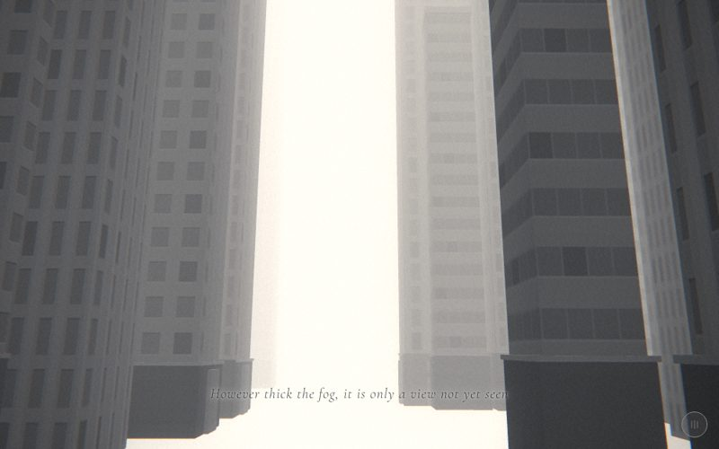

# 09 · towers

> "However thick the fog, it is only a view not yet seen"
> Source: `src/app.js`, banner `/* 9 — a forest of towers in the white haze */` · group: city · before/after: [sheet](../../assets/model-polish/city.jpg)

## At a glance
| | |
|---|---|
| Setting | Exterior, day, thick white haze. A forest of tall, narrow grey towers on both sides of an empty avenue (\|x\| < 4.5). The camera glides up the avenue, looking up. No street, no props |
| Tone | Light. `bg:'#f5f5f5'`; the background, the fog and the unlit ground are all `0xf5f5f5`, so there is no horizon line. `dark:()=>false`, so the caption is black with a white halo. Dips: the scene opens out of `#f5f5f5` (after the dark store scene), and for t > .9 it fades to umbrellas' `#c9c9c9` |
| Hero | **Absent.** It is a camera-only scene. The audit's "do not touch" list includes the absence of the hero, while the ROADMAP suggests a tiny figure for scale. That is an owner decision |
| Motion | Camera only. Scroll drives the camera; nothing in the scene moves and `time` is unused |
| Camera | `z = 12 - 30t`. Position `(sin(4t)·.5, 1.7+2t, z)`, `lookAt(sin(4t+.6)·.6, lerp(3,9,t), z-12)`. That gives (0, 1.7, 12) looking at (.34, 3, 0) at t=0; (.45, 2.7, −3) looking at (.31, 6, −15) at t=.5; and (−.38, 3.7, −18) looking at (−.60, 9, −30) at t=1. It travels 30 units down the avenue, rises 2, weaves ±.5, and its pitch goes from about 6° to about 24° up. Default fov |
| Budget | scene 1742 tris (v40 614) · no hero · 135 meshes · 11 instanced (33 instances) · 3 lights |

## Models
The counts come from replaying the `rng(21)` / `rng(22)` loop and match the inventory exactly. Triangle split: facades 51 × 12 = 612 · lips 21 × 12 = 252 · podium and cap 20 × 24 = 480 · doors 11 × 12 = 132 · fins 33 × 8 = 264 · ground 2.

| Model | Built with | Geometry | Tone | Placement / contact | Notes |
|---|---|---|---|---|---|
| Ground | `ground(0xf5f5f5)` with `g.material = B(0xf5f5f5)` | `PlaneGeometry(400,400)`, 2 tris | `0xf5f5f5`, **unlit** | y = 0 | Unlit, so it matches the fog and the background exactly. Only the towers' dark podiums show where the ground is |
| Towers ×51 | `building(w,h,d,false,{col:0x6a6a6a, front:[x<0?1:-1,0], piers, lobby:near, lip:h<32})` in an 80-iteration loop that skips \|x\| < 4.5 (29 skipped) | facade box, 12 tris | day facade tiles tinted `0x6a6a6a` (mid grey). Variants 17/21/13 | x within ±20 (\|x\| ≥ 4.5), z 14 to −56. w 1.5–4.5, d 1.5–4.5, h 15.5–51.6. Base on y = 0; only x and z are set | `front` is the face toward the avenue (+x for towers at x < 0, −x for those at x > 0). `near` = \|x\| < 9 (23 towers) |
| Podium + cap strip ×20 | `building()` lobby, on 20 of the 23 near towers | podium `(w+.2) × band × (d+.2)`, band 1.61–2.92; cap `(w+.3) × .1 × (d+.3)` | podium `C(.55/.6/.65)` of `0x6a6a6a` = `0x3a3a3a` / `0x3f3f3f` / `0x444444`; cap `0x616161` | Base on y 0, 10 cm proud | `renderOrder 1`. These are the dark blocks at the bottom of the frame in the t=.5 shot |
| Doors ×11 | `building()` | box `1 × dh × .12`, `dh = min(2, band−.25)` | `0x525252`, FrontSide | On the avenue face, 1 cm in front of the podium | `renderOrder 2`. All single: the front width is `d` ≤ 4.5, so no double door or canopy |
| Facade fins ×33 (11 `InstancedMesh`es × 3) | `building()` `piers` → `finGeo(h−band)` | 8 tris each, `.14 × (h−band) × .14`, open back | `0x616161` (`cityTones` lip of `0x6a6a6a`) | On the avenue face, from the podium top to the roof | Near towers with w > 2.4 and `r2 < .65`. `renderOrder 1`. They catch the light as the camera rises past |
| Parapet lips ×21 | `building()` `lip` (only `h < 32`) | box `(w+2o) × .35 × (d+2o)`, `o = min(.12, .03w, .03d)` | `0x616161` | Roof edge | Towers ≥ 32 tall get no lip: their tops are lost in the haze or above the frame |
| Background | `scene.background = Color(0xf5f5f5)` | — | `0xf5f5f5` | — | Same as the fog |

There is no setback, roof furniture or street furniture in this scene. Round 0 had setbacks and masts; round 1 removed them because they sat above the frame.

## Lights and atmosphere
- `lights(scene,{hemi:[0xffffff,0x999999,.9], dir:[0xffffff,.4,[3,6,2]]})`:
  - `HemisphereLight(0xffffff, 0x999999, .9)`: a lighter ground colour than the default `0x777777`, so the shaded faces stay pale
  - key `DirectionalLight(0xffffff, .4)` from (3,6,2), normalised × 20 = (8.57, 17.14, 5.71)
  - rim `.18` at (−3, 3.6, −6)
- **Shadows:** the doors (1 × ≤ 2) are the only meshes small enough to cast them. The shadow box (±14 around the origin) covers only part of the 30-unit path.
- `Fog(0xf5f5f5, 3, 45)`: very short. Fog starts 3 units from the camera, and towers more than 45 units away are pure white. This haze is the subject of the scene.
- No particles, sprites or glows. The film pass runs in light mode.

## Animation (`update(t, time)`)
- **Scroll-driven:** only the camera (the formulas above). The weave `sin(4t)` and the lookAt's `sin(4t+.6)` are out of phase, so the view drifts gently left and right while rising.
- **Time-driven:** nothing in the scene. `frame()` adds the global handheld drift.

## v40 → v41
See [model-polish/city.md](../model-polish/city.md): round 0, round 1 blockers 1 and 5.
- **Layout:** the same 51 towers (`rng(21)` keeps its draws). The v41 options draw from a new `rng(22)`.
- **Facades:** hero-scale floors (1.1) and three variants, where v40 used one tile.
- **Added on the near towers** (\|x\| < 9): podiums with doors, and 3 instanced fins on the avenue face. Parapet lips on towers under 32.
- **Round 0 → round 1:**
  - Round 0 was 5570 tris, with lips on every tower and setbacks and masts. Round 1 dropped the lips on towers ≥ 32 and removed the setbacks and masts that were above the frame.
  - The two bare `r2(); r2();` after the `piers` draw stand in for the removed setback and mast draws (code comment: "same r2 draws as before").
- **Z-fighting blocker** (found in this scene's podium close-ups): the podiums and doors striped against the facade in the 16-bit depth target. Fixed in `building()` with draw order (`renderOrder` 1 and 2) **and** real offsets: podium 10 cm proud, door back face 1 cm in front of the podium.
- **Triangles:** 614 → 1742 (2.8×). The notes' table gives the same numbers, because there is no hero here. The rule says roughly 2×; the notes accept 2.8× because v40 was 51 plain slabs.

## Editing notes
- **The avenue must stay clear** (\|x\| < 4.5). The camera weaves ±.5 and its lookAt ±.6. A tower in the gap would put the camera inside it.
- **Draw order:**
  - The `continue` for \|x\| < 4.5 comes after the x and z draws but before w, h and d, so a skipped iteration consumes only two `r()` values.
  - `piers = near && w>2.4 && r2()<.65` short-circuits, and is followed by two fixed `r2()` calls.
  - Adding, removing or reordering any of these draws reshuffles the whole forest.
- **Don't set y after `building()`.** Set only x and z.
- **Lips only on `h < 32`:** the polish kept parapets only where the camera can see a top. If you raise the camera, lengthen the climb or thin the fog, check the tops of the taller towers: they have no parapet.
- **Ground cue:** the ground is unlit and the same colour as the fog. Ground contact (owner rule: no floating buildings) comes from the dark podiums meeting the white plane. Keep the podiums on the near towers.
- **Caption band** (t .12–.75, lower middle): in the t=.5 shot the caption crosses the dark podium bands at the bottom of the frame. It is still legible in that shot, thanks to the white halo. Don't add darker or busier things there.
- **16-bit depth:** the podiums are 10–30 m from the camera, where the depth step is about 3–27 cm. Beyond about 18 m the 10 cm podium offset is less than one step and only `renderOrder` decides, so keep `renderOrder` on anything you add to a tower.
- **Ideas from the audit, not done:** L-plans (20 % two-box plans), slender towers with a stub, and one or two sky-bridges well above the camera path.
- `building()` is shared with scenes 1, 5, 6, 16, 17 and 20. Changes there show up here.

## Check it
- Shots, with a lead-in from the end of scene 8:
  `NODE_PATH=/opt/node-tools/node_modules WAIT=12000 node tools/shots.js 8.9 9.35 9.65 9.85`
- What to look at:
  - the podiums are solid (no horizontal stripes) at the bottom of the frame; crop them at 3×
  - the fins sit on the facade without flicker
  - no tower crosses the avenue
  - the caption reads over the podiums
  - near t .85, no tower top without a parapet comes into view
- **Budget:** `node tools/inventory.js`, then compare the `towers` row with `docs/data/inventory-v41.json`.
