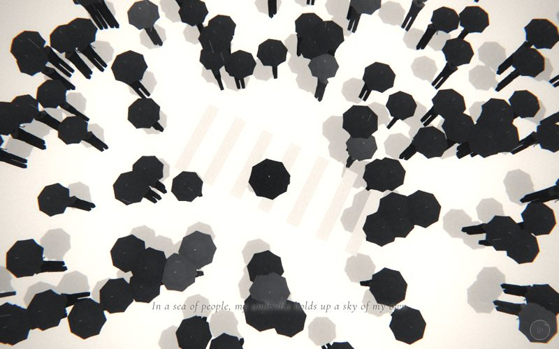

# 10 · umbrellas



> "In a sea of people, my umbrella holds up a sky of my own"
> Source: `src/app.js`, banner `/* 10 — from above: a crowd of identical black umbrellas */` · group: street-props · before/after: [sheet](../../assets/model-polish/street-props.jpg)

## At a glance
| | |
|---|---|
| Setting | Exterior, a pale grey street crossing in the rain, seen from high above. 160 people with black umbrellas stream along ±z across a zebra crossing, and he stands still in the middle |
| Tone | Light. `bg:'#c9c9c9'`, `scene.background` 0xc9c9c9, `dark:()=>false` for the whole scene (black caption with a white halo, weak grain and vignette). Dip: towers fades into `#c9c9c9` for its t > .9 and this scene fades out of it for t < .1; for t > .9 it fades to flip's `#eeeeee` |
| Hero | Stand, in the rest pose, holding his umbrella up in his **right** hand. `makePerson()` at (.1, 0, .2), `rotation.y = .3`. Rig calls: `arms[0].rotation.x = -.3`, `elbows[0].rotation.x = -2.25`, `hands[0].userData.grip(1)`. The umbrella (`uc` canopy + `us` shaft/hook) is placed at his fist. Only the canopy twirls |
| Motion | Time drives the crowd flow (each person slides along ±z and wraps), the twirl of his canopy and the rain. Scroll drives only the camera |
| Camera | Position `(lerp(.4,2.5,t), lerp(16,6,ease(t)), lerp(.6,7,ease(t)))`, `lookAt(.1,1.5,.2)` (fixed on him). It starts almost straight down from 16 units and ends oblique, 6 up and 7 back. x uses linear `t`; y and z use `ease(t)`. Default fov |
| Budget | scene **22558 tris (v40 3950, 5.7×), the heaviest scene on the site.** The next is `field` at 7710, and umbrellas is about a quarter of the 88588 tris of all 24 scenes. 22400 of it is the crowd: 160 instances × 140 tris of one merged umbrella + figure geometry · hero 1561 (v40 0: there was no figure, only a cone) · 62 meshes incl. the hero's 51 (v40 10) · 1 instanced (160) · 3 lights (hemi, key, rim) · 1 `LineSegments` (rain) |

## Models
`merge(parts)`, `canopyGeo(R,h)` and `tubeGeo(pts,r)` are **scene-local** helpers inside `build()`:
- **`merge(parts)`:** takes `[geometry, tone, matrix?]` triples and de-indexes them. It writes one grey per part as a vertex colour (tone `null` keeps the part's own colour attribute) and returns one flat-normal `BufferGeometry`.
- **`canopyGeo(R,h)`:** 8 gores of 4 triangles each, 32 tris. Each gore has an apex at (0, h, 0), an inner ring on the ribs at radius .52R and height .6h, and a hem on the ribs at radius R and y 0. The mid-gore hem point is pulled in to .9R and up .03, which makes the scalloped hem and a ridge along every rib.
- **`tubeGeo(pts,r)`:** a 4-sided tube along points, 8 tris per segment.
- **`sq` / `nc`:** `loftGeo` options, 4 sides rotated π/4. `sq` has caps; `nc` has `caps:false`.

### Crowd (`crowd`, one `InstancedMesh`, `N = 160`)
Material: `M(0xffffff,{vertexColors:true})` (lit, flat, double-sided). The greys come from the vertex colours, multiplied by the instance colour. The renderer has no sRGB output encoding, so a vertex grey of .11 shows as about `#1c`.

| Part (per person) | Built with | Tris | Vertex grey | Placement (instance-local, scale 1) | Notes |
|---|---|---|---|---|---|
| Legs × 2 | `loftGeo([[0,.15,.17,0,0,∓.085],[.88,.16,.18,0,0,∓.085]],nc)` | 8 + 8 | .12 | y 0–.88, centres x ±.085, about .06 apart | Square in plan (4 sides rotated π/4); no caps |
| Torso | `loftGeo([[.84,.3,.21],[1.3,.38,.24],[1.48,.46,.26],[1.56,.18,.14]],{sides:6,caps:false})` | 36 | .12 | y .84–1.56; widest (.46) at 1.48, then a shoulder step in to the .18 neck at 1.56 | Overlaps the leg tops |
| Head | `loftGeo([[1.52,.13,.13],[1.62,.19,.2],[1.76,.13,.15]],{sides:6,caps:false})` | 24 | .13 | y 1.52–1.76 | Faceless; the open top is hidden under the canopy |
| Canopy | `canopyGeo(.5,.3)` | 32 | .11 (≈ `#1c`) | Hem at y 2.0, apex 2.3, offset (.17, 2.0, .1) from the body axis | Two tiers with rib ridges (the art director asked to keep them) |
| Ferrule | `loftGeo([[h-.01,.03,.03],[h+.1,.014,.014]],nc)` | 8 | .42 | y 2.29–2.40, starting just inside the apex (2.3) | The light dot seen from above |
| Shaft | `loftGeo([[-.74,.03,.03],[h,.03,.03]],nc)` | 8 | .26 | y 1.26–2.3 | Clears the shoulder hull by .022 (round 1) |
| Hook (J handle) | `tubeGeo(hook,.013)`, `hook` = 3 points (0, −.74, 0) → (0, −.79, .05) → (0, −.74, .1) | 16 | .2 | Below the shaft, down to y 1.21 | Two segments since round 1 |
| **Total** | `crowdGeo = merge([[bodyGeo,null],[umbrellaGeo(.5,.3,.11),null,translate(.17,2.0,.1)]])` | **140** (body 76 + umbrella 64) | | × 160 = 22400 | `crowd.castShadow = true` is set by hand, because `buildAll()` skips instanced meshes. The crowd does not receive shadows |

**Per-instance data** (`U[i]` from `rng(66)`, drawn in this order per person):
- x ∈ (−8, 8) and start z ∈ (−11, 11)
- speed `v = ±(.8…1.4)`
- heading `rot` ∈ [0, 2π)
- lean `tilt` ±.05 rad about x
- scale `s` .9–1.06
- then one more `r()` for the colour: `setColorAt(i, setScalar(r()<.15 ? 1.8 : 1))`, so about 15 % of the crowd is a lighter grey (canopy .11 × 1.8 ≈ `#32`)

### Other models
| Model | Built with | Geometry | Tone | Placement / contact | Notes |
|---|---|---|---|---|---|
| Ground | `ground(0xb8b8b8)` | Plane 400 × 400, 2 tris | `0xb8b8b8`, lit, receives shadows | y 0 | The crowd's shadows land on it |
| Crossing stripes × 7 | `box(.4,.005,2.4,B(0xe6e6e6),i,.004,0)`, i = −3…3 | Box, 12 tris each | `0xe6e6e6`, unlit | x −3…3 every 1, z ±1.2, y .0015–.0065 | Unchanged since v40 (the audit lists them as do-not-touch). Only .0065 proud of the ground (see Editing notes) |
| His canopy `uc` | `merge([[canopyGeo(.58,.33),.075],[loftGeo([[.32,.03,.03],[.44,.014,.014]],sq),.85]])` | 32 + 16 = 48 tris | canopy .075 (≈ `#13`, the blackest), ferrule .85 (pale) | Hem at his fist + .64: world ≈ (−.06, 1.96, .52) (inventory). Apex ≈ 2.29, ferrule to ≈ 2.40 | Larger (R .58 vs .5), darker and pale-tipped, so "my umbrella" reads from above. `rotation.y = time*.2` |
| His shaft + hook `us` | `merge([[loftGeo([[-.74,.03,.03],[.33,.03,.03]],nc),.26],[tubeGeo(hook,.013),.2]])` | 8 + 16 = 24 tris | .26 / .2 | Same position as `uc`, `rotation.y = me.rotation.y`; the shaft runs from 1.22 to 2.29, so the fist (at canopy y − .64) closes on it .1 above the hook | Does not twirl, so the hook stays in the fist |
| Hero | `makePerson()` | hero rig, 1561 tris | default trousers `0x2a2a2a`, coat `0x3a3a3a` | Feet on the ground at (.1, 0, .2), on the crossing | The fist position comes from `hands[0].localToWorld(V3(0,-.05,0))` **once at build**, after `updateMatrixWorld(true)` |
| Rain | `rain(900,24,9)` | `LineSegments`, 900 strokes | white, opacity .25 | 24 × 24 area around the origin | Not a mesh |

Inventory check (v41): crowd 22400, stripes 84, his canopy 48, his shaft 24, ground 2. Total 22558.

## Lights and atmosphere
- `lights(scene,{hemi:[0xffffff,0x777777,.9],dir:[0xffffff,.5,[2,8,1]]})`:
  - a hemisphere light (sky `0xffffff`, ground `0x777777`, .9)
  - a shadow-casting key light at `normalize(2,8,1)·20`, .5, high (about 74° elevation; shadow camera ±14, 1536² map)
  - the automatic rim light at (−2, 4.8, −5), .225 (inventory: 0.23)
- **Shadows:** the crowd (set by hand), the hero's parts and his umbrella (bounding radius < 1.2, `buildAll()`) cast onto the lit ground. The grey octagons beside each canopy in the key shot are these shadows. They are what grounds the crowd in the oblique end frame.
- **Fog:** `Fog(0xc9c9c9, 14, 40)`, the same colour as the background. It barely touches the top view (the ground is about 15–16 units away) and hazes the far crowd at the oblique end (approx.).
- **Rain:** `rain(900,24,9)`, white strokes at opacity .25. They are faint against the light ground.
- **No sprites.** The film pass runs with `dark = 0`: weaker vignette and grain, and a reduced glow.

## Animation (`update(t, time)`)
- **Crowd flow (time):** for each person, `z = ((u.z + time·u.v·.8) % 22 + 33) % 22 − 11`. Everyone slides along ±z at .64–1.12 units/s and wraps at z ±11 (outside the top view).
- **Centre avoidance:** if `|u.x − .1| < 1.25` and `|z − .2| < 1.25`, then `z += 2.5·sign(z − .2)`. This **displaces, it does not steer**. A person crossing the 2.5 × 2.5 square around him pops three times: 2.5 back on entering, 5 forward at the centre line, and 2.5 back on leaving.
- **Matrix:** `m4.compose((u.x, 0, z), Euler(u.tilt, u.rot, 0), (s, s, s))` for all 160 every frame, then `instanceMatrix.needsUpdate = true`. There is no gait: the figures glide, and their random heading `rot` is not tied to the direction of travel.
- **His canopy (time):** `uc.rotation.y = time*.2`. The shaft and hook stay still.
- **Rain (time):** `rn.position.y = -(time*9 % 14) + 4`.
- **Camera (scroll):** see At a glance, plus the global handheld drift.

## v40 → v41
Source: [model-polish/street-props.md](../model-polish/street-props.md) ("10 — umbrellas" and "Round 1"). Audit priority HIGH ([audit](../model-polish/audit.md)). The audit's problem: in the oblique end frame the cones floated at y 1.75 with nothing under them ("floating" is a standing owner rejection), with no tip, ribs or tone variation, and his umbrella was identical to the others.
- **v40:**
  - `InstancedMesh(ConeGeometry(.5,.22,8), M(0x141414), 160)`, 24 tris each (inventory)
  - translated to y `1.75 + (i%3)·.04`, with no rotation, scale or shadows
  - his "umbrella" was the same cone at (.1, 1.8, .2), spinning, and there was no figure at all
- **v41 crowd:**
  - one merged umbrella + figure geometry (140 tris) in a single `InstancedMesh`, with `castShadow` on
  - per-instance heading, ±.05 rad lean, scale .9–1.06, and 15 % lighter instances
- **v41 hero:** a real `makePerson()` holding the biggest, blackest umbrella with a pale ferrule in his right fist (`grip(1)`). Only the canopy twirls.
- **Flow change:** the centre-avoidance radius and jump grew from .95 / 1.9 to 1.25 / 2.5, because his canopy is larger and crowd canopies cut into it in the top view. The rest of the flow logic, the stripes and the camera are unchanged.
- **Round 1:** 172 → 140 tris per person:
  - the hook was cut to 2 segments
  - the ferrule and head lost their caps
  - the body became two legs under a torso with a shoulder step
  - the umbrella offset became (.17, 2.0, .1) so the shaft clears the shoulder
- **Triangles: 3950 → 22558 scene tris (5.7×, hero excluded, inventory).** The group notes quote 3950 → 23651, which includes the old 1093-tri hero. This exceeds the "roughly 2×" guideline, and a waiver was requested: bodies under 160 umbrellas cannot fit in 2×, and the crowd is still one draw call.

## Editing notes
- **Heaviest scene; how to cut it if needed.**
  - 22400 of the 22558 tris are the crowd. Every triangle you add to `bodyGeo` or `umbrellaGeo` costs × 160.
  - `castShadow` also draws the crowd into the shadow map, so the GPU processes about 45k crowd triangles per frame (approx.).
  - In r128, frustum culling of an `InstancedMesh` uses only the base geometry's bounding sphere, which sits around the origin where this camera always looks. So in practice all 160 instances are drawn every frame.

  Options, cheapest look-cost first:

  | Cut | Per person | Scene saving | What you lose |
  |---|---|---|---|
  | Drop the hook from the crowd's `umbrellaGeo` (keep it on `us`) | 140 → 124 | −2560 | A thin (r .013) tube, hidden under the canopy from above and barely visible at the oblique end |
  | Head and torso 6 → 4 sides | 140 → 120 | −3200 | Rounder silhouettes become square; only visible in the oblique end frame |
  | One-tier canopy (apex → hem, 2 tris per gore) | 140 → 124 | −2560 | The rib ridges and the scalloped two-tier look. The art director asked to keep them |
  | Merge the two legs into one loft | 140 → 132 | −1280 | The leg gap the reviewers asked for |
  | `N` 160 → 120 | | −5600 | A thinner sea. `rng(66)` is drawn per person in order, so the first 120 people keep their places. AGENTS.md names "160 umbrellas" with the 320 shards as the largest instanced counts |
  | `crowd.castShadow = false` | | about half the per-frame crowd cost | The ground shadows that keep the end frame from looking like floating umbrellas (an owner rejection) |

- **Centre avoidance pops.** The displacement rule above teleports people near him. It is inherited from v40 (only the radius changed), and the audit lists the flow logic as do-not-touch. If it ever needs fixing, deflect them sideways in x smoothly (for example by `smooth()` on the distance) instead of jumping in z, and keep the clearance ≥ 1.25 so no canopy cuts into his.
- **Figures glide.** There is no walk cycle, and each heading is random, so at the oblique end some figures move sideways or backwards relative to their facing. To make them face their travel, set `rot` from the sign of `v` (0 or π; the torso is wide in x, so the figure faces ±z) plus a small jitter. Keep one `r()` call in place of `r()*TAU`, so the rest of the crowd keeps its layout.
- **His umbrella is placed once at build.** `fist` is computed from the posed rig at build time. If you change his position, rotation, `arms[0]`, `elbows[0]` or the hero rig's arm lengths, the umbrella follows on the next build. If you ever animate his arm, re-place `uc` / `us` every frame. Check that the fist still closes on the shaft (`grip(1)`) and the hook hangs below it.
- **Index 0 is his right hand** (local −x). The umbrella is in his right hand and the rest of him is in the default rest pose.
- **Vertex colours, not materials.** To retone a part, change its scalar in the `merge` lists (crowd canopy .11, his canopy .075, ferrules .42 / .85). The 15 % light instances multiply the vertex grey by 1.8. The material colour must stay `0xffffff`.
- **Caps are omitted on purpose** on the legs, torso, head and crowd ferrule (hidden from every camera here; the material is double-sided). If a future camera goes below the canopies, open tops will show.
- **Stripes are a depth near-miss.** Their top is only .0065 above the ground, while the 16-bit depth step is about .01 at 6 units and about .08 at 16 units (approx., ARCHITECTURE "Depth precision"). They render in the key shot. If they shimmer, make them ≥ .03 tall rather than restyling them (the audit says keep the stripes).
- **Caption band.** `dark` is false, so the caption is black text with a white halo, in the lower middle. In the key shot (t=.5) it runs across several black canopies and is partly hard to read. Any change to density or flow should keep the lower middle lighter while t ∈ .12–.75.
- **Perspective at the edges.** From 16 units up (45° fov), bodies poke out from under their canopies at the frame edges. It is correct, but reviewers comparing with v40's flat octagons notice it (street-props concern).
- **Owner rules:**
  - **no flowers in this scene.** The ART-DIRECTION feedback history lists 「這一幕不需要花 / 不要花瓣 / 不要花」 for umbrellas (and the giant daisy, petals, sunrise and ending). Daisies stay only in scenes 2, 4 and 17.
  - no faces on the crowd or the hero
  - the caption is verbatim
  - "my umbrella" must stay visually distinct: biggest, blackest, pale tip, in the centre

## Check it
```bash
NODE_PATH=/opt/node-tools/node_modules WAIT=9000 node tools/shots.js 9.9 10.2 10.35 10.65 10.85
```
- **10.2–10.35:** the top view. His canopy is the largest black octagon in the centre with a pale dot; no crowd canopy cuts into it. Shadows sit beside the canopies, and the stripes do not shimmer.
- **10.65–10.85:** the oblique end. People with legs stand on the ground with shadows, and nothing floats. Crop the centre at 2–3× and check his right fist closed on the shaft just above the hook. Read the caption over the crowd.
- The crowd is time-driven, so the positions differ between shots. Shoot twice if a pop near the centre is in doubt.
- Pose only: `tools/pose.html` with `arms[0] -.3`, `elbows[0] -2.25`, `grip(1)` to check the raised arm from the side and front.
