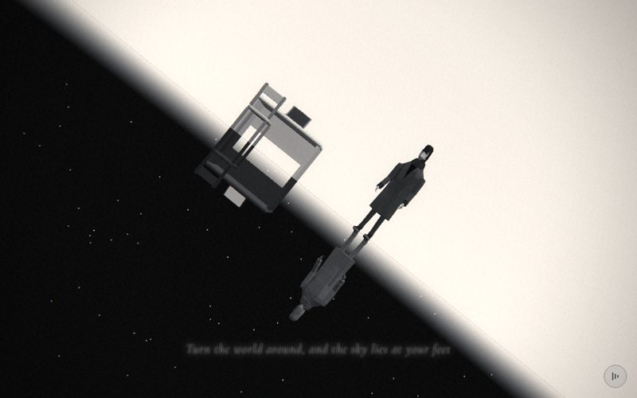

# 11 · flip

> "Turn the world around, and the sky lies at your feet"
> Source: `src/app.js`, banner `/* 11 — some days the whole world turns upside down */` · group: interiors · before/after: [sheet](../../assets/model-polish/interiors.jpg)

## At a glance
| | |
|---|---|
| Setting | Void split at the horizon y = 0: a pale sky above, a black starfield below. Above the line he stands beside a small desk with an open laptop and a chair. Below it hangs a dark, upside-down copy of him and the desk (the same models, `scale.y = −1`). No ground, no fog |
| Tone | Light → dark. `bg:'#eeeeee'`, no `scene.background` (the vertex-coloured sky sphere is the background), `dark: t => t > .5`: the caption, grain and vignette switch to dark mode exactly when the camera roll passes 90°. Dips: umbrellas fades into `#eeeeee`; for t > .9 this scene fades to drift's `#000` (by then the frame is upside down, dark half on top) |
| Hero | **Stand**, no rig calls: the default relaxed stance from `makeHero()` (arms loose, weight on one leg, head turned −.12). `makePerson()` (default tones) at `(.4, 0, .2)`, `rotation.y = −.4`, roughly facing the camera. No props held. Mirror: `makePerson({mat: M(0x555555)})` with the same position and rotation inside the flipped group |
| Motion | Camera only: an orbit at horizon height plus a 180° roll. Nothing in the scene moves |
| Camera | `a = lerp(−.35, .45, t)`, position `(sin(a)·8.5, 0, cos(a)·8.5)`: from (−2.92, 0, 7.99) to (3.70, 0, 7.65). `camera.up.set(0,1,0)`, `lookAt(−.6, 0, 0)` (between the desk and him), then `camera.rotateZ(ease(smooth(.15,.85,t))·π)`. Roll: 0° until t .15, 1° at .25, **90° at .5**, 179° at .75, 180° from .85. Default fov |
| Budget | scene 5386 tris (v40 4730) · heroes 3122 = 2 × 1561 (v40 2186) · 140 meshes (102 of them the two heroes) · 0 instanced · 2 lights · 700 points |

## Models
| Model | Built with | Geometry | Tone | Placement / contact | Notes |
|---|---|---|---|---|---|
| Sky sphere | `SphereGeometry(120,48,48)` with a per-vertex `color` attribute; `MeshBasicMaterial({vertexColors:true, side:BackSide, fog:false})` | 4512 tris, **84 % of the scene** | vertex grey `c = y > 0 ? .95 − .12·y : .02` (y normalised by 120): .95 at the horizon → .83 at the zenith above, .02 below | centred on the origin, radius 120 | The equator ring computes y ≈ 7e-15 (> 0), so it is light; the next ring down is at y ≈ −7.85. The light-to-black gradient across that one ring gap is the soft horizon in the shots |
| Horizon line | `Mesh(PlaneGeometry(240,.02), B(0x999999))`, `position.z = −30` | plane, 2 tris, FrontSide | `0x999999`, unlit | y ±.01, 30 units behind the origin, facing +z (the camera always stays on +z) | A crisp grey line over the soft sphere gradient |
| Stars | `stars(700, 60, {seed:5, minY:−60})`, then every y is rewritten to `−|y| − .5` | 700 points, `sizeAttenuation:false`, size 1.6 px, opacity .9, `fog:false` | white | radius about 36–60, all below y −.5, so only the lower (dark) half has stars | The array is edited before the first upload, so no `needsUpdate` is needed |
| Desk (light) | local `desk(mt, ms, ml, mk, msc)` with `M(0xc8c8c8), M(0xaaaaaa), M(0x777777), M(0x4a4a4a), B(0x333333,{side:DoubleSide})` | 18 meshes, 436 tris (parts below) | top `0xc8`, panels/chair `0xaa`, legs/laptop `0x77`, key area/hinge `0x4a`, screen `0x33` | stands on y 0, x −2.5…−1.1 | v41 tone split after the audit (v40 was all `0xbbbbbb`) |
| · top | `bevelBox(1.4,.07,.7,.02, mt, −1.8,.695,0)` | loft, 64 tris | `mt` | y .695–.765, x −2.5…−1.1, z ±.35 | Same local `bevelBox` as desk and room (10th arg = corner chamfer) |
| · side panels ×2 | `box(.06,.695,.62, ms, −2.47 / −1.13, .3475, 0)` | box | `ms` | y 0–.695 (touch the floor and the top), z ±.31 | Replaced v40's four `.05` sticks ("wire cage") |
| · modesty panel | `box(1.28,.42,.05, ms, −1.8,.48,−.28)` | box | `ms` | y .27–.69 at the back (z −.305…−.255), between the side panels; 5 mm under the top | |
| · laptop base | group `lap` at (−1.8, .765, .02); `bevelBox(.42,.022,.29,.006, ml, 0,0,0, .3)` | loft, 64 tris | `ml` | on the desk top, y .765–.787 | |
| · key area, trackpad | `box(.36,.004,.13, mk, 0,.023,−.01)`, `box(.1,.003,.06, mk, 0,.023,.1)` | box ×2 | `mk` | ~3 mm proud of the base top | |
| · hinge | `CylinderGeometry(.012,.012,.4,6)`, `rotation.z = π/2`, at (0,.022,−.14) | 6-sided, 24 tris | `mk` | along the base's back edge | |
| · lid + screen | group `lid` at the hinge, `rotation.x = −.32` (leans back, away from the chair); `bevelBox(.42,.27,.018,.005, ml, 0,0,0, .3)` + `box(.37,.22,.004, msc, 0,.145,.01)` | loft 64 + box 12 | `ml`, screen `msc` | screen 3 mm proud of the lid face | The wedge reads as an open laptop from the orbit |
| · chair | `cx = −2.2, cz = .5`: seat `bevelBox(.44,.06,.44,.015, ms, cx,.44,cz, .25)`; back slat `box(.44,.14,.04, ms, cx,.86,cz+.19)`; legs ×4 `box(.045,.44,.045, ml)` at `cx±.19, cz±.19`, y .22; uprights ×2 `box(.045,.45,.045, ml)` at `cx±.19`, y .725, z `cz+.19` | 64 + 12 + 72 tris | seat/slat `ms`, legs `ml` | seat y .44–.50, x −2.42…−1.98, z .28–.72 (7 cm under the desk edge); legs on y 0, 2.75 cm clear of the side panel; slat y .79–.93 between the uprights (.5–.95) | Round 1 moved it to x −2.2, z .5 so the slat no longer crosses the lid's silhouette from the camera |
| Hero (light) | `makePerson()` in group `light` | 1561 tris, 51 meshes | default (`0x2a2a2a` / `0x3a3a3a`, per-facet jitter) | `(.4, 0, .2)`, `rotation.y = −.4`; bbox x .07–.69, y −.034–1.912 | Soles at y −.034 (default stance), i.e. 3.4 cm below the horizon |
| Mirror group `dark` | `new THREE.Group()`, `dark.scale.y = −1`, holds `m2` and a second `desk(…)` | — | — | everything at y → −y | See "How the mirror is built" |
| Hero (mirror) | `makePerson({mat: pale})`, `pale = M(0x555555)` | 1561 tris | one flat `0x555555` for every part | `position.copy(me.position)`, `rotation.y = me.rotation.y`; bbox y −1.912…+.034 | `mat` replaces all of the hero's materials, so the copy has no per-facet tone jitter |
| Desk (mirror) | `desk(M(0x3a3a3a), M(0x2c2c2c), M(0x202020), M(0x151515), B(0x999999,{side:DoubleSide}))` | 436 tris | top `0x3a`, panels/chair `0x2c`, legs/laptop `0x20`, key area `0x15`, screen `0x99` | y −1.045…0 | The mirror keeps a **lit** screen (`0x999999`) so the upside-down world reads too |

### How the mirror is built
1. `desk()` is a local factory that builds the whole desk + laptop + chair from five materials (top, panels, legs/laptop, key area, screen). It is called twice, so both worlds share exactly the same geometry and positions. Only the tones differ.
2. `light` = desk (light tones) + `me`. `dark` = desk (dark tones) + `m2`, where `m2` copies `me`'s position and `rotation.y` **once, at build time**.
3. `dark.scale.y = −1` reflects the whole group through the plane y = 0. Every model stands on y = 0, so each object meets its own reflection at the horizon: the desk's side panels and the chair legs touch exactly; the two heroes' shoes overlap by 6.8 cm (soles at −.034 and +.034, each 3.4 cm past the plane), which reads as the feet meeting.
4. Why it renders correctly: three.js r128 checks `matrixWorld.determinant() < 0` per object and flips the front-face winding (`frontFaceCW`), and the normal matrix handles the reflected normals. So the reflected meshes are not inside-out even with `FrontSide` materials. All `M()` materials are `DoubleSide` anyway, and the two screens pass `side: DoubleSide`.
5. Lighting is not mirrored. The directional light shines from above, so the flipped desk's top (now facing down) gets only the hemisphere ground colour (`0x555555` × .9). That is part of why the mirror reads dark; the other part is its darker materials.
6. The sphere does the rest: light sky above, black below, and the stars only in the lower half. The camera sits on the mirror plane (y = 0), so before the roll the two worlds are symmetric about the middle of the frame.

## Lights and atmosphere
- `HemisphereLight(0xffffff, 0x555555, .9)` and `DirectionalLight(0xffffff, .5)` at (2, 5, 3) (default target at the origin). Neither casts shadows (`lights()` is not used), so there is no contact shadow under the desk or his feet.
- No fog, no `scene.background`. The sphere is `fog:false` and unlit, so its greys are final before the film pass.
- Film pass: light mode until t = .5, dark mode after (stronger grain and vignette).

## Animation (`update(t, time)`)
- **Scroll-driven only.** Orbit `a = lerp(−.35, .45, t)` at radius 8.5 and height 0, looking at (−.6, 0, 0). Then the roll `ease(smooth(.15, .85, t))·π` about the view axis: flat until t .15, eased through 90° at t .5, upside down from t .85. `camera.up` is reset every frame because `lookAt` uses it, and `rotateZ` is applied after `lookAt`.
- `time` is unused. `frame()` adds the handheld drift (including a ±.004 roll) after `update()`.
- The t=.5 screenshot shows the roll at roughly 40°, not 90°: the page eases toward the scroll target, so the shot was taken at about t = .4.

## v40 → v41
From [model-polish/interiors.md](../model-polish/interiors.md), "11 — flip" and round 1:
- **`desk(m)` → `desk(mt, ms, ml, mk, msc)`.** v40 built nine `0xbbbbbb` / `0x333333` boxes: a `.05` top, four `.05 × .72` sticks, an upright laptop (`.45 × .03 × .32` base, `.02` lid) and a two-slab chair centred behind the desk. v41: a `.07` chamfered top on two side panels and a modesty panel; a hinged wedge laptop (chamfered base, dark key area and trackpad, 6-sided hinge, lid leaning back .32 rad with a screen); a chair with a chamfered seat, four legs, two uprights and a back slat. Light tones split into four greys.
- **Mirror:** gets its own darker tones and a lit `0x999999` screen.
- **Round 1:** the chair moved to x −2.2, z .5 so its slat clears the lid silhouette at 11.35 and 11.65.
- Untouched (audit "do not touch"): sphere, horizon line, stars, camera roll, the `scale.y = −1` mechanism.
- **Triangles:** scene 4730 → 5386 (+656; 1.14×). The sphere is 4512 of both. The notes' 6916 → 7572 adds the v40 heroes (2186). The heroes went 2 × 1093 → 2 × 1561 through the hero group.

## Editing notes
- **Keep the two worlds in sync.** Anything added to `light` needs its twin in `dark`. Put it in `desk()` (with a material argument) or add a second copy by hand. Rig calls on `me` (a pose, a head turn) must be repeated on `m2.userData`. `m2` copies `me`'s position and rotation only at build time, so if you animate `me` in `update()`, copy the transform there too.
- **Everything must stand on y = 0.** The mirror plane is the horizon. A prop that sinks below y = 0 shows through into the dark half, and its reflection pokes up into the light half. A prop that floats leaves a gap at the horizon.
- **Caption contrast (open, not fixed in v41).** `dark(t) = t > .5` describes the top of the frame, but the caption sits in the lower middle, which is on the **opposite** half. For t .12–.5 the black caption (white halo) sits on the black starfield. After .5 the white caption (dark halo) sits on the pale sky, which the roll has brought to the bottom. Both before/after sheets and the t=.5 shot show a dim, low-contrast caption. Untried fix: `dark: t => t < .5`. That also inverts the grain and vignette strength, so judge it in shots at 11.3 and 11.7.
- **Horizon softness = sphere ring spacing.** The 48 × 48 sphere is 84 % of the scene's triangles. Fewer height segments would widen the soft band below the horizon (24 segments → about 15.7 units at r 120 instead of 7.85). A cheaper sphere needs another way to keep the band, for example a gradient texture. Not tried.
- **No shadows and no ground.** The desk and hero read against the sky (grey .83–.95) only by tone. Keep the ≥ 10 % step from REFERENCE-STYLE between a new light-world prop and the sky behind it. Upward faces come out brighter than their albedo under hemi .9 + directional .5, so a pale prop can vanish into the sky (ART-DIRECTION: white on white disappears).
- **The orbit stays on +z** (x −2.9 → 3.7, z 7.65–8.5), so the horizon line plane at z −30 always faces the camera. Move it, or make it `DoubleSide`, if the orbit ever swings past ±90°.
- **Caption band** (t .12–.75): the dark copy's head hangs down toward the lower middle of the frame (see the t=.5 shot). Keep new geometry out of the band below the mirror figure.
- **Text rules:** the caption is fixed (English, no flower words). No text on the laptop screens.

## Check it
- Shots, with 10.7 as the lead-in (the polish used the same warm-up):
  `NODE_PATH=/opt/node-tools/node_modules WAIT=9000 node tools/shots.js 10.7 11.2 11.35 11.5 11.65 11.85`
- What to look at:
  - **11.2–11.35:** the roll starting; desk panels, chair legs and soles meeting their reflections at the horizon; the chair slat clear of the lid; the caption on the dark half
  - **11.5:** the frame on its side (roll ≈ 90° once the easing catches up); the lit mirror screen
  - **11.65–11.85:** upside down; the mirrored desk is readable; the caption on the pale half
  - no stripes on the laptop key area or the screens (they are 3 mm proud)
- **Hero:** standing default pose only. `tools/pose.html` is needed only after a `makeHero()` change.
- **Budget:** `node tools/inventory.js`, then compare the `flip` row with `docs/data/inventory-v41.json`.
