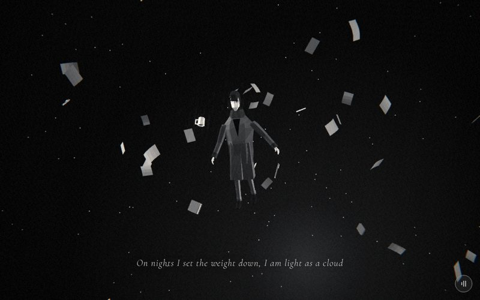

# 12 · drift



> "On nights I set the weight down, I am light as a cloud"
> Source: `src/app.js`, banner `/* 12 — weightless at night, papers drifting */` · group: void-objects · before/after: [sheet](../../assets/model-polish/void-objects.jpg)

## At a glance
| | |
|---|---|
| Setting | Void. A black starfield with no ground and no fog. The hero floats weightless at the origin among 40 curled paper sheets and five small desk objects (two pens, a mug, a phone, a notebook) |
| Tone | Dark all scene. `bg:'#000'`, `scene.background = new THREE.Color(0)` (pure black), `dark:()=>true`, so the film pass uses strong grain and vignette and the caption is white with a dark halo. Dips: flip's last 10 % fades to `#000`; for t > .9 this scene fades to eclipse's `#111` |
| Hero | **Float.** `makePerson({body:0x4a4a4a,jacket:0x3a3a3a})` inside a `pivot` group at y −.95. `me.userData.float(time)` every frame. Holds nothing |
| Motion | The pivot slowly yaws (`t·1.2`) and rolls (−.25 → .35) with scroll and wobbles in pitch with time. The papers and props sway ±.4 with time, tumble slowly and sink 1.5 units over the scene. The camera orbits 1.6 rad and descends |
| Camera | `a = t·1.6`; position `(6·sin a, lerp(1.5,−.5,t), 6·cos a)`, `lookAt(0,0,0)`. Start (0, 1.5, 6), end ≈ (6.0, −.5, −.18). Default fov (45°, 62° portrait). The camera and the pivot turn the same way, so the camera moves only .4 rad relative to his front and he is always seen front-on or in three-quarter view |
| Budget | scene 608 tris (v40 80) · hero 1561 (v40 1093) · 108 meshes · 0 instanced · 1500 star points · 1 sprite · 4 lights · 18 materials |

## Models
| Model | Built with | Geometry | Tone | Placement / contact | Notes |
|---|---|---|---|---|---|
| Hero | `makePerson({body:0x4a4a4a,jacket:0x3a3a3a})` → `makeHero` | faceted lofts, 1561 tris, 51 meshes | trousers `0x4a4a4a` (lighter than the coat here), coat `0x3a3a3a` | Child of `pivot` (a `THREE.Group` at the origin), `me.position.set(0,-.95,0)`, so his hips sit at the pivot; feet ≈ −1.0, hair top ≈ .97 (measured with `float()` applied) | Pose from `userData.float(time)`. The only object in the shadow pass (receives and casts; self-shadow only, as there is no ground) |
| Paper sheets × 40 | local `sheet(w,h,curl,k)`: non-indexed `BufferGeometry`, `R=4` bands, point `(i−.5)·w, (j/R−.5)·h, curl·(j/R)^k` | single layer, 4 quads = **8 tris** each (320 total) | `pm = M(0x606060)`, one shared material (flat, roughness 1, double-sided) | Origins from `drift(p,7,5)`: x, z ∈ ±3.5, y ∈ ±2.5, re-drawn until the origin is > 1.1 from the y axis, > .8 from every earlier origin and `clear()` passes (see Editing notes) | Three shared geometries `sg`: `sheet(.21,.3,.05)` (quadratic curl), `sheet(.21,.3,.035,1)` (linear, so a flat sheet tilted .035 over its height), `sheet(.21,.3,.07,3)` (cubic). Sheet i uses `sg[i%3]`. `i%10<3` → `scale .75` (12 of 40). .21 × .3 is the A4 proportion. Direct children of `scene`, not of `pivot` |
| Pen × 2 | local `pen()` group | barrel `CylinderGeometry(.007,.007,.14,6,1,true)`, open-ended (12) + tip `CylinderGeometry(.002,.0065,.022,6,1)` at y −.076 (24) + clip `box(.006,.045,.006,lt,.012,.04,0)` (12) = **48 tris** | barrel `M(0x505050)`; tip and clip `lt = M(0x9a9a9a)` | `drift(o,4,3)`: origin within x, z ±2, y ±1.5 | Scaled ×2 (≈ .28 long). The tip starts inside the open barrel. Its narrow end (.002) is the one inside the barrel, so the exposed end flares to .0065 rather than tapering to a point (only a few pixels at this distance) |
| Mug | local `mug()` group | open 6-sided `loft([[0,.07,.07,0],[.09,.08,.08,0]],m,{sides:6,caps:false})` (12) + C-handle of 3 boxes: `box(.03,.01,.012)` at (.052,.072,0) and (.052,.024,0), `box(.008,.058,.012)` at (.066,.048,0) (36) + bottom `CircleGeometry(.03,6)` at y .002 (6) + coffee `CircleGeometry(.033,6)` at y .078 (6) = **60 tris** | body `M(0x9a9a9a)`; coffee `B(0x151515)` (unlit) | `drift(o,4,3)` | Scaled ×2 (.18 tall). An open cup: the walls have no caps, and the dark coffee disc is .012 (local) below the rim, so from above it reads as a rim around a dark interior |
| Phone | local `phone()` group | `loft([[0,.064,.134,.3],[.005,.07,.14,.3],[.01,.064,.134,.3]],…,{sides:8})`: a .01-thick chamfered slab with a wider middle ring (48) + screen `box(.058,.01,.126,B(0x6a6a6a),0,.015,0)` sitting on the slab top (12) = **60 tris** | body `M(0x303030)`; screen `B(0x6a6a6a)` (unlit) | `drift(o,4,3)` | Scaled ×2. The screen is a 1 cm block, not a film on the slab (16-bit depth) |
| Notebook | local `book()` group | two cover lofts `[[0,.12,.16,.1],[.008,.12,.16,.1]]` and `[[.02,…],[.028,…]]`, 8 sides (32 each) + page ring `loft([[.008,.158,.212,0],[.02,.158,.212,0]],…,{sides:4,rot:π/4,caps:false})`, which is an open .112 × .15 rectangle between the covers (8) = **72 tris** | covers `cm = M(0x343434)`; pages `M(0xb0b0b0)` | `drift(o,4,3)` | Scaled ×2. No spine and no page-block faces parallel to the covers (16-bit depth) |
| Stars | `stars(1500,80,{seed:9})` | 1500 `Points` | white, opacity .9, size 1.6 px, no size attenuation, `fog:false` | shell of radius 48–80 around the origin | static |
| Under-glow | `glow(10,.18)` | additive sprite | white, opacity .18 | (0, −2.5, −2): below and behind him | static. Approx. the soft pale haze low in the t=.5 frame |
| Background | `scene.background = new THREE.Color(0)` | — | `#000` | — | no fog |

Origins of the props after replaying the `rng(12)` draws (before sway and sink): pen (−.18, .14, −1.54), pen (−1.82, 1.08, 1.99), mug (−1.82, 1.31, −.94), phone (1.71, −.39, −1.77), notebook (−1.74, −.30, −.52). The worst sheet or prop needed 15 draws, none reached the 60-try fallback, and the closest origin is 1.113 from the axis.

## Lights and atmosphere
- `lights(scene,{hemi:[0xffffff,0x444444,1.1],dir:[0xffffff,1.3,[-4,3,5]]})`:
  - hemisphere white over `0x444444`, intensity 1.1
  - shadow-casting key light 1.3 from the upper left front (direction (−4,3,5))
  - automatic rim light .59 (1.3 × .45) from (4, 1.8, −9)
- An extra `DirectionalLight(0xffffff,.8)` at (5, −2, −4) lights him from below, behind and to the right.
- No fog and no ground. The black background and the stars carry the depth.
- **Film pass:** anything above .8 brightness blooms. The sheets are `0x606060` so a band facing both the key and the hemisphere light stays grey (the code comment says ~`#d8` after the pass; the group notes say ~`#d0`) instead of clipping to white. The phone screen (`B(0x6a6a6a)`) and coffee disc (`B(0x151515)`) are unlit, so their tones are fixed.
- **Shadows:** only the hero. On the first `update()` call, every entry in `papers` (sheets and props, via `traverse`) gets `receiveShadow = castShadow = false` (the `noShadow` flag).

## Animation (`update(t, time)`)
- **Hero:** `me.userData.float(time)` (time-driven idle):
  - legs `sin(time)·.25` and `sin(time+1)·.25`
  - right knee `.3 + sin(.8·time)·.2`, left knee .5
  - arms spread sideways: `rotation.z = −.6 − sin(.7·time)·.2` (right) and `.6 + sin(.8·time)·.2` (left)
  - elbows −.4
- **Pivot:** `rotation.set(sin(time·.3)·.1, t·1.2, lerp(−.25,.35,t))`. The pitch wobble is time-driven; the yaw and roll are scroll-driven.
- **Sheets and props** (same code for all 45 objects, from `userData = {o, s}`, where `s` holds three `rng(12)` values):
  - position `(o.x + sin(time·.3 + s.x·6)·.4, o.y + sin(time·.4 + s.y·6)·.4 − t·1.5, o.z)`. They sway ±.4 in x and y with time and sink 1.5 over the scene with scroll.
  - rotation `(time·.3·s.x + s.y·6, time·.2·s.y, s.z·6)`: a slow tumble about x and y.
- **Camera:** see At a glance. Scroll-driven only, plus the global handheld drift.

## v40 → v41
Source: [model-polish/void-objects.md](../model-polish/void-objects.md) ("12 drift", Round 1, Round 2). Audit priority LOW.
- **v40:** 40 flat `PlaneGeometry(.21,.3)` quads in one unlit `MeshBasicMaterial(0xdddddd)`. They read as confetti (audit), and at `0xdd` unlit (≈ .87) every sheet sat above the film pass's .8 glow threshold.
- **Sheets (first pass):** single-layer sheets curled across their height (4 bands, 8 tris, three curl profiles), lit with `M` so each band shades differently, 30 % at scale .75.
- **Props (first pass):** five small objects added that drift with the sheets: two pens, a mug, a phone, a notebook.
- **Round 1:**
  - *Shadow-acne lattice on the sheets (blocker):* first fixed with a `transparent:true` flag, replaced in Round 2.
  - *Tone:* sheet tone `0x86 → 0x70`.
  - *Props:* scaled ×2 so they read.
  - *Placement:* `drift()` re-draws origins that are within 1.1 of his axis or .8 of another origin.
- **Round 2:**
  - *Placement:* `clear()` added. It rejects origins whose orbit projects onto his silhouette in front of him, or onto the caption strip while the caption shows.
  - *Shadows:* the explicit `noShadow` opt-out replaces the transparent flag.
  - *Tones:* sheets `0x70 → 0x60`; mug `0xbd → 0x9a`; notebook pages `0xcf → 0xb0`; pen barrel `0x2a → 0x50`.
  - *Props rebuilt for the 16-bit depth target:* open cup, open pen barrel, notebook without a spine, screen as a block. This removed a hatched lattice on the notebook and mug.
- **Untouched:** `float()`, the pivot rotation and the orbit camera.
- **Triangles (inventory, hero excluded):** 80 → 608.
  - Breakdown: 320 for the sheets + 288 for the props (pens 2 × 48, mug 60, phone 60, notebook 72).
  - The notes give 1173 → 1747 including the v40 hero (1093). That implies 654 for the set, which does not match the measured 608, so use the inventory.
  - Separately, the hero grew 1093 → 1561 (hero group, [hero.md](../model-polish/hero.md)).
- The group's other item, `suitcase()` (scenes 1 and 3; see `docs/MODELS.md`), does not appear in this scene.

## Editing notes
- **Add drifting things through `drift()` and push them into `papers`.** That way they get:
  - the clearance tests
  - the sway, tumble and sink in `update()`
  - the shadow opt-out on the first frame
  
  Any other opaque `M` mesh you add gets `buildAll()`'s shadows (receive always, cast if its radius is < 1.2). Thin sheets as shadow receivers produced the acne lattice.
- **`clear()` duplicates the scene's motion.** It replays:
  - the camera path (`a = t·1.6`, radius 6, y `lerp(1.5,−.5,t)`)
  - the sink (`−t·1.5`)
  - the sway (a 3 × 3 grid of ±.4)

  If you change any of these in `update()`, change `clear()` too, or sheets will cross his chest or the caption again. Its tests:
  - reject anything closer than .5 in view depth
  - reject anything in front of him whose projection falls inside a box of half-width .45 (+ .3 per unit of height for his lean, + the sheet margin `e = .2`) and height −1.1….9, measured in units projected to his depth
  - while t ∈ (.1, .77), reject anything inside the caption box (NDC y −.82…−.68, |x| < .47)
- **`clear()` assumes a 45° fov and a 16:10 frame** (`TAN = tan(π/8)`, x divided by 1.6). Portrait screens (fov 62) are not covered by the caption test.
- **rng discipline:** the sheets and the props draw from one `rng(12)`, and each rejection consumes draws. Changing the sheet count, the `drift()` ranges, the margin or any test reshuffles every later origin, props included. Re-check 12.35 / 12.5 / 12.65 after any change.
- **16-bit depth:** at the 6–8 unit orbit, two parallel faces closer than ~.012 world units z-fight into a hatched lattice. That is .006 in prop-local units, because the props are ×2. Keep open tubes, gaps and blocks as they are, and do not add caps, a spine or screen films.
- **Prop scale is deliberately ×2** (mug .18 tall, phone .28, pens .28, notebook .24 × .32). At real size they were unreadable at the 6-unit orbit.
- **Tone ceiling:** do not raise `pm` above `0x60`. The group lowered it `0x86 → 0x70 → 0x60` because the key-lit bands clipped to white in the film pass. The notes leave lowering it further to the owner.
- **The papers do not turn with him.** They are children of `scene`; only the hero is inside `pivot`. The pivot's roll and yaw tilt him relative to the cloud.
- **Hero colours:** trousers `0x4a4a4a` under a `0x3a3a3a` coat. The legs are a step lighter than the coat, so they separate from it against the black.
- **Owner rules:** no trembling (`float()` is slow idle motion; keep it that way); the caption is verbatim.
- **Not done:** the audit's optional idea of printing a block of grey lines (no words) on 4–6 sheets.

## Check it
```bash
NODE_PATH=/opt/node-tools/node_modules WAIT=12000 node tools/shots.js 12.2 12.3 12.35 12.5 12.65
```
- 12.2 and 12.3 are the warm-up (the notes say an x.35 shot needs a two-step lead-in and WAIT ≥ 12 s on this machine).
- **12.35 / 12.5 / 12.65:**
  - no sheet over his chest or face in front of him
  - the caption strip clear of sheets and props
  - the mug and notebook readable as silhouettes near him
  - no sheet clipping to pure white
- Crop a prop at 2–4× and look for a hatched lattice (the 16-bit depth problem). Shadow acne would show on the sheets.
- **Hero:** `float()` only. After a `makeHero()` change, check it in `tools/pose.html` with `POSE = U => U.float(0)`, at `?0`, `?1` and `?2`. The page reads a bare number; `?v=1` does not work.
