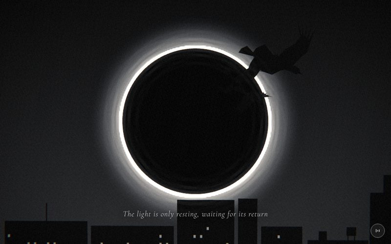

# 13 · eclipse



> "The light is only resting, waiting for its return"
> Source: `src/app.js`, banner `/* 13 — eclipse over the skyline, crows crossing it */` · group: night-city · before/after: [sheet](../../assets/model-polish/night-city.jpg)

## At a glance
| | |
|---|---|
| Setting | A void-like night sky. A total eclipse (black disc, white ring, halo) above a flat cut-out skyline, with six crows flying across the disc. Built as unlit silhouette layers (flat planes, plus the 3D crows) rather than a lit 3D place |
| Tone | Dark. `bg:'#111'`, `scene.background = gradTex('#0a0a0a','#303030')` (darker at the top, lighter toward the skyline), `dark:()=>true` all scene. Dips: drift's end fades into `#111`, and for t > .9 this scene fades to petals' `#101010` |
| Hero | **Absent.** No `makePerson` in this scene |
| Motion | The crows fly up-left and away across the disc (scroll-driven path, time-driven flap and bob). The ring and halo brighten over the first 40 % |
| Camera | Position `(lerp(.8,-.8,t), .2, lerp(13,11,t))`, `lookAt(0,0,0)`. A slow push-in with a small lateral slide. Default fov |
| Budget | scene 3276 tris (v40 2908) · hero 0 · 289 meshes · 0 instanced · **0 lights** · 1 sprite · 10 materials |

## Models
Everything uses `MeshBasicMaterial`, made by the local `flat(color, opacity)`: `transparent:true, depthTest:false, depthWrite:false, side:DoubleSide`. The halo is a `SpriteMaterial`. **Visibility is decided only by `renderOrder`.** The local `put(mesh, ord)` sets `renderOrder` and adds the mesh to the scene.

| Model | Built with | Geometry | Tone | Placement / contact | Notes |
|---|---|---|---|---|---|
| Sky | `gradTex('#0a0a0a','#303030')` as `scene.background` | 4 × 256 canvas texture | `#0a0a0a` top → `#303030` bottom | screen-space | The skyline (`#060606`) reads against the lighter lower sky |
| Halo | `canvasTex(256,256, …)` → `THREE.Sprite(SpriteMaterial({blending:Additive, depthTest:false, depthWrite:false}))`, `scale 9.6` | sprite | white. The canvas strokes a radius-80 circle three times (`lineWidth 6`, `shadowBlur 28`); opacity animated .45 → 1 | origin, `renderOrder 1` | The canvas ring radius maps to 80/128 × 4.8 = 3.0 units, exactly the torus radius |
| Ring | `TorusGeometry(3,.025,6,160)` | **1920 tris (59 % of the scene)** | `flat(0xffffff,1)`; colour animated `setScalar(.6 → 1)` | origin, `renderOrder 2` | 6 tube sides, 160 segments around for a smooth circle. Untouched by the polish (audit: keep the disc and ring sizes) |
| Disc | `CircleGeometry(2.985,128)` | 128 tris | `flat(0x000000,1)` | origin, `renderOrder 3` | Hides everything inside r 2.985 (the inner half of the halo stroke), so only the outer glow shows |
| Skyline blocks × 20 | local `P(w,h,cx,cy)` → `PlaneGeometry` in the shared `mb = flat(0x060606,1)` | 2 tris each | `0x060606` | Plane z = 4, all bottoms at y −4.4, inside the `sky` group, `renderOrder 5`. Built left to right from x = −14 to 14 with gaps `r()*.15` | `rng(77)`. Width `.5+r()*1.8` (.5–2.3). Height `.6+r()*(|x|<4 ? 2.2 : 4.5)`: the centre column is lower. Tops reach −2.05 at most in the centre (|cx| ≤ 3.5) and −.11 overall |
| Setback storeys | `P(w2,h2, cx+ox, top+h2/2)` | plane | `mb` | On the block's roof | `k < .28`. 4 in this seed |
| Stair head + water tank | 4 planes: head `sw×sh` at `cx−w·.25`, tank `.26×.24` at `cx+w·.22` on two `.025×.13` legs | plane ×4 | `mb` | On the roof | `.28 ≤ k < .5`. 2 sets in this seed |
| Billboard frame | 3 planes: two `.03×.3` posts + a `bw×.3` board, `bw = .6w` | plane ×3 | `mb` | On the roof, board top at `top+.6` | `.5 ≤ k < .62`, only where `|cx| > 4.5` or `top+.6 < −2.6`. 2 in this seed |
| Gable | `BufferGeometry` triangle `(x,top)–(x+w,top)–(gx,gy)` | 1 tri | `mb`, `renderOrder 5` | On the roof | `.62 ≤ k < .72` and `w < 1.1`. **Seed 77 produces none**: the branch exists but emits nothing today |
| Antenna masts | `P(.03,.5, mx, top+.25)` | plane | `mb` | `mx = x + w·(.3–.7)` | 50 % chance on blocks taller than 1.5, through the same clearance test. 8 in this seed |
| Lit windows × 133 | `PlaneGeometry(.06,.08)` in `mw = flat(0x8a8a8a,1)` | 2 tris each | `0x8a8a8a` | z 4.01, `renderOrder 6`. Grid with a .22 pitch vertically (from y −4.2) and .18 horizontally, inset .12 | Each slot is lit with 12 % chance. Grey (`0x8a` ≈ .54) stays under the film pass's .8 glow threshold, so they don't bloom |
| Crows × 6 | `makeCrow()` | 145 tris each (870 total): see the next table | `flat(0x050505,1)`, **one material per crow** | `renderOrder 8` (above everything) | Scale and offset per bird from `birds = [[s,dx,dy,ph], …]`: `[1.5,0,0,0]`, `[1.05,-1.6,.5,1.7]`, `[.85,-2.6,-.6,3.1]`, `[.7,-3.4,.4,4.4]`, `[.4,-4.6,1.1,2.3]`, `[.34,-5.3,.3,5.2]` (the last two are the v41 far crows) |

Skyline totals in this seed: 20 blocks + 4 setbacks + 8 stair/tank planes + 6 billboard planes + 8 masts + 133 windows = 179 meshes, 358 tris.

### Crow parts (`makeCrow`, crow-local; +x = beak, y up, z = wing span)
| Part | Geometry | Tris | Notes |
|---|---|---|---|
| Body | `loftGeo` with 6 sections and **5 sides**, built by `along()` (loft axis turned to +x with `rotation.z = −π/2`). Runs from −.42 (tail root) to .4 (neck); width .04 → .15 → .06 | 60 | Plump faceted outline instead of v40's scaled octahedron |
| Head | `loftGeo` with 4 sections and **6 sides**, at (.46, .06, 0) | 48 | Replaces v40's 8 × 6 sphere (80 tris) |
| Beak | `ConeGeometry(.045,.2,4)`, `rotation.z = −π/2`, at (.64, .05, 0) | 12 | Unchanged |
| Tail | `tri()` fan: 3 triangles from x −.36 to a wedge at −.82 … −.88, ±.17 wide | 3 | Unchanged |
| Inner wing × 2 | group `root` at (.05, .04, 0): two quads, z 0 → .26 (rising to y .04) → .48 | 4 per side | The .04 spanwise crease means the wing never thins to a line edge-on. v40 used one flat quad |
| Hand × 2 | group `tip` at z ±.48: one quad out to ±.22–.24 | 2 per side | |
| Primaries × 10 | 5 triangles per hand fanning from z .2: length `.32 − .03i`, sweep `−.05 − .07i` | 5 per side | The "fingers" that make it read as a crow (owner: crows, not gulls) |

## Lights and atmosphere
- **No lights at all.** All materials are `MeshBasicMaterial`/`SpriteMaterial`, so anything built with `M()` would render black.
- **No fog** (`scene.fog` is unset). The depth illusion comes only from crow scale and the skyline in front of the disc.
- The background gradient is the "air". The halo sprite is additive. The ring is pure white from t = .4 on, which is above the film pass's .8 glow threshold, so the pass adds glow around it.
- Known cosmetic issue: **concentric bands inside the disc rim.** The audit attributes them to the film-pass glow bleeding from the ring plus the halo texture's three strokes; the group notes attribute them to the film-pass bloom kernel. Left alone in v41.
- The film pass is in dark mode all scene (strong vignette and grain).

## Animation (`update(t, time)`)
- **Ring and halo:** `ring.material.color.setScalar(.6 + .4·smooth(0,.4,t))` and `hs.material.opacity = .45 + .55·smooth(0,.4,t)`. They brighten over t 0 → .4, then hold.
- **Crows (crow i):**
  - Progress: `k = clamp(1.1t − .05i)`.
  - Position: `x = lerp(6.5, −.5, k) + .7·dx`, `y = lerp(−.6, 4.1, k) + .8·dy + .08·sin(1.3·time + ph)`, `z = lerp(5, 0, k)`. They fly up-left and away from the camera across the upper-right of the disc. The lead crow finishes at t ≈ .91.
  - Orientation: `rotation (−.55, π/2 − .9, .12·sin(1.1·time + ph))`.
  - Flap: `userData.flap(ph)` sets `root.rotation.x = sd·(.1 + .5 sin ph)` and `tip.rotation.x = sd·(−.15 + .4 sin(ph − .6))` with `ph = 6.5·time + ph`. The lead crow (i = 0) glides (fixed phase .35) whenever `sin(.8·time) > .55`.
- **Camera:** scroll-driven push from z 13 to 11 and x .8 to −.8, plus the global handheld drift.
- The path is scroll-driven; the flap, bob and roll are time-driven (idle motion, allowed).

## v40 → v41
Source: [model-polish/night-city.md](../model-polish/night-city.md) ("13 eclipse" and "Round 1"). Priority LOW in the [audit](../model-polish/audit.md).
- **Skyline:**
  - Was flat-topped rectangles (width .6–2.1) with centred antenna masts.
  - Now has varied rooflines: setback storey (28 %), stair head + water tank on legs (22 %), billboard frame (12 %), gable on narrow blocks (10 %), plus masts. Widths are .5–2.3.
  - It is the same unlit material and `renderOrder` as before.
  - This seed: 20 blocks / 133 windows (v40: 19 blocks, 6 masts, 163 windows).
- **Round 1 blocker fix:**
  - A tank stood under the disc; the furniture also touched the caption.
  - Roof furniture is now emitted only beside the eclipse/caption column (`|cx| > 3.5`, billboards `|cx| > 4.5`) or when its top stays below −2.6.
  - The rng draws are unchanged by the test, so the layout is stable.
- **Crows:**
  - Octahedron body and sphere head replaced by a 5-sided loft body and a 6-sided loft head.
  - Creased two-quad inner wings.
  - The beak, tail, five primaries and flap logic are unchanged.
  - Two small far crows added (scale .4 and .34).
- **Untouched:** the render-order trick, flap, ring and disc sizes, halo.
- **Triangles:** 2908 → 3276 (1.13×). The crows went from 4 × 121 = 484 to 6 × 145 = 870; the skyline went from 376 to 358. The group measured per-frame 2596 → 2995 and draw calls 106 → 148.
- **Group concern:** the crows are unlit silhouettes, so their new facets show only in the outline (`cmp_crows.png`, "not a dramatic change").

## Editing notes
- **Draw order is the depth.** Back to front: halo 1 → ring 2 → disc 3 → skyline 5 → windows 6 → crows 8. Rules for anything new:
  - Make it with `flat()` (or the same flags: `depthTest:false, depthWrite:false, transparent:true`).
  - Give it an explicit `renderOrder`.
  - An opaque material (`transparent:false`) renders in three.js's opaque pass, before every transparent object. The halo, disc, skyline and crows then paint over it, whatever its `renderOrder`.
  - z positions only change parallax and perspective size, never occlusion.
- **Unlit scene:** use `flat()`, `B()` or sprites. `M()` renders black here, and adding lights would change nothing for the existing `MeshBasicMaterial`s.
- **Keep the column under the disc calm.**
  - The halo band and the caption both project onto the skyline plane (z = 4) inside |x| < 2.5, above y ≈ −2.4 at both camera ends.
  - Any roof piece on a block with |cx| ≤ 3.5 must keep its top below −2.6 (the `clear()` test).
  - The plain centre blocks still reach −2.05, so in the t=.5 screenshot the caption text crosses the tops of the centre blocks. It stays readable as white text with a dark halo on near-black, but don't raise the centre blocks or add anything bright there.
  - If the owner wants more variety under the disc, the group notes say a setback whose top stays below −2.6 is the only safe piece.
- **rng discipline:** each roof branch draws its random numbers *before* `clear()` decides whether to emit. Keep that order, or the block widths and heights change.
- **Crows:** the owner asked for crows, not gulls (ART-DIRECTION feedback, "鳥改成烏鴉"). Keep the primaries, the wedge tail and the flap. Each crow makes its own `flat(0x050505)` material (6 materials); sharing one would be a free cleanup.
- **Budget lever:** the ring alone is 1920 tris. With 3 or 4 tube sides it would be 960 or 1280 tris, and at .025 thick the difference is probably invisible. The audit only protects the ring and disc *sizes*, so this is allowed, but it has not been tried.
- **No hero:** the ART-DIRECTION feedback row for this scene ("鳥改成烏鴉，人看起來太呆了": crows, not gulls; the figure looked too stiff) dates from when a figure was in this shot. There is no figure now; adding one is a staging change for the owner to decide.
- No flower motif and no text in the scene. Keep it that way.

## Check it
```bash
NODE_PATH=/opt/node-tools/node_modules WAIT=9000 node tools/shots.js 12.9 13.35 13.65
```
- **13.35:** the crows entering over the upper-right ring. Check that no roof piece crosses the ring, the halo or the caption.
- **13.65:** the crows further up-left and smaller. Check the far crows (scale .4/.34) and the caption over the centre skyline.
- Crow facets show only in the outline. For a close-up, crop the PNG around the lead crow (see the crop command in `docs/model-polish/brief.md`).
