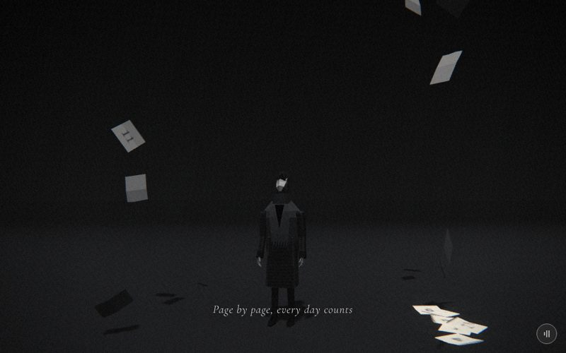

# 14 · petals



> "Page by page, every day counts"
> Source: `src/app.js`, banner `/* 14 — counting the days: torn-off calendar pages drift down around him */` · group: void-objects · before/after: [sheet](../../assets/model-polish/void-objects.jpg)

**The key is historical.** The scene shows falling calendar pages and contains nothing flower-like. Never describe it with flower words. ROADMAP suggests renaming `petals → days`; if you do, rename it in `CAPTIONS`, `SCENES` and the docs together.

## At a glance
| | |
|---|---|
| Setting | Void with a floor: an empty dark ground plane fading into fog, no walls and no horizon objects. The hero stands at the origin looking up while 26 torn-off calendar pages fall around him and settle on the floor. A faint dawn glow appears far behind him in the second half |
| Tone | Dark all scene. `bg:'#101010'`, `scene.background = gradTex('#050505','#1d1d1d')` (darker at the top), `Fog(0x111111,8,30)`, `dark:()=>true`. Dips: eclipse's last 10 % fades to `#101010`; for t > .9 this scene fades to shards' `#1c1c1c` |
| Hero | **Stand.** `makePerson()` (default tones), `rotation.y = .3`, `userData.head.rotation.x = −.55` (looking up). No rig call per frame, no props |
| Motion | Pages fall one after another (page n starts at t = .72·(n−1)/26, each fall lasts .267 of t), tumbling with time, then ease flat onto the floor over the last 15 % of their fall. The dawn glow fades in from t .5 |
| Camera | Position `(lerp(3.5,2,t), lerp(1.2,2,t), lerp(5,4,t))`, `lookAt(0, lerp(2,1.6,t), 0)`. Low and looking up past him at first, then rising to look slightly down. Front three-quarter (he faces ≈ .3 rad toward +x, the camera sits at ≈ .46–.61 rad). Default fov |
| Budget | scene 626 tris (v40 54) · hero 1561 (v40 1093) · 78 meshes · 0 instanced · 0 points · 1 sprite · 3 lights · 34 materials |

## Models
| Model | Built with | Geometry | Tone | Placement / contact | Notes |
|---|---|---|---|---|---|
| Hero | `makePerson()` → `makeHero` | faceted lofts, 1561 tris, 51 meshes | default: trousers `0x2a2a2a`, coat `0x3a3a3a` | Origin, feet on y 0, `rotation.y .3`, head tilted back −.55 | Standing default pose. Receives and casts shadows (`buildAll`). His shadow falls on the ground |
| Ground | `ground(0x161616)` | `PlaneGeometry(400,400)`, 2 tris | `M(0x161616,{side:FrontSide})` | y 0, under everything | Receives shadows. Fades into the `0x111111` fog from 8 to 30 units |
| Calendar page × 26 | local `leaf(seed,curl)`: non-indexed `BufferGeometry`, a 3 × 2 grid (`C=3`, `R=2`) | front 12 + back 12 = **24 tris**. `W .34 × H .42`; back layer offset `T = .005` behind the front; curl `curl·(j/R)^2.2` toward the top; the 4 top vertices are each dropped by `tear` .05–.066 (`rng(seed)`), so the top edge is ragged | `MeshStandardMaterial({map, color:0xbcbcbc, side:DoubleSide, roughness:1, flatShading:true})`, **one material and one texture per page** | Ring around him: angle `a`, radius `R`, `x = sin a·R`, `z = cos a·R·.8` (an ellipse). Lands at `rest` height .008–.036 | Three shared geometries `pg = [leaf(1,.03), leaf(2,.05), leaf(3,.02)]`; page i uses `pg[i%3]`. The front UVs map the page texture; every back vertex samples UV (.06,.5), a blank paper texel, so the reverse is plain paper. The .005 edge faces were dropped (invisible at this scale) |
| Page texture × 26 | `canvasTex(128,160, …)` | canvas | paper `#f2f2ef`; top band `#1a1a1a`, 26 px tall; "DAY" 14 px serif in `#f2f2ef` at baseline 18; the day number 72 px serif in `#222` at baseline 118 | — | **The word "DAY" is never visible.** The torn top edge sits at UV v .843–.881, below the lettering's baseline (v .8875), so it is torn off with the top. What remains is a 2–18 mm dark stub (the rest of the band) over the number. This is deliberate (Round 2: no "comb teeth" through the letters) |
| Dawn glow | `glow(30,0)` | additive sprite, scale 30 | white, opacity animated 0 → .5 | (0, 1, −18): far behind him | Sprite materials keep three.js's default `fog:true`. At ≈ 22 units from the camera, `Fog(8,30)` mixes roughly two-thirds of it toward `0x111111` (approx., not measured) |
| Background | `gradTex('#050505','#1d1d1d')` | 4 × 256 canvas | `#050505` top → `#1d1d1d` bottom | screen-space | — |

**Layout after the re-draws** (replaying `rng(55)` and `bad()`):
- Radii are 1.335–2.346. The worst page needed 14 draws, and none reached the 60-try fallback.
- 18 of the 26 pages land at x > 0, which is the right half of the frame from this camera.
- Rest heights: 13 pages at .008, 6 at .015, 3 at .022, 2 at .029 and 2 at .036.
- Examples: DAY 1 lands at (1.88, −.87); DAY 26 at (−2.02, −.16).

## Lights and atmosphere
- `lights(scene,{hemi:[0x888888,0x111111,.55],dir:[0xffffff,.8,[1,6,3]]})`:
  - hemisphere `0x888888` over `0x111111`, intensity .55
  - shadow-casting key light .8 from high above, slightly right and in front (direction (1,6,3))
  - automatic rim light .36 from (−1, 3.6, −7)
- `Fog(0x111111, 8, 30)` and the gradient background.
- **Shadows**, set every frame in `update()`, overriding `buildAll()`:
  - pages: `receiveShadow = false` always; `castShadow = k < 1`, so they cast only while falling
  - the ground receives the pages' shadows and the hero's
- **Film pass:** pages are toned to `0xbcbcbc` × the near-white canvas so landed pages read as paper, not as lights. In the t=.5 screenshot the landed cluster nearest the camera (lower right) is still the brightest thing in the frame.

## Animation (`update(t, time)`)
- **Fall progress:** for page i, `k = clamp((t·1.25 − o·.9)·3)` with `o = i/26`. The page is visible while k > 0.
  - Each fall lasts .267 of t. DAY 1 falls over t 0 → .267 and DAY 26 over .692 → .959, so everything has landed before the dip.
- **Sway:** `sw = sin(k·9 + seed)·(1−k)·.6` (seed = i·1.37). It is applied tangentially: `x = sin a·R + cos a·sw`, `z = cos a·R·.8 − sin a·sw`. The radius never shrinks, so no page swings through him.
- **Height:** `y = max(lerp(6.5, rest, k), .003 − lo)`. `lo` is the lowest of 8 corner probes (x ±.17, y ±.21, z −.005/.05) rotated by the page's current rotation, computed only when k > .8. A page that is still turning is held up by its lowest corner and never cuts the floor.
- **Rotation:**
  - **Falling** (f ≤ 0, where `f = clamp((k−.85)/.15)`): a time-driven tumble, `(time·1.6 + seed, seed, sin(time·2.5 + seed)·.8)`.
  - **Landing** (the last 15 %): when f first rises above 0, the current angles are re-wound with `near()` to the nearest turn of the target and cached in `s.land`. They are then lerped to `(−π/2, 0, seed)`, i.e. lying face up.
  - `s.land` is cleared whenever f ≤ 0, so scrolling back works.
- **Dawn:** `dawn.material.opacity = smooth(.5,1,t)·.5`.
- **Camera:** see At a glance. Scroll-driven only. The positions are deterministic in t; only the tumble angles use `time`.

## v40 → v41
Source: [model-polish/void-objects.md](../model-polish/void-objects.md) ("14 petals", Round 1, Round 2). Audit priority MEDIUM.
- **v40:**
  - One shared `PlaneGeometry(.34,.42)` with a white `MeshStandardMaterial({map})`.
  - Radius `.7 + r()·1.6`, with the sway along x only.
  - Pages snapped to flat at k = 1 at y .02.
  - Landed pages rendered as white blobs.
- **First pass:**
  - Each page became a closed slab (44 tris) with a curl and a torn top edge.
  - Material `color 0xbcbcbc` with `flatShading`, so landed pages read as paper.
  - Rest height .008.
- **Round 1:**
  - The spin eases to flat over the last 15 %, with Euler angles re-wound so there is no snap.
  - Each page is held up by its lowest rotated corner, so nothing pokes through the floor (measured lowest corner y = +.003).
  - The radius was raised and the sway made tangential, so pages no longer swing through him.
  - The edge faces were dropped (44 → 24 tris; the scene went from 2239 to 1719 in the notes' hero-included count).
- **Round 2:**
  - *Shadow acne on airborne pages and on overlapping landed pages (blocker):* pages never receive shadows and stop casting once landed.
  - *Overlaps:* each page gets its own rest height, stacking 7 mm above any earlier page whose centre is within .4 in xz.
  - *Placement:* `R = 1.15 + r()·1.2`, plus the `bad()` re-draw against his silhouette and the caption strip.
  - *Tear:* deepened to .05–.066 so it cuts below the lettering.
- **Untouched (audit "do not touch"):** the DAY canvas drawing, the fall timing `k`, the dawn glow.
- **Triangles (inventory, hero excluded):** 54 → 626 (26 × 24 + ground 2). The notes' 1147 → 1719 include the v40 hero (1093).
- The group's other item, `suitcase()` (scenes 1 and 3; see `docs/MODELS.md`), does not appear in this scene.

## Editing notes
- **No flowers, in the scene or in the text.** These are calendar pages. The caption is verbatim.
- **`bad()` duplicates the scene's motion.** It replays:
  - the camera path, the look-at and his centre (0, .9, 0)
  - the fall formula `k`
  - the tangential sway and the `lerp(6.5,.02,k)` height

  Change it whenever you change any of these in `update()`. It samples t in steps of .01 and tests two things:
  - **Silhouette:** in front of him (view depth < his − .25), the page must not project within ±(.45 + margin) of his centre in x and ±(1 + margin) in y at the same time, with margin `E = .22`, in units projected to his depth.
  - **Caption:** while t ∈ (.12, .76), the page must stay out of the box NDC y −.82…−.68, |x| < .45.

  Like scene 12, it assumes a 45° fov and a 16:10 frame; portrait is not covered.
- **rng discipline:** the layout is the result of re-draws from one `rng(55)`. Changing N, the R range, the camera, the fall or `bad()` moves every page after the first one affected. The shot at 14.5 once showed a page over his face; that is why the silhouette test exists. Re-shoot 14.35 / 14.5 / 14.65 after any change.
- **Stacking vs depth precision:** stacked pages are 7 mm apart. ARCHITECTURE gives the 16-bit depth step as ≈ 3e-4·z², which is about 7.5 mm at 5 units (the pages sit roughly 3–7 units from the camera). By that formula the stagger is at the limit; this is an inference, not a measurement. Don't reduce it, and increase it if pages land farther from the camera. With `receiveShadow` off, the notes found no lattice and no pair of pages on one plane.
- **Shadow flags live in `update()`.** Do not move them to build time: `buildAll()` runs after `build()` and turns `receiveShadow` back on for every opaque standard-material mesh.
- **Landed brightness:** if the owner finds the landed pages too bright, lower the page `color` (`0xbcbcbc`) or give landed pages a darker tone (the audit's suggestion). Don't touch the canvas: "DAY textures" are on the audit's do-not-touch list.
- **Dawn glow:** opacity tops out at .5, and fog eats roughly two-thirds of it (approx.). If it should read stronger, `dawn.material.fog = false` is the lever. This is untested.
- **Hero head:** the head tilted back −.55 used to show a bright "crown". The hero group fixed it in `makeHero()` with a fuller hair shell, a fringe plate and darker crown and chin facets ([hero.md](../model-polish/hero.md)). Re-check a head close-up at 14.5 after any hair or head change.
- **No ground props:** the audit's optional idea of leaning pages against each other was not done.

## Check it
```bash
NODE_PATH=/opt/node-tools/node_modules WAIT=12000 node tools/shots.js 13.9 14.2 14.35 14.5 14.65 14.85
```
- 13.9 and 14.2 are the warm-up (the group used 13.9 before 14.35, and the notes ask for WAIT ≥ 12 s).
- **14.35 / 14.5 / 14.65:**
  - no page over his face or body in front of him
  - nothing on the caption strip
  - landed pages flat on the floor, none cutting through it
  - no lattice on airborne or overlapping pages (crop at 4–5×)
  - the head reads as dark hair with a small pale face, with no bright crown
- **14.85:** almost every page has landed (DAY 26 lands at t .959). Look at the stacked clusters at the right.
- **Hero:** standing pose only. After a `makeHero()` change, check it in `tools/pose.html` with `POSE = U => { U.head.rotation.x = -.55 }`, at `?0`, `?1` and `?2`.
