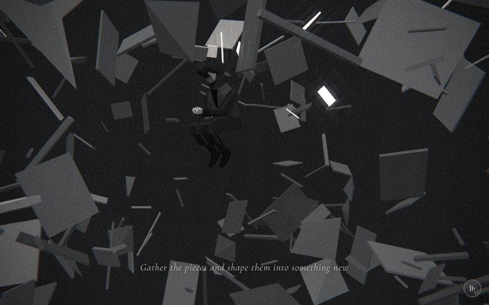

# 15 · shards



> "Gather the pieces and shape them into something new"
> Source: `src/app.js`, banner `/* 15 — everything shatters; he is curled up in the middle */` · group: void-objects · before/after: [sheet](../../assets/model-polish/void-objects.jpg)

## At a glance
| | |
|---|---|
| Setting | Void. A flat dark-grey backdrop with fog, no ground. The hero hangs curled up at the origin while 320 pieces (plates and planks, sticks, flat wedges) fly outward from around him |
| Tone | Dark all scene. `bg:'#1c1c1c'`, `scene.background = new THREE.Color(0x1c1c1c)`, `Fog(0x1c1c1c,6,30)`, `dark:()=>true`. Dips: petals' last 10 % fades to `#1c1c1c`; for t > .9 this scene fades to flood's `#000` |
| Hero | **Curl.** `makePerson({body:0x0e0e0e,jacket:0x232323})`, stored in the legacy-named variable `dad`. The pose is set by hand once in `build()` (no rig call per frame): knees to chest, arms around the knees, head down. Each frame: position (0, −.55, 0), rotation (.25, .4 + t·.3, 0). Holds nothing |
| Motion | Explosion: every piece moves out along its own direction by `ease(t)·speed` and spins. The hero turns .3 rad with scroll. The camera orbits and pulls back. The only time-driven motion is a slow extra x-spin of every piece (`time·.1`) |
| Camera | `a = t·π·.7 + .3`, `R = lerp(3.6,7,t)`; position `(sin a·R, lerp(.5,1.4,t), cos a·R)`, `lookAt(0,0,0)`. Start ≈ (1.06, .5, 3.44), end ≈ (4.19, 1.4, −5.61). It begins almost in front of him (his yaw .4, camera azimuth .3) and ends at his left side, slightly behind him (his yaw .7, camera azimuth 2.5). Default fov |
| Budget | scene 3440 tris (v40 1280) · hero 1561 (v40 1093) · 54 meshes · 3 instanced (320 instances) · 4 lights · 10 materials |

## Models
| Model | Built with | Geometry | Tone | Placement / contact | Notes |
|---|---|---|---|---|---|
| Hero (`dad`) | `makePerson({body:0x0e0e0e,jacket:0x232323})` → `makeHero` | faceted lofts, 1561 tris, 51 meshes | trousers `0x0e0e0e` (the shoes are derived darker), coat `0x232323` | (0, −.55, 0), floating in the void, nothing under him | Pose: `legs −1.75`, `knees 2.25`, arms `(−.85, 0, ±.45)` (right +.45, left −.45), elbows −1.0, head .9, whole body `rotation.x .25`. The thighs are past −.6, so the coat uses its seated lap pieces and knee flaps (CHARACTER.md). Receives and casts shadows (`buildAll`) |
| Plates and planks × 160 | `InstancedMesh(new THREE.BoxGeometry(1,.04,1), …, 160)` | 12 tris each, **1920** | per instance (see tone bands) | start distance `d = 1.2 + r()·1.4` along `dir` | Scale `(w, 1, w·(.3 + r()·.8))` with `w = .3 + r()·.9`: .3–1.2 wide, .04 thick, .09–1.32 deep. Square plates to long planks |
| Sticks × 110 | `InstancedMesh(new THREE.BoxGeometry(.06,.06,1), …, 110)` | 12 tris each, **1320** | per instance | same | Scale `(.5–1.4, .5–1.4, .35–1.55)`: cross-section .03–.084, length .35–1.55 |
| Flat wedges × 50 | `InstancedMesh(new THREE.TetrahedronGeometry(.5,0), …, 50)` | 4 tris each, **200** | per instance | same | Scale `(w, .15, w)` with `w = .4 + r()·.9`: a flattened triangular sliver |
| Shard material × 3 | `M(0xffffff,{emissive:0x262626})`, one per instanced mesh (made in `mk`) | — | white base × per-instance colour; emissive floor `#262626` | — | `frustumCulled = false` on all three |
| Background | `scene.background = new THREE.Color(0x1c1c1c)` | — | `#1c1c1c` | — | fog in the same colour, 6 → 30 |

**Per-instance construction** (one `rng(31)` for all three meshes, plates first, then sticks, then wedges):
- **Direction:** `normalize(r()−.5, (r()−.5)·.8, r()−.5)`, slightly flattened vertically.
- **Distance and speed:** start distance `d` 1.2–2.6; speed `sp = 2 + r()·9`.
- **Spin:** `rot` is a random start angle (0–6 rad per axis); `vr` is a spin of ±3 rad per axis over the scene.
- **Size near him:** pieces starting closer than 1.8 are scaled ×.6. Replaying the draws gives 145 of the 320.
- **Tone:** a draw `k` picks the band (`c.setScalar`). Replaying `rng(31)` gives these counts:

| Band | Rule | Grey | Count |
|---|---|---|---|
| White-lit | `k < .08`, flying up (`dir.y ≥ −.05`) | .9 | 13 |
| White demoted | `k < .08`, flying down | .15 | 12 |
| Mid | `.08 ≤ k < .2`, flying up | .22–.4 | 20 |
| Mid demoted | `.08 ≤ k < .2`, flying down | .05–.2 | 20 |
| Dark | `k ≥ .2` | .05–.2 | 255 |

**Mirrored pieces:** any piece whose flight passes within 1.2 (plates, wedges) or .7 (sticks) of the orbiting camera has its `dir.x` and `dir.z` negated (azimuth + π, `s.flipped = true`). This uses no rng draws. Six pieces are mirrored (5 plates, 1 stick), matching the notes.

**Final distances** from the origin (`d + sp`): 3.5–13.4. The far pieces fade into the `#1c1c1c` fog.

## Lights and atmosphere
- `lights(scene,{hemi:[0xbbbbbb,0x111111,.6],dir:[0xffffff,1,[3,5,4]]})`:
  - hemisphere `0xbbbbbb` over `0x111111`, intensity .6
  - shadow-casting key light 1.0 from the upper right front (direction (3,5,4))
  - automatic rim light .45 from (−3, 3, −8)
- **`fill = PointLight(0xffffff,.5,10)`:** a low fill that follows the camera's azimuth at radius 2.2, y 1.2 (`fill.position.set(sin a·2.2, 1.2, cos a·2.2)`). Without it the curled figure was only rim-lit.
- `Fog(0x1c1c1c, 6, 30)` in the background colour.
- **Shadows:** `buildAll()` skips instanced meshes, so the pieces neither cast nor receive shadows. Only the hero self-shadows.
- **Emissive floor:** with `emissive 0x262626`, a face that no light reaches renders about `#2e` after the film pass, against a `#22` backdrop (group notes), so near pieces no longer read as black holes. The tone bands were lowered to compensate, so lit faces stay as dark as before.
- **Film pass:** when a light hits one of the 13 white-lit pieces (.9), it crosses the .8 glow threshold and blooms as a bright sliver, like the reference frames f080–f083.

## Animation (`update(t, time)`)
- `ex = ease(t)`.
- **Each piece:**
  - position `dir·(d + ex·sp)`
  - rotation `(rot.x + vr.x·ex + time·.1, rot.y + vr.y·ex, rot.z + vr.z·ex)`
  - scale `s`
  
  The matrices are written with `setMatrixAt`, then `instanceMatrix.needsUpdate = true` on all three meshes.
- **Hero:** `dad.position.set(0,-.55,0)`; `dad.rotation.set(.25, .4 + t·.3, 0)`. Scroll-driven, with no time term: the owner removed the trembling.
- **Camera and fill:** see At a glance and Lights. Scroll-driven.

## v40 → v41
Source: [model-polish/void-objects.md](../model-polish/void-objects.md) ("15 shards", Round 1, Round 2). Audit priority LOW.
- **v40:**
  - One `InstancedMesh` of 320 `TetrahedronGeometry(.5,0)`, scaled flat (`.2–1.4, .05–.17, .2–1.1`).
  - Tone `.12 + r()·.45`, start distance `.6 + r()·1.2`.
  - The hero was hidden behind the nearest shards until about t .5 (audit).
- **First pass:**
  - Split into the three instanced meshes of the reference (160 plates, 110 sticks, 50 wedges).
  - Per-instance greys: 80 % dark, 12 % mid, 8 % white-lit.
  - Nothing starts closer than 1.2, and pieces inside 1.8 are scaled ×.6.
  - Added the camera-side point fill.
- **Round 1:**
  - The white-lit tone is given only to pieces flying upward; downward ones are demoted, which removed a white plate behind the caption.
  - The dark band floor was raised.
  - Widening the white draw to `k < .12` was tried and reverted: it changes the rng sequence, and another piece then filled the frame.
- **Round 2:**
  - Mid tones also only on upward pieces (20 of 40 demoted).
  - Emissive floor `0x262626`, with bands lowered to dark .05–.2, mid .22–.4, demoted white .15, white .9. A first try at `0x33` lifted everything into a grey wall and was reverted.
  - Camera-path mirroring of the 6 near-lens pieces.
  - Measured nearest approach of any piece to the camera: 1.14 (a stick).
- **Untouched:** the explosion easing, the curl pose and the camera.
- **Triangles (inventory, hero excluded):** 1280 → 3440 (1920 + 1320 + 200). The notes' 2373 → 4533 include the v40 hero (1093).
- **Hero:** the curl now reads as knees to chest with the coat lying over the thighs. Before, the coat formed a slab. This came from the hero group's lap and knee pieces ([hero.md](../model-polish/hero.md)).
- The group's other item, `suitcase()` (scenes 1 and 3; see `docs/MODELS.md`), does not appear in this scene.

## Editing notes
- **Owner rules:**
  - no trembling ("身體窩成一團，痛苦的感覺 → 手太僵硬，不要抖動"): keep the hero's motion scroll-driven
  - do not touch (audit): the curl pose (arms around the knees) and the explosion easing
  - the caption is verbatim; ART-DIRECTION's text rule frames the shards as material for something new
- **rng discipline:** each piece consumes, in order:
  - `dir` (3 draws), `d` (1)
  - scale: plates 2, sticks 3, wedges 1
  - `sp` (1), `rot` (3), `vr` (3), `k` (1)
  - one more draw for the mid and dark bands, none for the white band

  Changing a threshold, a branch, a count or the order changes every later piece. The reviewed frames depend on this exact sequence. To change tones without moving pieces, change only the values inside a branch, not the number of `r()` calls.
- **The mirror loop duplicates the camera path** (`a = t·π·.7 + .3`, `R = lerp(3.6,7,t)`, y `lerp(.5,1.4,t)`, steps of .02). If you change the camera in `update()`, change the loop too.
- **Instancing:** keep `frustumCulled = false`. The instances fly far outside the unit geometry's bounding sphere, and three.js r128 culls an `InstancedMesh` by that sphere. Instanced meshes get no shadows from `buildAll()`; set `castShadow` by hand if a piece's shadow on him is ever wanted.
- **Caption zone:**
  - Only upward-flying pieces may be white or mid grey; this keeps the lower middle calm.
  - In the t=.5 screenshot the lower half is still full of large dark-to-mid-grey plates around the caption. The caption stays legible as white text with a dark halo, but don't brighten the downward bands.
  - Round 1 noted a pale key-lit plate at the lower right behind the end of the caption at 15.35; Round 2's mid-band demotion addressed that class of piece.
- **The hero is small and dark** (SCENES.md weak spot). He is a near-black figure (`0x0e0e0e` / `0x232323`) lit by the key, the rim and the camera-side point fill. A spine joint (ROADMAP) would make the curl read better. The torso cannot bend today, which is why the whole body is tilted with `rotation.x .25`.
- **Near clearance:** nothing starts within 1.2 of him, and the camera path keeps 1.2 from plates and wedges and .7 from sticks. New piece types need the same check.
- **The variable name `dad` is legacy.** It is the hero, built by `makeHero` (`makePerson` with neither `child` nor `father`).

## Check it
```bash
NODE_PATH=/opt/node-tools/node_modules WAIT=12000 node tools/shots.js 14.9 15.1 15.25 15.35 15.5 15.65
```
- 14.9, 15.1 and 15.25 are the warm-up chain the notes require before 15.35 (otherwise the frame lags).
- **15.35:**
  - the curled figure clearly visible, with no piece covering him
  - no white or pale piece behind the caption
  - no black-hole faces near the lens
- **15.5 / 15.65:**
  - the white slivers (upward-flying pieces only, so none low in the frame)
  - the camera at his left side, slightly behind him
  - the coat over the thighs, with no slab
- **Pose:** `tools/pose.html`'s default `POSE` is exactly this curl. Open it at `?0`, `?1` and `?2` (side, front, three-quarter) after any `makeHero()` change. The page reads a bare number; `?v=1` does not work.
