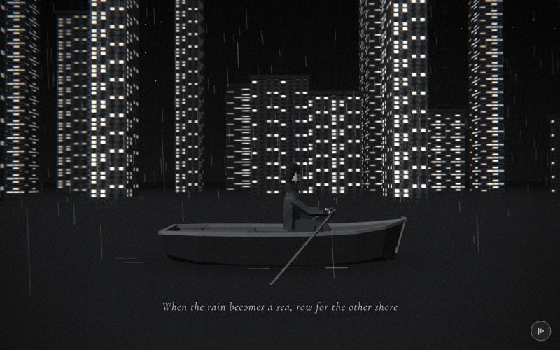

# 16 · flood



> "When the rain becomes a sea, row for the other shore"
> Source: `src/app.js`, banner `/* 16 — rowing alone through a flooded city in the rain */` · group: water-ground · before/after: [sheet](../../assets/model-polish/water-ground.jpg)

## At a glance
| | |
|---|---|
| Setting | Exterior at night: a flooded city. A dark water plane fills the lower half of the frame. 22 lit night towers stand in it along the back (z −15…−42), under rain and stars. In the foreground a small plank-and-rib rowing boat crosses the frame from left to right with the hero rowing it |
| Tone | Dark. `bg:'#000'`. `scene.background = gradTex('#000','#1e1e1e')` (black at the top, `#1e` at the bottom), `Fog(0x080808,14,80)`. `dark:()=>true` for the whole scene: white caption with a dark halo, dark-scene grain and vignette. Dips: fades in from its own `#000`; for t > .9 it fades to rooftop's `#ece8e1` |
| Hero | Row (seated, scripted stroke). `makePerson({body:0x2a2a2a, jacket:0x303030})`, `sit()`, a child of the boat at (.1, −.425, 0), `rotation.y = π/2` (he faces the bow, +x, the direction of travel). Both fists are closed once at build: `me.userData.hands?.forEach(h=>h.userData.grip(1))`. Every frame the stroke sets `arms[*].rotation.x` and `elbows[*].rotation.x`, and the two oars are re-aimed from his fists |
| Motion | Scroll moves the boat from x −6 to 8 (`lerp(-6,8,t)`), and the camera with it. Time drives everything else: the stroke (one stroke per 3.93 s), the boat's bob and pitch, and the falling rain |
| Camera | Position `(x-1.5+t*3, lerp(1.5,.8,t), lerp(7,5.5,t))`, `lookAt(x,1.3,-4)`, where x is the boat's x. That is (−7.5, 1.5, 7) at t=0, (1, 1.15, 6.25) at t=.5 and (9.5, .8, 5.5) at t=1: from the aft quarter, through abeam, to the bow quarter, getting lower and closer. Default fov, plus the handheld drift. The lookAt height was lowered 1.6 → 1.3 in v41 for caption clearance (see Editing notes) |
| Budget | scene 1438 tris (v40 690, 2.08×) · hero 1561 (v40 1093) · 159 meshes incl. the hero's 51 (v40 98) · 0 instanced · 2 lights · 600 star points · 1 `LineSegments` (rain, 1400 streaks) · 69 materials (v40 58). Split: towers + lips + reflections 792, boat and oars 594, water + smear + wake 52 |

## Models
All boat parts are children of `boat` (a `Group`), in boat space: +x is the bow, y = 0 is the waterline at rest, and +z is the camera side. Station data `ST` = `[x, halfBeam, sheerY, chineY, keelY, rake]` × 7, and the local `at(x)` interpolates `[halfBeam, sheerY, chineY, keelY]` at any x.

| Model | Built with | Geometry | Tone | Placement / contact | Notes |
|---|---|---|---|---|---|
| Water | `ground(0x0c0c0c)`, then `water.material = M(0x202020,{roughness:.45, metalness:.1, side:FrontSide})` | `PlaneGeometry(400,400)`, 2 tris | `0x202020` (lifted from `0x0c0c0c` in v41, **not yet confirmed by the owner**) | y = 0, opaque | It hides everything below y 0: the hull bottom, the blades, the reflections and the lower half of the rain |
| Night towers ×22 | `building(w,h,2+r()*4,true)`, `b.position.set(x,h/2,z)`, `rng(17)` | facade box 12 tris + parapet lip 12 tris | night facade (lit window grid, `emissiveIntensity .85`); lip `0x1e1e1e` (`cityTones` night) | x = −40 + 4i ± 1, z = −14 − (0…30), w 2–6, d 2–6, h 6–36. Replayed: x −39.6…44.9, z −41.7…−15.4, h 6.7…34.4. Base at y 0 (on the water) | Night towers get only the lip (no podium or door). The lip has `renderOrder 1` |
| Tower reflections ×22 | `new THREE.Mesh(b.geometry, MeshBasicMaterial({map:FACADE.night, transparent:true, opacity:.18, depthWrite:false}))`, `scale.y = -1`, y = −h/2 | box, 12 tris each (264) | night tile variant 0 | Entirely below y 0 | **Invisible:** they sit under the opaque water (water-ground notes, city.md). `FACADE.night` is variant 0 even when the tower above is variant 1 or 2 |
| Rain | `rain(1400,40,6)` | `LineSegments`, 1400 streaks, each .45 long with a .02 slant | white, opacity .25 | x, z ±20, y 0–14, following the boat's x | Near the boat it is inside the fog's near distance (14), so it is not fogged. It falls as one block |
| Stars | `stars(600,90,{seed:13,minY:20})` | `Points`, 600 | white, size 1.6 px (no attenuation), opacity .9, `fog:false` | radius 54–90, y ≥ 20 | Above the towers |
| Hull | local `shell(1,0,0,.08)` | `BufferGeometry`: 6 bays × 2 sides × 2 strakes (topside, bilge) × 2 tris + a 3-tri flat transom = 51 tris, flat normals | `M(0x1a1a1a,{vertexColors:true})`, per-facet tone ±4 % (`rng(3)`) | Transom at x −1.72 (raked), stem at 1.82 (raked); beam 1.2 (half-beam .60 at x −.5); sheer .44 at the transom rising to .66 at the stem; keel −.15 amidships, so the draft is about .15 | DoubleSide (the `M` default), so the inside reads. Length ≈ 3.5 |
| Inner planking | `shell(.96,-.012,.03,.06)` | 51 tris | `M(0x3a3a3a,{vertexColors:true})`, ±3 % | x and beam × .96, sheer .012 lower, chine and keel .03 higher | The lighter inside, as in reference frame f103 |
| Gunwale rail | local `railGeo` | ribbon with top, outer and inner faces along the sheer: 2 sides × 6 bays × 3 quads = 72 tris | `railM = M(0x5a5a5a)` | Top at sheer + .035, bottom at sheer − .012, .07 wide, outer edge .025 outside the hull. At the oarlocks (x .45) the rail top is .524 | The sides meet at the stem |
| Stem post | `box(.06,.56,.06,railM,1.735,.45,0)`, `rotation.z = -.25` | box | `0x5a5a5a` | Parallel to the raked stem. Its bottom end is inside the hull at y ≈ .17; the top is about .03 proud of the rail | Round 3 moved it inside the hull's side profile, so no nub shows below the keel |
| Transom cap | `box(.07,.045,.9,railM,-1.72,.452,0)` | box | `0x5a5a5a` | On the transom's top edge | |
| Duckboard ×3 | `box(2.4,.006,.2,fbM,-.14,.017,0)`, `box(2.0,.006,.08,fbM,-.21,.017,±.16)` | boxes | `fbM = M(0x2e2e2e)` | Tops at y .02. His soles rest on them at about .018 (the rig's baseline) | Each plank stays inside the inner planking: round 3 raycast down from every bottom corner and found 11–23 mm of hull below each |
| Ribs ×12 | local `bar(p,q,.035,darkM)`: a box aligned from p to q with `quaternion.setFromUnitVectors(UP,…)` | .035 square bars | `darkM = M(0x1c1c1c)` | At x −1.3, −.45 and .75, both sides: a bilge piece (x, −.03, ±.2) → (x, chine+.02, ±.8·hb) and a topside piece from there → (x, sheer−.03, ±(hb−.04)) | Two pieces per rib, so the rib follows the chine |
| Thwarts ×3 | `box(w,.04,.24,M(0x383838),x,y,0)` + inset top plate `box(w-.04,.01,.2,M(0x4e4e4e),x,y+.025,0)` | boxes | `0x383838`, plate `0x4e4e4e` | x −1.05 (y .41), .12 (y .45) and 1.1 (y .41); plate tops at .44, **.48** and .44. `w` is the hull width at that height × .95 (about 1.05, 1.11 and .79) | The middle thwart (top .48, .03 under the rail) carries him. The lighter plate fakes a bevel |
| Thole pins ×4 | `box(.02,.09,.024,darkM,.405 / .495, ly+.045, ±lz)` | boxes | `0x1c1c1c` | `[hbL,syL] = at(.45)`, `ly = syL+.035` (.524, the rail top), `lz = hbL+.012` (.568; the .024-deep pins end flush with the rail's outer edge at hb + .025 = .581). The pins stand .524–.614, one each side of x .45 | The shaft rests on the rail between the two pins of its side. ROADMAP: too small to read |
| Oars ×2 | one `Group` per side (`sd` −1, +1), children of `boat`: shaft `CylinderGeometry(.022,.022,2.2,6,1,true)` (rotated onto +z, `position.z = 1.0`, spanning −.1…2.1), blade `loftGeo([[0,.045,.09,0],[.2,.045,.27,0],[.45,.03,.23,0]],{sides:4,rot:π/4})` (`rotation.x = π/2`, z 1.75–2.2), handle `box(.05,.05,.1,M(0x222222),0,0,.03)` | shaft 12 tris (open tube), blade 24, handle 12: 48 per oar | `oarM = M(0x4a4a4a)`, handle `0x222222` | The group's origin is the grip point in his fist. Its +z axis is aimed every frame at `userData.lock = V3(.45, ly+.038, sd*lz)` = (.45, .562, ±.568) | The blade is a 4-sided tapered loft (rectangular section, about .03 thick and up to .19 wide; not cupped) whose wide dimension is vertical. It stays under the water at every phase. See Animation for the aim code |
| Hull smear | `Mesh(PlaneGeometry(5,2.8), MeshBasicMaterial({map:SH, transparent:true, opacity:.9, depthWrite:false}))`, `SH` = `canvasTex` radial gradient `rgba(0,0,0,.6)` → 0 | 2 tris | black, fading out | `rotation.x = -π/2`, y .006, centred under the boat; `renderOrder 1` | In the `wake` group, which follows the boat's x but not its bob. It stands in for the film's inverted reflection (f096, f098) |
| Wake dashes ×4 | `box(.3,.004,.018,dm,x,.012,z)`, `dm = B(0x8a8a8a)` | boxes | `0x8a8a8a`, unlit | (−.35, .7) and (.7, .66) along the hull's sides at the waterline; (−2.15, .2) and (−2.4, −.14) behind the transom | In `wake` |
| Hero | `makePerson({body:0x2a2a2a, jacket:0x303030})` | 1561 tris | trousers `0x2a2a2a`, coat `0x303030` | Seated on the middle thwart, soles on the duckboard | A child of `boat`, so he bobs and pitches with the oars |

## Lights and atmosphere
- **Hand-placed lights, no `lights()`, so there are no shadows in this scene:**
  - `HemisphereLight(0x8a8a8a, 0x050505, .55)`
  - moon `DirectionalLight(0xffffff, 1.1)` at (−6, 8, 10), front-left of the boat on the camera side; its target is the origin. `castShadow` is not set
- `Fog(0x080808, 14, 80)`. The towers at 20–50 units are partly fogged; the boat is never fogged.
- Lit windows on the night facades (emissive). With the stars they are the brightest pixels, so the film pass's glow taps (> .8 brightness) catch them.
- Rain: 1400 white streaks at opacity .25. Stars: 600 fixed-size points.
- The hull smear (dark, transparent) and four light wake dashes on the water read as the reflection and the wake.
- **Film pass:** dark mode for the whole scene, so the grain and vignette are strong.

## Animation (`update(t, time)`)
- **Boat (scroll + time):**
  - `x = lerp(-6,8,t)`
  - `boat.position.set(x, sin(time*1.3)*.04, 0)`: bob ±.04
  - `boat.rotation.z = sin(time*1.1)*.03`: pitch along the boat's length
  - `wake.position.x = x`: the smear and dashes follow without bobbing
- **Stroke (time only, both arms in phase):**
  - `ph = time*1.6`, `pull = (1 - sin(ph))/2`. The period is 2π/1.6 ≈ 3.93 s.
  - `arms[*].rotation.x = lerp(-1.25,-.6,pull)` and `arms[*].rotation.z = 0`
  - `elbows[*].rotation.x = lerp(-.15,-1.2,pull)`
  - At `pull = 0` (the catch) the arms reach forward almost straight. At `pull = 1` (the finish) the hands are drawn in toward the lower ribs.
  - Round 3 measured the hands in boat space at eight phases: y .757–.781 against the shoulder at .931, so they stay .15–.17 below the shoulder line for the whole stroke, and the forearms are at most 13° above horizontal.
- **Oar aim (every frame, after the stroke):**
  ```js
  boat.updateMatrixWorld(true);
  oars.forEach((o,i)=>{const el=elbows[1-i];        // hero faces +x: his right hand (elbows[0]) is on the +z side
    grip.set(0,-.33,0);el.localToWorld(grip);boat.worldToLocal(grip);   // grip point in the fist, in boat space
    dir.copy(o.userData.lock).sub(grip).normalize();                     // from the fist through the oarlock
    o.position.copy(grip);o.quaternion.setFromUnitVectors(Z,dir)});      // oar origin in the fist, +z through the lock
  ```
  - `oars[0]` is the far oar (`sd = -1`, −z) and is driven by `elbows[1]`, his left arm. `oars[1]` is the near oar (+z, the camera side) and is driven by `elbows[0]`, his right arm.
  - The grip point (0, −.33, 0) in elbow space is .075 beyond the hand pivot (hands hang .255 below the elbows), inside the closed fist.
  - Because the oar is placed from the hand and aimed through a fixed lock, the fist and the oar can never separate. This was the owner's v31 fix for 「手根桿子分離了」.
  - Measured in round 3 over the full stroke: the shaft bottom clears the rail's outer edge (.531 vs the rail top .524); the dip is 27–29°; the blade tip is .20–.33 under the water and the blade root −.11…+.007.
- **Rain:** `rn.position.y = -(time*9 % 7)` (the whole field drops 7 units and snaps back every .78 s), and `rn.position.x = x`.
- **Camera:** the formula above, then the handheld drift from `frame()`.

## v40 → v41
Source: [model-polish/water-ground.md](../model-polish/water-ground.md) ("16 flood (priority)" and rounds 1–3). Audit priority HIGH ([audit](../model-polish/audit.md)). The audit's problems: the hull read as a hollow wedge (no gunwale, stem, keel or ribs); the near oar cut through the hull side (lock at z ±.5, inside the wall); one thwart; shoes hovering; flat box blades.
- **v40:**
  - The hull was a deformed `BoxGeometry(2.8,.45,1,6,1,1)` (52 tris, `M(0x2c2c2c)`, y .12).
  - One thwart `box(.12,.04,.9,M(0x3a3a3a),.1,.32,0)`.
  - Box oars: shaft `.035²×2.2`, blade `box(.035,.18,.42)` at z 2.0, lock `V3(.3,.42,sd*.5)`.
  - Two oarlock boxes at (.3, .38, ±.5).
  - Hero at y −.42.
  - Stroke `arms lerp(-1.25,-.55)`, `elbows lerp(-.1,-1.25)`.
  - Water `M(0x0c0c0c,{roughness:.35,metalness:.2})`.
  - `lookAt(x,1.6,-4)`.
- **Round 0:**
  - The plank-and-rib hull from seven stations, plus the inner shell, rail, stem post, transom cap, floorboards, ribs and three thwarts.
  - The oarlocks moved onto the rail, with 6-sided shafts and loft blades.
  - The smear and seven wake dashes.
  - The water lifted from `0x0c` to `0x20`, because black on black hid the hull and the smear.
- **Round 1:** 2.5 oars, so the blades reached the water.
- **Round 2:**
  - Blocker: the near oar crossed the caption at 192/192 samples.
  - The lock plate was replaced by thole pins on the rail's outer edge, with the shaft resting on the rail. The oars became 2.2.
  - Three planks that fit inside the hull. Four wake dashes.
  - The hands were lifted to shoulder height. The round-3 review made that pose a blocker.
- **Round 3:**
  - The stroke went back to a natural one, close to the v40 ranges (above).
  - The hero was raised .04 from round 0's −.465 (to y −.425), the rowing thwart's top to .48, and the duckboard tops to +.02.
  - `lookAt` y 1.6 → 1.3 (the frame shifts about 20 px).
  - The stem post moved inside the hull profile.
- **Kept on purpose:** the per-frame oar aim code, the rain, and the towers and their reflections (the audit's do-not-touch list). The list also named the stroke animation, which round 3 adjusted slightly for the caption clearance. The boat's path and the camera path are unchanged apart from `lookAt`.
- **Triangles:** 690 → 1438 (2.08×, inventory). The boat and oars grew from 160 to 594 and the water extras from 2 to 52. The 264 tris of tower lips come from the city group's `building()` change. The group notes quote 1783 → 2267, which includes the v40 hero (1093) and not the lips.

## Editing notes
- **Never parent the oar to the hand, and never animate the oars on their own.** Change the stroke and the oars follow automatically. Keep `boat.updateMatrixWorld(true)` after the arm rotations and before `localToWorld`; without it the oars use last frame's hand position and visibly detach while the boat bobs.
- **Oar ↔ hand mapping:** `elbows[1-i]`. If the hero is turned around (for example to face the stern, as a real rower would), the mapping, the lock sides and the stroke all have to be reworked. Ask the owner first; he faces the bow in both v40 and v41.
- **Blade roll is implicit.** `setFromUnitVectors(Z,dir)` picks the shortest rotation, so the blade's roll is not controlled, and the far oar's `dir` points away from +Z. If you make the blade asymmetric, check both oars.
- **Caption clearance of the near oar:**
  - The band is NDC \|x\| < .42 and y < −.68, which is below 525 px in a 1000×625 shot. The caption shows for t .12–.75.
  - **Round 3 sweep** (run in the page with the real update code): t .10–.77 in steps of .0335 × stroke time 0–4 s in steps of .1, which is 840 samples. Each sample projected 41 points of the near oar, from the grip to where it enters the water. Result: 0 hits. The lowest point was at NDC y −.626 (about 17 px above the band line) at t ≈ .5. The camera's handheld drift is about ±2 px.
  - **What buys the margin:**
    - the lock is as low as it can be (the shaft resting on the rail's outer edge, `lock.y = ly + .038`), so the oar runs steeply into the water
    - the seat is raised .04
    - `lookAt` y is 1.3
  - With the v40 stroke and `lookAt` 1.6, all 840 samples hit the band. Other configurations that also cleared it in the round-3 sweep, with the v40 arms and the hero not yet raised (y −.465): `lookAt` 1.15, or the camera 1.2 units farther back.
  - **Any change** to `lookAt`, the camera path, the hero's y, the stroke ranges, the oar length or the lock needs the sweep re-run. The probe script is not in the repo. Rebuild it from this description and run it with `tools/browser.js` (`openSite(b,{width:1000,height:625})`).
- **Don't lift the blade on the recovery.** The water is opaque, and a raised blade swings toward the camera into the caption band (round-2 notes). The blade stays submerged at every phase.
- **Hands below the shoulders.** Round 2's shoulder-height hands were rejected. Keep the hands .15–.17 below the shoulder line.
- **Moving the lock inboard does not steepen the oar.** Round 3 checked the inner-edge idea analytically: with the shaft resting on the rail, a lock .042 inboard must also go .044 higher, and the oar gets *shallower*.
- **Water tone `0x20` is pending the owner's confirmation.** To revert to v40's pitch-black water, use `water.material=M(0x0c0c0c,{roughness:.35,metalness:.2,side:THREE.FrontSide})`. The smear and the wake dashes then disappear. The flood rows of the [sheet](../../assets/model-polish/water-ground.jpg) show the difference: before is v40's `0x0c` water, and the after column (round 1) already uses `0x20`.
- **The reflections are dead weight:** 264 tris that never render, because they are under the opaque water. Delete them, or make them visible (for example a transparent water or a mirrored copy drawn above the plane). If kept, use `b.material.map` instead of `FACADE.night` (city.md). The audit listed them as do-not-touch, so treat a visible reflection as an owner decision.
- **Depth:** the smear is only .006 above the water, 5–8 units from the lens, where one 16-bit depth step is about .8–2 cm. SCENES.md calls the smear faint. If it speckles or drops out, use `polygonOffset` on its material. Don't use `depthTest:false`, which would also draw it over the hull.
- **Coat in the boat:** the round-0 notes flagged the coat's seat piece through the middle thwart. The hero group's v41 coat (short seat piece, lap pieces; see [CHARACTER.md](../CHARACTER.md) and [hero.md](../model-polish/hero.md)) says nothing hangs under the thighs any more. Re-check in a close crop at 16.5 after any seat or rig change.
- The stroke values above are mirrored in CHARACTER.md's pose table; keep both in step when you change the stroke.
- **Open (ROADMAP item 2):** a darker pool or an inverted hull copy under the waterline for hull contact (REFERENCE-STYLE suggests a hull copy at opacity .3), and thole pins big enough to read.

## Check it
```bash
NODE_PATH=/opt/node-tools/node_modules WAIT=9000 node tools/shots.js 15.9 16.3 16.35 16.5 16.65 16.85
```
- 15.9 is a lead-in. Jumping straight to 16.x lagged and showed scene 15.
- The stroke runs on `time`, so each shot catches a random stroke phase. Shoot several positions, or repeat one.
- **16.3–16.65:** the near oar must stay above the caption text, the fists closed on the handles, and the shaft leaving between the thole pins above the rail without cutting it.
- **16.5:** close-crop the boat for his soles on the duckboard, his thighs on the middle thwart and no coat below the thwart.
- **16.85:** the low end of the camera arc, where the blades enter the water.
- Also look at: the smear and dashes visible on the `0x20` water; the boat's dark hull against the water.
- **Pose only:** `tools/pose.html` with `sit()`, arms −1.25 / −.6 and elbows −.15 / −1.2 (the two ends of the stroke).
