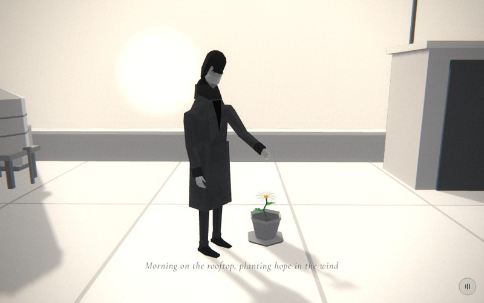

# 17 · rooftop



> "Morning on the rooftop, planting hope in the wind"
> Source: `src/app.js`, banner `/* 17 — dawn on the rooftop, a small potted daisy */` · group: water-ground · before/after: [sheet](../../assets/model-polish/water-ground.jpg)

## At a glance
| | |
|---|---|
| Setting | Exterior, dawn. A flat roof terrace: pale roofing panels with dark tar joints, a parapet with a lighter coping on all four sides, a door bulkhead with an antenna mast (back right), a water tank on legs and an AC unit (back left). He stands near the middle and reaches toward a small faceted planter holding a daisy. The sun glow rises behind the back parapet |
| Tone | Light and warm. `bg:'#ece8e1'`. `scene.background = gradTex('#f6f1e8','#d9d6d0')` (warm white at the top, grey at the bottom), `Fog(0xe4e0d8,8,70)`. `dark:()=>false`: black caption with a white halo, light-scene film pass. Dips: fades in from its own `#ece8e1`; for t > .9 it fades to room's `#f7f7f7` |
| Hero | Stand, static (no `stroll`, no animation). `makePerson()` with the default tones at the origin, `rotation.y = .9` (facing about (.78, 0, .62)). `head.rotation.x = .45` (looking down at the plant). His **left** arm reaches toward the planter: `arms[1].rotation.x = -.7`, `elbows[1].rotation.x = -.3`. The hand is open (default grip) and holds nothing |
| Motion | Camera orbit. Scroll also raises the sun glow (y −2 → 9). Time sways the daisy. Nothing else moves |
| Camera | `a = lerp(-.4,.9,t)`. Position `(sin(a)*3.4, lerp(1.4,2.1,t), cos(a)*3.4)`, `lookAt(.3,.9,-.3)`. That is (−1.32, 1.4, 3.13) at t=0, (.84, 1.75, 3.29) at t=.5 and (2.66, 2.1, 2.11) at t=1: a 74° orbit at radius 3.4 around the origin, rising .7. It starts at his front-right (about 74° off the way he faces) and ends almost straight in front of him, so his reaching left arm is on screen right. Default fov, plus the handheld drift |
| Budget | scene 5088 tris (v40 3294, 1.54×) · hero 1561 (v40 1093) · 247 meshes incl. the hero's 51 (v40 105) · 1 instanced (15 panels) · 3 lights · 1 sprite (sun) · 73 materials (v40 45). Split: daisy 2850, skyline buildings 1596 (never in frame, see Editing notes), the roof set itself 642 |

## Models
`box(w,h,d,mat,x,y,z)` takes the centre position. `bevelBox(w,h,d,b,mat,x,y,z)` is **scene-local**: a 4-ring, 8-sided `loft` from y to y+h with chamfer b (64 tris), where `y` is the **bottom**.

| Model | Built with | Geometry | Tone | Placement / contact | Notes |
|---|---|---|---|---|---|
| Roof slab | `box(10,.3,8,M(0x9c9c9c),0,-.154,0)` | box | `0x9c9c9c` | x ±5, z ±4, top at y −.004 | Shows only in the panel seams, as the tar joints |
| Roofing panels ×15 | local `InstancedMesh(pg, M(0xc6c6c6,{side:FrontSide}), 15)`, `pg = PlaneGeometry(1.84,2.427)` with `rotateX(-π/2)` | flat quads, 2 tris each | `0xc6c6c6` × per-panel `.95 + r2()*.07` (`r2 = rng(72)`) | 5 columns × 3 rows: x = (i−2)·1.88 (−3.76…3.76), z = (j−1)·2.467. Tops at y = 0: **the walking surface**. The .04 seams are at x ±.94 and ±2.82 and at z ±1.23 | `receiveShadow = true` is set by hand (instanced meshes are skipped by `buildAll`). Five columns, so no seam runs under his feet (soles x −.12…+.18) |
| Parapet walls ×4 | `box(w,.57,d,wall,x,.265,z)`, `wall = M(0xbdbdbd)` | boxes | `0xbdbdbd` | Back and front 10 × .3 at z ±3.85; sides .3 × 7.4 at x ±4.85, butting between the end walls (no coincident faces). y −.02….55, so the bottoms run into the slab | |
| Copings ×4 | `box(cw,.06,cd,cope,x,.58,z)`, `cope = M(0xdcdcdc)` | boxes | `0xdcdcdc` | y .55–.61. 10.1 × .4 on the end walls, .4 × 7.3 on the sides: a .05 overhang on each long face; the side copings stop at z ±3.65, where they butt against the end copings | The lighter cap that says "parapet" |
| Door bulkhead | group `bh` at (3.6, 0, −2.55): body `box(1.4,2.05,1.3,M(0xb6b6b6),0,1.025,0)`, cap `box(1.56,.1,1.46,M(0xcdcdcd),0,2.1,0)`, door `box(.78,1.9,.05,M(0x4e4e4e),0,.95,.66)`, knob `box(.05,.05,.05,M(0x8a8a8a),.28,1.0,.7)` | boxes, 72 tris with the mast | body `0xb6b6b6`, cap `0xcdcdcd`, door `0x4e4e4e`, knob `0x8a8a8a` | Body 0–2.05, cap 2.05–2.15. The door faces +z and stands 3.5 cm proud of the body's front face (z .65) | Back right, outside the camera's path. The camera passed through the v40 stairhead's spot at t ≈ 1 |
| Antenna mast | on `bh`: `box(.05,2.0,.05,M(0x6a6a6a),-.5,3.1,-.4)` + crossbar `box(.5,.03,.03,…,-.5,4.05,-.4)` | boxes | `0x6a6a6a` | Mast from 2.1 (inside the cap) to 4.1 | |
| Water tank | group `tk` at (−3.5, 0, −2.2): 4 legs `box(.07,.45,.07,M(0x707070),±.3,.225,±.3)`, platform `box(.8,.08,.8,M(0x8a8a8a),0,.49,0)`, drum `CylinderGeometry(.42,.42,.8,8)` `M(0xc2c2c2)` at y .93, cap `ConeGeometry(.45,.22,8)` `M(0xd2d2d2)` at 1.44, 2 hoops `CylinderGeometry(.432,.432,.025,8,1,true)` `M(0x8a8a8a)` at y .797 and 1.063 | 184 tris | legs `0x707070`, platform and hoops `0x8a8a8a`, drum `0xc2c2c2`, cap `0xd2d2d2` | Legs 0–.45, platform .45–.53, drum .53–1.33, cap 1.33–1.55. The hoops stand 1.2 cm proud of the drum | Back left. It enters the frame from about t = .5 (left edge of the t=.5 shot). The two hoop bands are "the one form that says tank" (code comment) |
| Tank down-pipe | on `tk`, `pipeM = M(0x7a7a7a)`: outlet stub `box(.12,.04,.04,…,.42,.56,.05)`, elbow `box(.05,.05,.05,…,.48,.56,.05)`, vertical run `box(.04,.56,.04,…,.48,.28,.05)` | boxes | `0x7a7a7a` | From the drum's base down to the roof (y 0–.56) | |
| AC unit | group `ac` at (−4.15, 0, −3.15): base `box(.9,.08,.5,M(0x7a7a7a),0,.04,0)`, body `bevelBox(1.0,.7,.55,.02,M(0xc0c0c0),0,.08,0)`, grille `box(.7,.4,.012,M(0x9a9a9a),0,.45,.28)`, fan ring `CylinderGeometry(.2,.2,.03,8)` `M(0x9a9a9a)` at y .795, hub `CylinderGeometry(.16,.16,.012,8)` `M(0x3a3a3a)` at .815 | 152 tris | body `0xc0c0c0`, base `0x7a7a7a`, grille and fan `0x9a9a9a`, hub `0x3a3a3a` | Base 0–.08, body .08–.78. The grille is on the +z face, 1.1 cm proud. It is in the back-left corner: 5 cm from the side wall's inner face, 27.5 cm from the back wall | Mostly hidden behind the tank (see Editing notes) |
| Planter | group `pot` at (.55, 0, −.2): saucer `CylinderGeometry(.21,.19,.025,6)` `M(0x767676)` at y .0125; body `loft([[.02,.2,.2,0],[.05,.24,.24,0],[.23,.33,.33,0]],M(0x8e8e8e),{sides:6})`; soil `CylinderGeometry(.16,.16,.012,6)` `M(0x3c3c3c)` at .232; rim `CylinderGeometry(.18,.165,.035,6,1,true)` `M(0xa0a0a0)` at .2475 | 96 tris; all six-sided with the same orientation (θ₀ = 0) | saucer `0x767676`, body `0x8e8e8e`, soil `0x3c3c3c`, rim `0xa0a0a0` | Saucer 0–.025 on the panels. The body flares from radius .10 at y .02 (5 mm into the saucer) to .165 at .23. The soil is .226–.238. The rim (.23–.265) has its lower edge exactly on the body's top edge, so nothing shows through under it | Just in front of his left hand, to his front-left |
| Daisy | `makeDaisy({r:.11, stem:.22})` at (.55, .46, −.2), `head.rotation.x = .3` | 21 petals (80 each), centre 462, calyx 126, stem tube 392, 2 leaves (95 each): 2850 tris | petals `0xf1f1ec`, centre `0xe79a14` (emissive `0x7a4a00`), green `0x1d7a2c`; smooth | The stem base is at about y .24, 2 mm above the soil top (.238), inside the rim | **Not** a child of `pot`: it is placed at the same (x, z) separately. Sways on `time`, pivoting at the head. Unchanged since v40 (owner-approved) |
| Skyline ×30 | `building(3+r()*5, 4+r()*22, 3+r()*5, false)`, `b.position.set((r()-.5)*80, -26, -20-r()*45)`; the first 150 draws of `r = rng(71)` | day facade box + lip (30) + podium and cap (22) + door (18, 11 of them double with a canopy): 1596 tris, 133 meshes (replayed) | day facade tiles, untinted; trim from `cityTones` (day) | Replayed: x −33.3…35.2, z −61.9…−23.1, h 4.2…25. `position.set(…,-26,…)` overrides the y = h/2 that `building()` sets, so each box is centred at y −26 and the roofs are at −23.9…−13.5, far below the roof terrace | **Never in frame** (computed; see Editing notes). city.md: "17 rooftop still buries its skyline at y=-26 by design" |
| Sun glow | `glow(16,.8)` at (−14, y, −60) | additive `Sprite`, 16 units across | white radial gradient | y from −2 to 9 over the scene, behind the back parapet | Default `depthTest`, so the parapet hides the lower part early on. Fogged (default sprite fog) |
| Hero | `makePerson()` | 1561 tris | trousers `0x2a2a2a`, coat `0x3a3a3a` | At the origin, standing on the panels (soles about −.02…−.03, the rig's baseline) | Casts a long shadow toward the camera |
| Background / fog | `gradTex('#f6f1e8','#d9d6d0')`, `Fog(0xe4e0d8,8,70)` | — | — | — | — |

## Lights and atmosphere
- `lights(scene,{hemi:[0xffffff,0x9a9a9a,.9], dir:[0xfff4e0,.8,[-4,3,-6]]})`:
  - `HemisphereLight(0xffffff, 0x9a9a9a, .9)`
  - warm key `DirectionalLight(0xfff4e0, .8)` from (−4,3,−6), normalised × 20 = (−10.24, 7.68, −15.36). That is back-left, the same side as the sun glow, so shadows fall toward the camera. It casts shadows (±14 shadow camera, 1536 px), which covers the whole roof.
  - rim `DirectionalLight(0xffffff, .36)` at (4, 1.8, −10)
- **Shadows** (`buildAll`, radius < 1.2):
  - Cast: the hero, the daisy, the planter, the tank parts, the AC parts, the bulkhead cap, door, knob and mast.
  - Do not cast: the slab, walls, copings, the bulkhead body (radius ≈ 1.4) and the skyline (only its 10 smallest door boxes pass the radius test, 26 units below the roof).
  - The panels receive because of the hand-set flag. In the t=.5 shot, long shadows run down the frame toward the lens.
- `Fog(0xe4e0d8, 8, 70)`: the fog colour sits between the two background stops.
- **Sun:** an additive glow sprite rising from y −2 to 9. There is no sun disc mesh.
- **Film pass:** light mode, warm highlights.

## Animation (`update(t, time)`)
- **Scroll-driven:**
  - `sun.position.y = lerp(-2,9,t)`
  - the camera orbit above
- **Time-driven:** `d.rotation.z = sin(time*1.1)*.05`. The daisy group's origin is its **head** (`makeDaisy` hangs the stem below it), so the sway pivots at the head and the stem base swings about ±1.1 cm sideways inside the soil. That stays inside the rim; check it if you make the sway larger or the stem longer.
- The hero, planter and props are static. After `update()`, `frame()` adds the handheld drift.

## v40 → v41
Source: [model-polish/water-ground.md](../model-polish/water-ground.md) ("17 rooftop" and rounds 1–3). Audit priority MEDIUM ([audit](../model-polish/audit.md)). The audit's problems: a .15 parapet with no coping (a knife edge); the stairhead and antenna out of frame from 17.4 to 17.65, so nothing said "roof"; a pot with no rim, soil or saucer.
- **v40:**
  - roof `box(10,.3,8,M(0xcfcfcf),0,-.15,0)` (top at 0)
  - two parapet boxes `.5` tall and `.15` thick (back and left only), `0xbdbdbd`
  - a stairhead `box(1.2,1.6,1.2,M(0xb0b0b0),3.2,.8,1.6)` at the front right, with the antenna on it
  - pot `CylinderGeometry(.16,.12,.24,6)` `M(0x8a8a8a)` at (.55, .12, −.2)
  - the same daisy, hero pose, skyline layout, sun and camera
- **Round 0:**
  - a four-sided parapet with copings
  - roofing panels over a darker slab
  - the bulkhead with door and mast at the back right
  - the tank, the AC and the faceted planter
- **Round 1:**
  - Blocker: feet, saucer and props were buried in the thick panels. The panels were set to y = 0 and the walls extended down to the slab.
  - The AC moved from x 2.2 to the back-left corner, because it sat behind his reaching hand.
- **Round 2:**
  - Panels became flat instanced quads, so the seams are pure tar with no lit edge.
  - The tank was rebuilt with an 8-sided drum, hoops, cap and down-pipe.
  - The panel tones were moved to `rng(72)`, so `rng(71)` keeps the v40 skyline layout.
- **Round 3:** the planter rim was closed (the rim's bottom edge sits on the body's top edge).
- **Untouched:** the daisy, the reaching arm, the sun rise and the camera arc (the audit's do-not-touch list).
- **Triangles:** 3294 → 5088 (1.54×, inventory):
  - +558 from this scene's own models (84 → 642)
  - +1236 from the city group's `building()` change (lips, podiums, doors) on the 30 buried skyline boxes (360 → 1596)
  - The water-ground notes quote 4387 → 4945, which includes the v40 hero and predates the `building()` merge.

## Editing notes
- **The walking surface is y = 0**, the panel quads; the slab top is 4 mm lower. Everything standing starts at y 0: the hero, saucer, tank legs, pipe, AC base and bulkhead. Round 1's blocker was feet and props buried in thick panels. Keep new props on y 0 and keep the panels flat quads.
- **Depth:** the 4 mm slab offset is less than one 16-bit depth step beyond about 3.6 units from the lens, so the far seams rely on draw order (the slab is created first); the t=.5 shot is clean. If the distant seams speckle, lower the slab. The tank hoops (1.2 cm) and AC grille (1.1 cm) have no `renderOrder` and are 6–9 units from the lens, where one step is about 1.1–2.4 cm (ARCHITECTURE.md). Give them `renderOrder 1` if they stripe.
- **Keep his reaching hand against the bare back parapet.** The code comment says so: all furniture is to his left or behind him. The AC was moved twice for this reason (x 1.4 → 2.2 → the back-left corner).
- **The AC unit is nearly invisible.** Seen in plan, the line from the camera to the AC's centre passes within .01–.35 of the tank drum's axis over the whole arc (computed for t 0–1; the drum radius is .42). The drum covers most of it, and only an edge, or the part seen under the tank platform, can show. `docs/model-polish/README.md` and ROADMAP list the hidden AC unit: move it off the camera-to-tank line or delete it (152 tris).
- **The skyline is never seen.** Replaying `rng(71)` and testing a 21 × 21 grid on every building roof against the coping line (y .61 at the parapet's outer edge) and the view frustum gives no point above the parapet in frame. The test covered t 0–1 at 1000×625, 16:9 and portrait (aspect .6 at 62°); it is computed, not shot.
  - The 30 buildings cost 1596 tris and 133 meshes (draw calls), for nothing.
  - Options: drop them; or keep the boxes with `{lobby:false}` (no podium or door; they are 26+ units below the roof anyway); or raise them if the owner wants a visible city below.
  - Raising them is a composition change; ask the owner first.
- **Orbit path:** the camera circles at radius 3.4 around the origin, with z from 2.1 to 3.4 and x from −1.3 to 2.7. Anything placed in front of him at that radius is in the lens's path; the v40 stairhead at (3.2, 1.6) was.
- **Planter and daisy move together.** They are separate objects at the same (x, z) = (.55, −.2). Keep the stem base (y .24) just above the soil (.238) and inside the rim (inner radius about .165). The daisy is owner-approved; don't restyle it.
- **Seams vs feet:** if you move him in x, keep his soles inside the middle panel column (\|x\| < .92).
- **Caption band** (t .12–.75, lower middle): in the t=.5 shot the caption sits on the bare panels just below the planter and his feet. Keep the roof in front of him empty. Don't move the planter lower in the frame.
- **Owner rules:** never mention flowers in the caption or site text (this daisy, crack's and desk's are the only daisy props); no faces.

## Check it
```bash
NODE_PATH=/opt/node-tools/node_modules WAIT=9000 node tools/shots.js 16.9 17.12 17.35 17.5 17.65 17.9
```
- 16.9 is a lead-in.
- **17.12–17.65:** his reaching left hand reads against the bare back parapet; soles and the saucer sit on the panels, not in them; the seams are dark with no light edge.
- **17.5:** close-crop the planter: the rim closed on the body, soil under the rim, and the stem base on the soil.
- **17.65–17.9:** the tank with its hoops and pipe enters on the left; the camera does not enter the bulkhead; check whether any of the AC shows.
- **Pose only:** `tools/pose.html` with `arms[1].rotation.x = -.7`, `elbows[1].rotation.x = -.3`, `head.rotation.x = .45`, to check the reaching hand from the front and side.
