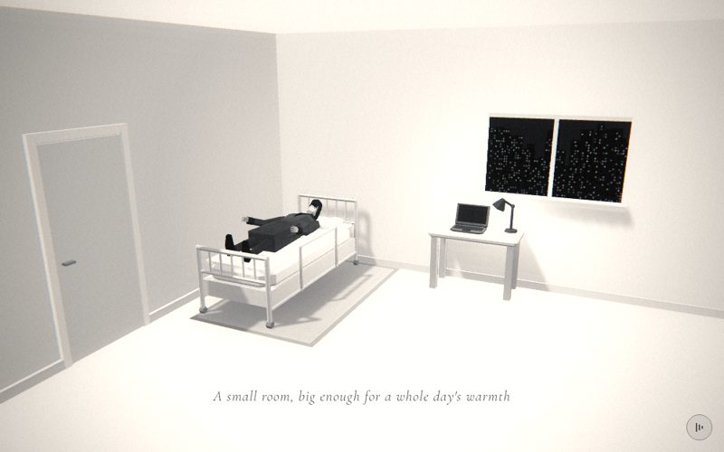

# 18 · room

> "A small room, big enough for a whole day's warmth"
> Source: `src/app.js`, banner `/* 18 — the small rented room */` · group: interiors · before/after: [sheet](../../assets/model-polish/interiors.jpg)

## At a glance
| | |
|---|---|
| Setting | Interior, a white rented room seen from a high corner. Two walls only (back wall at z −1.35 with a window onto a night city, side wall at x −2.45 with a door), a white floor, a rug, a tube-frame bed modelled on the reference film's hospital bed (f106–f110), a small desk with a laptop and an angled lamp |
| Tone | Light. `bg:'#f7f7f7'`, `scene.background = Color(0xf2f2f2)`, `Fog(0xf2f2f2, 6, 24)`, `dark:()=>false` all scene (black caption with a white halo, light-mode grain and vignette). The dip colour `#f7f7f7` is a step lighter than the rendered background `#f2f2f2`. Dips: rooftop fades into `#f7f7f7`; for t > .9 this scene fades to call's `#0a0a0a` |
| Hero | **Lie**, on his back on the bed, head on the pillow. `makePerson()` (default tones), a child of the `bed` group: `rotation.x = −π/2` (head toward the headboard, −z; front facing up), `position (0, .76, 1.08)` in bed space, `arms[0].rotation.z = −.5` (right arm out toward the far side), `head.rotation.set(.55, 0, 0)` so the head rests on the pillow. No props held |
| Motion | Camera only. Nothing in the scene moves |
| Camera | `k = ease(t)`: position `(lerp(2.6,.6,k), lerp(3,1.9,k), lerp(6.5,2.8,k))`, `lookAt(−.7, .8, −.5)`. From (2.6, 3, 6.5), high in the open corner, to (.6, 1.9, 2.8): it descends and moves closer to the bed. (1.6, 2.45, 4.65) at t=.5. Default fov |
| Budget | scene 1526 tris (v40 300) · hero 1561 (v40 1093) · 128 meshes (51 hero) · 0 instanced · 4 lights · 0 points |

## Models
The bed parts are children of `bed` at (−1.6, 0, −.2). "Bed z" below is in that space; add −.2 for world z. Constants: `HZ = −1` (head end), `FZ = 1.2` (foot end), `PX = .46` (frame half-width). The frame material is `frame = M(0xc4c4c4)`. Local helpers: `tube(r,h,x,y,z,rx,rz)` = open `CylinderGeometry(r,r,h,6,1,true)` (12 tris) in `frame`; `ball(r,x,y,z)` = `SphereGeometry(r,6,4)` (36 tris); `bevelBox` = 8-sided chamfered loft (64 tris, 10th arg = corner chamfer); `contactShadow(w,d,o)` = the REFERENCE-STYLE radial-gradient plane.

| Model | Built with | Geometry | Tone | Placement / contact | Notes |
|---|---|---|---|---|---|
| Floor | `ground(0xf4f4f4)` | plane 400, FrontSide | `0xf4f4f4` | y 0 | Receives the bed's shadow |
| Back wall | custom `wallGeo`: 8 quads (4 front quads around the opening + 4 reveal faces), 16 tris, `computeVertexNormals` | `BufferGeometry` | `wm = M(0xe6e6e6)` | front face z −1.35, x −2.5…3.5, y 0–3.2; window opening x .6–2.2, y 1.2–2.2; reveal back to z −1.45 | One mesh, so there is no seam at the window edge (a four-box version left one) |
| Side wall | `box(.1,3.2,5, M(0xdedede), −2.5,1.6,1)` | box | `0xdedede` | inner face x −2.45, z −1.5…3.5 | One step darker than the back wall (`0xe6`), so the corner reads |
| Door slab | `box(.02,2.1,.9, M(0xd4d4d4), −2.44,1.05,DZ)`, `DZ = 2.0` | box | `0xd4d4d4` | on the side wall face (x −2.45…−2.43), z 1.55–2.45, past the bed's foot | |
| Architrave | jambs `box(.05,2.2,.08, am, −2.43,1.1, DZ±.49)`, head `box(.05,.08,1.06, am, −2.43,2.16,DZ)`, `am = M(0xececec)` | box ×3 | `0xececec` | 4.5 cm proud of the wall (x −2.405); the slab sits 2.5 cm back inside it | |
| Door handle | `box(.06,.022,.1, M(0x8a8a8a), −2.4,1.0,DZ+.33)` | box | `0x8a8a8a` | 6 cm out from the slab, at z 2.33 | |
| Skirting ×3 | `sk = M(0xd2d2d2)`: back `box(6,.1,.04)` at (.5,.05,−1.33); side `box(.04,.1,2.97)` at z −.015 and `box(.04,.1,.97)` at z 3.015, x −2.43 | box | `0xd2d2d2` | 4 cm proud, y 0–.1. The side run stops at the door jambs (z 1.47 and 2.53) | |
| Rug | two `PlaneGeometry`s in `M(c,{side:FrontSide})`, `rotation.x = −π/2`, centred (−1.3, y, −.05): border 1.6 × 2.5 at y .003, field 1.48 × 2.38 at y .005 | plane ×2 | border `0x747474`, field `0x8c8c8c` | world x −2.1…−.5, z −1.3…1.2: under the bed, rear edge at the skirting, showing on the camera side | Mid-grey on purpose (see Editing notes) |
| City window | `PlaneGeometry(1.6,1)` + `MeshBasicMaterial({map: city})`; `city = canvasTex(512,320, …)` with `rng(8)`: 40 black `#050505` towers on `#141414`, windows lit with 30 % chance at alpha .4–.9 | plane, unlit | night city texture | (1.4, 1.7, −1.43): fills the opening, 8 cm behind the wall face, 2 cm in front of the reveal back | The texture is unchanged since v40 (audit "do not touch") |
| Sill, head, mullion | `wf = M(0xcccccc)`: sill `box(1.72,.06,.2)` at (1.4,1.175,−1.32); head `box(1.6,.05,.08)` at (1.4,2.175,−1.395); mullion `box(.05,1,.06)` at (1.4,1.7,−1.405) | box ×3 | `0xcccccc` | sill y 1.145–1.205 (top 5 mm above the reveal floor at 1.2) and 13 cm proud of the wall; head and mullion inside the reveal | Round 2 lifted the sill 5 mm so its top is not coplanar with the reveal |
| Contact shadow | `contactShadow(1.8, 3, .45)` at bed (0, .008, .1) | plane, `MeshBasicMaterial` with the radial-gradient `SHADOW` map, transparent, `depthWrite:false`, `renderOrder 1` | black, opacity .45 at the centre | world x −2.5…−.7, z −1.6…1.4 (its back part is hidden behind the wall) | Under the bed, on top of the rug |
| Base slab | `box(.92,.19,2.16, M(0xcacaca), 0,.315,.1)` | box | `0xcacaca` | y .22–.41: rests on the side-rail tops (.2 + r .02), its ends inside the corner posts | Round 2 blocker fix (mattress and slab used to float) |
| Mattress | `bevelBox(.9,.19,2.12,.04, M(0xe0e0e0), 0,.41,.1, .3)` | loft, 64 tris | `0xe0e0e0` | y .41–.60, on the slab | Darker than the sheet and pillow, so the white parts read (REFERENCE-STYLE) |
| Sheet | `box(.86,.03,2.06, M(0xfafafa), 0,.615,.1)` | box | `0xfafafa` | y .60–.63, inside the mattress's .04 top chamfer | |
| Pillow | `pm = M(0xf4f4f4)`: middle `box(.6,.075,.4)` at (0,.6475,−.72); two ends `bevelBox(.16,.1,.4,.025, pm, ±.22,.61,−.72, .35)` | box + 2 lofts, 140 tris | `0xf4f4f4` | middle top .685, ends top .71 (x ±.14–.30): a .28-wide trough. Bottoms at .61, 2 cm into the sheet | The head lies in the trough |
| Corner posts ×4 | `tube(.028, top−.05, ±PX, (top+.05)/2, z)` for `[HZ, .95]`, `[FZ, .8]` | open 6-sided | `frame` | y .05 → .95 (head) / .8 (foot); world z −1.2 / 1.0 | |
| Post caps ×4 | `ball(.032, ±PX, top, z)` | sphere 6 × 4 | `frame` | on each post top, over the top rail's end | |
| Castors ×4 | `CylinderGeometry(.04,.04,.06,6)`, `rotation.z = π/2`, at (±PX, .0346, z) | hex wheel, 24 tris | `0x777777` | stands on one flat (apothem .0346 = .04·cos 30°), so it touches y 0; encloses the post's open bottom end | |
| Top and lower rails ×4 | `tube(.028, .92, 0, top, z, 0, π/2)` and `tube(.02, .92, 0, low, z, 0, π/2)`; ends `[z, top, low]` = `[HZ, .95, .62]`, `[FZ, .8, .52]` | open 6-sided | `frame` | across each end between the posts | Headboard .95, footboard .8: the reference bed's proportions |
| Side rails ×2 | `tube(.02, FZ−HZ, ±PX, .2, (HZ+FZ)/2, π/2)` | open 6-sided | `frame` | y .2, along the bed, carry the base slab | |
| Spindles ×10 | one shared `CylinderGeometry(.012,.012,1,6,1,true)`, plain meshes, `scale.y = top − low` | 12 tris each | `frame` | x −.3 to .3 every .15, between each end's two rails | **Not** instanced on purpose: `buildAll()` skips instanced meshes for `castShadow`, and the headboard's barred shadow on the back wall needs them |
| Side guard | `GX = PX+.02 = .48`, `GY = .74`, `GZ = [−.35, .55]`: rail `tube(.018, .9, GX, .74, .1, π/2)`; uprights `tube(.018, .54, GX, .47, z)`; `ball(.022)` at the top ends, `ball(.024)` at y .2 | 180 tris | `frame` | camera side (+x, world x −1.12), over his torso (world z −.55 → .35), clear of the pillow end and about 14 cm from his left arm. The lower balls merge with the side rail | After f106 |
| Hero | `makePerson()` in `bed` | 1561 tris, 51 meshes | default | world (−1.6, .76, .88); body y .639–.98, z −1.003 → .914 (feet inside the footboard at z 1.0). Back 9 mm above the sheet (.63); head lowest point .693, 8 mm above the pillow trough (.685), x −1.70…−1.53 (4–7 cm clear of each raised end). Right hand out to x −2.14, 9 cm past the mattress edge | Straight legs (thighs at 0 rad), so the standing coat panels show, not the seated lap pieces |
| Desk | `dt = M(0xbdbdbd)`, `dl = M(0xb0b0b0)`: top `bevelBox(1.1,.07,.55,.02, dt, .6,.695,−1.05)`; apron `box(.98,.07,.05, dl, .6,.66,−1.255)`; 4 legs `box(.08,.7,.08, dl)` at x .13 / 1.07, z −1.25 / −.85 | loft + 5 boxes, 124 tris | top `0xbd`, legs/apron `0xb0` | top y .695–.765, x .05–1.15, z −1.325…−.775 (2.5 cm off the back wall); legs y 0–.7, tops inside the desk top | v40 floated on two back legs |
| Laptop | group `lap` at (.5,.765,−1.05), `lm = M(0x4a4a4a)`, `ld = M(0x262626)`: base `bevelBox(.42,.022,.29,.006, lm, …, .3)`, key area `box(.36,.004,.13, ld)`, trackpad `box(.1,.003,.06, ld)`, hinge `CylinderGeometry(.012,.012,.4,6)`, lid group at (0,.022,−.14) with `rotation.x = −.32` holding `bevelBox(.42,.27,.018,.005, lm, …, .3)` and a screen `box(.37,.22,.004, B(0x1e1e1e))` | 188 tris | body `0x4a4a4a`, keys `0x262626`, screen `0x1e1e1e` (unlit, dark) | on the desk top; the lid leans back toward the wall | Same model as flip's `desk()` laptop, in fixed dark tones. The screen is off |
| Lamp | group `lg` at (1.0,.765,−1.2), `lmm = M(0x3a3a3a)`: disc `CylinderGeometry(.075,.085,.025,6)`; stem `CylinderGeometry(.016,.016,.3,6)` (y .025–.325); joint `SphereGeometry(.026,6,4)` at .325; arm `CylinderGeometry(.013,.013,len,6)` from (0,.325,0) to (−.09,.42,.14), aimed with `quaternion.setFromUnitVectors(UP, dir)`; shade open `CylinderGeometry(.03,.09,.12,6,1,true)` at (−.12,.38,.14), `rotation.z = −.5`; bulb `SphereGeometry(.028,6,4)`, `B(0xffffff)`, at (−.135,.355,.14) | 156 tris | `0x3a3a3a`, bulb white unlit | on the desk's back-right corner; the shade's wide mouth points down and toward the laptop (−x) | v40 was a `.03` stick with a sphere bulb |

Triangle split (1526): bed 890 (tube frame 660 = posts, rails, caps and castors 360 + spindles 120 + guard 180; slab, mattress, sheet, pillow and shadow 230), laptop 188, lamp 156, walls + door + skirting + rug + window 168, desk 124. REFERENCE-STYLE's budget for "bed with rails and IV stand" is ≤ 900.

## Lights and atmosphere
- `lights(scene, {hemi:[0xffffff, 0x999999, .95], dir:[0xffffff, .5, [−3,6,3]]})`:
  - `HemisphereLight(0xffffff, 0x999999, .95)`
  - key `DirectionalLight(0xffffff, .5)` from (−3,6,3), normalised × 20 = (−8.16, 16.33, 8.16). It casts shadows (camera ±14, 1536 px map), so the bed, desk and hero throw shadows toward +x and −z: the headboard's barred shadow lands on the back wall.
  - rim `DirectionalLight(0xffffff, .225)` at (3, 3.6, −7)
- `PointLight(0xffffff, .6, 4)` at (.9, 1.12, −1.06): inside the lamp shade, 3.5 cm from the bulb (moved 5 cm in v41 to sit in the shade).
- **Shadow casters** (from `buildAll()`'s radius < 1.2 rule): the hero, the whole bed (base slab r 1.18, mattress 1.11, sheet 1.12, side rails 1.10 all just pass), the desk, laptop, lamp, door slab, architrave, door handle, sill, window head, window mullion and the short .97 side skirting run. Not casting: floor, both walls, the back skirting, the 2.97 side skirting run and both rug planes (all receive).
- `Fog(0xf2f2f2, 6, 24)`: at t = 0 the camera is ~8 units from the bed, so far parts take a little haze; by t = 1 the set is inside the fog's near distance.
- Film pass in light mode. The near-white sheet (`0xfa`) and pillow (`0xf4`) read because they sit on the `0xe0` mattress inside the `0xc4` frame.

## Animation (`update(t, time)`)
- **Scroll-driven:** only the camera, eased with `ease(t)` (formula above). `lookAt` is fixed on (−.7, .8, −.5), between the bed and the desk.
- `time` is unused. `frame()` adds the handheld drift.

## v40 → v41
From [model-polish/interiors.md](../model-polish/interiors.md), "18 — room", rounds 1 and 2:
- **Bed:** v40 was a `0xc4c4c4` frame slab, a white mattress box, a pillow box and four bare `.04` posts. v41 builds it after the reference hospital bed:
  - a 6-sided tube frame on hex castors
  - a headboard (.95) and a footboard (.8), each with a top rail, a lower rail and five spindles
  - side rails, a base slab, a chamfered `0xe0` mattress with a `0xfa` sheet
  - a pillow with a trough
  - a camera-side guard rail
  - a wide contact shadow

  The bed was lengthened to 2.2 so his feet are inside the frame. The hero's position, pose and head/pillow contact are unchanged.
- **Round 1:** the side guard, the pillow trough, a blanket over the footboard (later removed), the door with its architrave and handle, the rug. Tubes became open-ended and the castors hex wheels to pay for it.
- **Round 2 (blockers):** the base slab moved to y .22–.41, so it rests on the rails and carries the mattress (both floated before). The blanket was dropped: the reference bed carries none, and a fold on the sheet would cut through his shins. The rug was made darker so it reads. The sill was lifted 5 mm. The sheet was narrowed to .86, inside the mattress chamfer. The spindles changed from one `InstancedMesh` to ten plain meshes so they cast shadows.
- **Desk:** four `.08` legs and an apron (v40: two `.04` back legs, floating at the front); a hinged laptop; a lamp with a base, stem, joint, arm, cone shade and bulb.
- **Window:** a real reveal in a one-piece wall mesh, a deeper sill, head and mullion. v40 laid the texture 1 cm in front of a `.1` wall box.
- **Skirting** on both walls.
- **Triangles:** scene 300 → 1526 (5.1×, scene only). The notes' 1393 → 2619 (1.88×) adds the v40 hero (1093) to both, which is how the "≤ 2×" rule was judged. The hero went 1093 → 1561 through the hero group.
- Untouched (audit "do not touch"): head/pillow contact (`head.rotation.x = .55`), the camera, the city texture.

## Editing notes
- **Head on the pillow is owner-critical** (「頭埋進枕頭了」). The hero's bed position (0, .76, 1.08), `rotation.x = −π/2` and `head.rotation.x = .55` are tuned together with the pillow tops (.685 middle, .71 ends). The head clears the trough by 8 mm and the back clears the sheet by 9 mm. Raising the sheet or pillow pushes the head into it; raising the hero breaks the head contact. Check any change with a close shot.
- **The lying hero is a straight slab** (ROADMAP §1 and §2): no spine, rigid coat panels, a box-like torso from the camera. This needs a spine joint in `makeHero()` (hero item), not a bed change.
- **Rug tone is forced by the lighting.** Under hemi .95 + key .5 + rim, plus the film pass's glow, an upward face lighter than about `0x90` clips to the floor's white (the polish measured `0xa4` at 252 of 255). So the rug is `0x8c` in a `0x74` border, an 11 % step. A lighter rug needs lower light intensities, which changes the whole room.
- **Stacked floor layers:** floor y 0, rug border .003, rug field .005, contact shadow .008 (transparent, `depthWrite:false`, `renderOrder 1`). These gaps are at or below one 16-bit depth step at the camera distance (≈ 3–8 units). The round-2 notes report no artefacts there at 18.35, 18.65 and 18.85. Do not add another layer between them. Give a new floor decal its own `renderOrder` instead of a smaller offset.
- **The back wall is one hand-built mesh.** Moving or resizing the window means editing `wx0, wx1, wy0, wy1` in `wallGeo` and the city plane, sill, head and mullion together. A four-box wall left a seam line (round 1).
- **Spindles stay plain meshes** for the barred shadow on the wall. Posts, caps and castors (4 each) are plain meshes too, so they also cast shadows.
- **Contact rules met today:** castors stand on a flat at y 0; posts end inside the castors; the slab sits on the rails; the mattress on the slab; the desk legs end inside the desk top; the lamp disc and laptop sit on the desk top (.765). Keep these when you move anything.
- **White on white:** every white object sits on a darker one (sheet on mattress, mattress on slab, frame `0xc4` against `0xe6` and `0xde` walls). Keep a ≥ 10 % step (REFERENCE-STYLE §1).
- **Caption band** (t .12–.75): the caption sits on the open floor in front of the bed and the rug corner. Keep that floor area empty.
- **Ideas tried and rejected:** a blanket folded over the footboard (round 1, removed in round 2: not in the reference, and a fold on the sheet would cut through his shins); a lighter rug (the audit's `0xe8`, the reviewers' `0xc8`/`0xd0` and a `0xa4` try all clipped to white); a four-box wall (seam at the window).

## Check it
- Shots, with 17.7 as the lead-in (the polish used the same warm-up):
  `NODE_PATH=/opt/node-tools/node_modules WAIT=9000 node tools/shots.js 17.7 18.35 18.65 18.85`
- What to look at:
  - **18.35:** the whole room: the door and architrave, the rug reading against the floor, the window reveal
  - **18.65:** the bed: head resting in the pillow trough, not sunk into the pillow; the side guard clear of his arm, the barred headboard shadow on the wall, no air under the mattress
  - **18.85:** close; the mattress corner, no lit ledge under its chamfer, the castors on the floor
- **Close-ups:** crop the PNG with PIL at 2–3× around the head and the foot end.
- **Pose:** `tools/pose.html` has no bed, and `POSE` only receives `userData`, not the figure, so it cannot lay him down. Check the lying pose in scene shots.
- **Budget:** `node tools/inventory.js`, then compare the `room` row with `docs/data/inventory-v41.json`.
