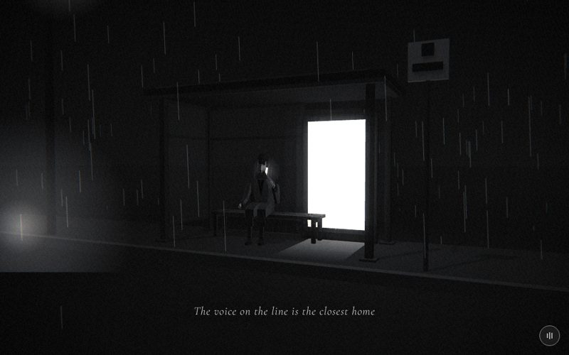

# 19 · call



> "The voice on the line is the closest home"
> Source: `src/app.js`, banner `/* 19 — a bus stop in the rain: calling home, saying everything is fine */` · group: street-props · before/after: [sheet](../../assets/model-polish/street-props.jpg)

## At a glance
| | |
|---|---|
| Setting | Exterior at night: a bus shelter on a pavement in the rain, seen from across the road. A lit ad panel, a slatted bench, glazing on two sides, a bus-stop flag outside and a street lamp off to the left |
| Tone | Dark. `bg:'#0a0a0a'`, `scene.background = gradTex('#050505','#1a1a1a')` (darker at the top), `dark:()=>true` for the whole scene. Dip: room fades into `#0a0a0a` for its t > .9 and this scene fades out of it for t < .1; for t > .9 it fades to bloom's `#9a9a9a` |
| Hero | Sit on the bench, phone to his ear. `makePerson()`, `sit()`, at (−.35, −.295, −.62), `rotation.y = .25`. His **left** arm (index 1) is raised: `arms[1].rotation.set(-.35,0,.15)`, `elbows[1].rotation.x = -2.45`. His right arm (index 0) rests forward toward his knee: `arms[0]` x −.7, `elbows[0]` x −.6. `head.rotation.set(.25,0,-.12)` (looking down, tilted). The phone and its glow follow the head every frame |
| Motion | Time drives the rain, the phone follow and a passing car's headlight glow. Scroll drives only the camera push. The hero is static |
| Camera | `k=ease(t)`. Position `(lerp(3.6,1.3,k), lerp(1.5,1.25,k), lerp(7,3.2,k))`, `lookAt(lerp(.2,-.35,k), lerp(1.2,1.15,k), -.6)`. It pushes in from across the road, from the right, onto him. Default fov |
| Budget | scene 622 tris (v40 160, 3.9×) · hero 1561 (v40 1093) · 100 meshes incl. the hero's 51 (v40 58) · 0 instanced · 4 lights (hemi, key, rim, point) · 3 sprites · 1 `LineSegments` (rain) · 25 materials (v40 14) |

## Models
`box(w,h,d,mat,x,y,z)` takes the centre position. `bevelBox(w,h,d,b,mat,x,y,z)` is **scene-local** (a copy of the one in `store`): a 4-ring, 8-sided `loft` from y to y+h with chamfer b, 64 tris, with `y` = **bottom**. `PV = .15` is the pavement height.

Shared materials: `fm = M(0x202020)` (frames, posts, rails), `dk = M(0x101010)` (fascia, flag marks), `lt = M(0x3a3a3a)` (gutter). All are lit (`M`), so they read through the key and rim lights. Only the ad panel, phone and wet smear are unlit `B`.

### Street
| Model | Built with | Geometry | Tone | Placement / contact | Notes |
|---|---|---|---|---|---|
| Road | `ground(0x0e0e0e)` | Plane 400 × 400 | `0x0e0e0e`, lit | y 0 | |
| Pavement | `box(30,PV,2.2,M(0x1c1c1c),0,PV/2,-.2)` | Box 30 × .15 × 2.2 | `0x1c1c1c` | x ±15, y 0–.15, z −1.3….9 | The shelter, bench, flag and lamp stand on it |
| Kerb stone | `box(30,PV+.01,.15,M(0x323232),0,PV/2+.005,.835)` | Box | `0x323232` | y 0–.16, z .76–.91 | .01 taller and .01 proud of the pavement front (no coplanar faces) |
| Street lamp | pole `sl = box(.1,5,.1,M(0x161616),-4,2.5,.6)`, arm `box(.5,.06,.06,M(0x161616),-3.8,4.95,.6)`, head `box(.34,.1,.2,M(0x202020),-3.6,4.95,.6)` | 3 boxes | `0x161616`, head `0x202020` | Pole y 0–5 at x −4 (its base is inside the pavement, with no plinth); the head hangs .4 toward +x | The arm and head are new in v41 |
| Lamp glow | `glow(2,.5)` | sprite | white | (−3.6, 4.9, .6), under the head | |
| Bus-stop flag | group `sp` at (2.45, PV, .6): pole `CylinderGeometry(.03,.03,2.28,6)`, `M(0x2e2e2e)`; plate `box(.46,.46,.06,M(0xc4c4c4),0,2.5,0)`; band `box(.34,.09,.05,dk,0,2.42,.045)`; square `box(.14,.14,.05,dk,0,2.62,.045)` | 6-sided cylinder (24 tris) + 3 boxes | pole `0x2e2e2e`, plate `0xc4c4c4` (lit), marks `0x101010` | On the pavement right of the shelter. Pole top at world 2.43, plate 2.42–2.88. The marks stand .04 proud of the plate face with their backs inside it | No text. The plate's tone follows the scene light (mid grey). Round 1 fixed a "barcode" z-fight and the pole showing through the plate face |
| Rain | `rain(1100,20,21)` | `LineSegments`, 1100 strokes | white, opacity .25 | 20 × 20 area around the origin | Not a mesh |
| Car headlights | `car = glow(3, 0)` | sprite | white, additive | On the road at z 2.2, y .6, sweeping x −14 → 14 | Opacity animated (see Animation). There is no car mesh |

### Shelter
| Model | Built with | Geometry | Tone | Placement / contact | Notes |
|---|---|---|---|---|---|
| Posts × 4 + base plates | `box(.1,2.35,.1,fm,x,PV+1.175,z)` + `box(.22,.03,.22,fm,x,PV+.015,z)` | Boxes | `0x202020` | Corners (±1.7, −1) and (±1.7, .3); y .15–2.5, up to the roof underside | v40 posts were `.06` and read as wire (audit) |
| Roof slab | `bevelBox(3.8,.16,1.7,.04,M(0x262626),0,2.5,-.35)` | 8-sided loft, 64 tris (the heaviest mesh here) | `0x262626` | y 2.5–2.66, x ±1.9, z −1.2….5: overhangs the posts | |
| Fascia × 3 | front `box(3.8,.1,.03,dk,0,2.57,.515)`; sides `box(.03,.1,1.7,dk,±1.915,2.57,-.35)` | Boxes | `0x101010` | On the front and both side edges (none at the back) | |
| Gutter | `box(3.84,.05,.08,lt,0,2.48,.53)` | Box | `0x3a3a3a` | Under the front edge, y 2.455–2.505 | The lighter line along the roof front in the key shot |
| Glazing panes × 2 | `gl = MeshStandardMaterial({color:0x777777,transparent:true,opacity:.18,roughness:.2})`; rear `box(1.85,2.05,.02,gl,-.675,PV+1.3,-1.0)`; left `box(.02,2.05,1.2,gl,-1.7,PV+1.3,-.35)` | Boxes | `0x777777` at 18 % | Rear x −1.6….25 (it ends at the ad frame's left post), left z −.95….25; y .425–2.475 | A raw material, not `M()`: single-sided and smooth. Transparent, so no shadows |
| Rails × 6 | rear `box(1.95,.05,.05,fm,-.675,y,-1.0)`, left `box(.05,.05,1.2,fm,-1.7,y,-.35)` at y = PV+.27, PV+1.75, PV+2.32 | Boxes | `0x202020` | Sill .42, mid 1.9, head 2.47 | The mid rail sits at 1.9 so no bar crosses behind his head |
| Ad panel | `ad = Mesh(PlaneGeometry(1.1,1.8),B(0xf2f2f2))` at (.9, 1.25, −.94) | Plane | `0xf2f2f2`, unlit | x .35–1.45, y .35–2.15, .04 behind the frame's front face | The brightest thing in the frame. Moved from x 1.05 to .9 in round 1 |
| Ad frame | back box `box(1.3,1.95,.04,fm,.9,1.225,-1.0)`, top `box(1.3,.1,.1,fm,.9,2.2,-.95)`, bottom `box(1.3,.2,.1,fm,.9,.25,-.95)`, sides `box(.1,2.05,.1,fm,.3/1.5,1.225,-.95)` | 5 boxes | `0x202020` | x .25–1.55; the bottom bar reaches the pavement (y .15) | It ends .1 short of the rear-right post (x 1.65). The notes keep that dark gap visible at 19.5 |
| Wet smear | `wet = Mesh(PlaneGeometry(1.0,1.5), B(0xffffff,{map:gradTex('rgba(255,255,255,.55)','rgba(255,255,255,0)'),transparent,opacity:.7,depthWrite:false}))`, `rotation.x = -π/2` | Plane | white gradient | Flat at y .156 (.006 above the pavement), x .4–1.4, z −.9….6. Brightest at the panel end, fading toward the kerb | The ad's reflection on wet ground |

### Bench and hero
| Model | Built with | Geometry | Tone | Placement / contact | Notes |
|---|---|---|---|---|---|
| Slats × 4 | `box(2.0,.05,.085,slm,-.3,.565,-.65+dz)`, dz = ±.055, ±.165 | Boxes | `slm = M(0x3c3c3c)` | x −1.3….7, y .54–.59 (seat top .59), centres z −.815…−.485 (outer edges −.8575…−.4425), .025 gaps | Replaces v40's single slab, whose top was at .65 |
| End frames × 2 | legs `box(.06,.4,.06,bf,x,PV+.2,-.8 / -.5)`, stretcher `box(.06,.05,.36,bf,x,.515,-.65)` | 3 boxes each | `bf = M(0x242424)` | x = −1.22, .62. Legs from the pavement (.15) to .55; the stretcher at .49–.54 carries the slats | An inverted U per end |
| Hero | `makePerson()` + pose (see At a glance) | hero rig, 1561 tris | default trousers `0x2a2a2a`, coat `0x3a3a3a` | (−.35, −.295, −.62). Soles .148 on the .15 pavement; thighs .015 into the slat tops (street-props round 1, before the hero merge) | Raised from v40's −.33 |
| Phone | `BoxGeometry(.035,.13,.008)`, `B(0xffffff)` | Box | white, unlit | Re-placed every frame at head world position + (.09, .01, .02), `rotation (0,.25,-.2)` | At his left ear (world +x) |
| Phone glow | `pg = glow(.5,.35)` | sprite | white | Copies the phone position every frame | The bright point at his head in the key shot |

Inventory check (v41): 44 boxes (528), roof 64, flag pole 24, ad, wet and ground planes 6. Total 622.

## Lights and atmosphere
- `lights(scene,{hemi:[0x666666,0x080808,.35],dir:[0xffffff,.25,[-2,6,3]]})`:
  - a hemisphere light (sky `0x666666`, ground `0x080808`, .35)
  - a shadow-casting key light from `normalize(-2,6,3)·20`, .25 (from the upper left, on the camera side, +z)
  - the automatic rim light at (2, 3.6, −7), .1125 (inventory: 0.11)
- **Ad light:** `adL = PointLight(0xffffff, .9, 4.5)` at (1.05, 1.3, −.5), in front of the panel. Within its 4.5 range are the hero (about 1.4 away, on his +x side, his left), the bench and the pavement near the panel. It stayed at x 1.05 when the panel moved to .9 (deliberate).
- **Background:** `gradTex('#050505','#1a1a1a')`. **Fog:** `Fog(0x0c0c0c, 6, 26)`.
- **Sprites:** the phone glow, the lamp glow and the car glow.
- **Shadows:** small `M` meshes cast (bounding radius < 1.2: the posts and base plates, the six rails, the two side fascias, the five ad-frame boxes, the bench parts, the flag parts, the lamp arm and head, and the hero). The roof, front fascia, gutter, pavement, kerb, road and lamp pole only receive. The glazing is transparent and is skipped.
- **Rain:** `rain(1100,20,21)`, white strokes at opacity .25. They read strongly against the dark background (see the key shot).
- **Film pass:** `dark` is always 1 (strong vignette and grain). The ad panel (`0xf2`) and the phone (white) are above the glow threshold, so they bloom.

## Animation (`update(t, time)`)
| What | Driver | Formula |
|---|---|---|
| Rain | time | `rn.position.y = -(time*9 % 14) + 3` |
| Phone + glow | every frame | `U.head.getWorldPosition(tmp)`; `phone.position = tmp + (.09, .01, .02)` (a **world-space** offset); `phone.rotation.set(0,.25,-.2)`; `pg.position.copy(phone.position)` |
| Car glow | time | `c = (time*.35) % 1`; `car.position = (lerp(-14,14,c), .6, 2.2)`; `opacity = sin(c·π)·.55`. One pass every ≈ 2.86 s, brightest at x 0 |
| Camera | scroll | the eased push from the At-a-glance table, plus the global handheld drift |

## v40 → v41
Source: [model-polish/street-props.md](../model-polish/street-props.md) ("19 — call" and "Round 1"). Audit priority HIGH ([audit](../model-polish/audit.md)). The audit's problems: `.06` posts and a `.08` roof read as wire, the bench was a slab on two sticks, the rear glass was invisible, and there was nothing for the rain to reflect in.
- **v40:**
  - roof `box(3.4,.08,1.4,fm,0,2.5,-.3)` (v40 `fm = M(0x1a1a1a)`) on four `.06` posts at x ±1.65
  - the ad at x 1.05 in a `box(1.2,1.9,.06)` frame
  - one glass `box(2.1,.9,.03)` at (−.55, 1.4, −.95)
  - a bench `box(2,.06,.42,M(0x2a2a2a),-.3,.62,-.65)` on two `.05` legs
  - the hero at y −.33
  - a bare lamp pole with its glow at (−3.8, 5, .6)
- **v41 shelter:**
  - `.1` posts with base plates
  - a bevelled `.16` roof with fascia on three edges and a lighter gutter
  - full-height rear and left panes with sill, mid and head rails
  - the ad as an inset frame with a back box, grounded by the bottom bar
  - a wet smear plane in front of the ad
- **v41 bench:** four `.085` slats on two inverted-U end frames.
- **v41 outside:** a bus-stop flag (no text), a kerb stone, and a lamp arm and head (the glow moved under the head, to (−3.6, 4.9)).
- **Round 1:**
  - the flag plate was made `.06` deep and set on top of the pole, with the marks .04 proud (this fixed the barcode z-fight and the pole showing through the face)
  - the ad and frame moved .15 left to x .9 and the rear pane was shortened, so a dark gap shows between the frame and the post
  - the hero was raised to −.295 and the slats lowered to .565, so the soles sit on the pavement (.148) instead of .037 into it, and the thighs sit .015 into the slats instead of .085
  - the kerb was set .01 proud
- **Triangles:** 160 → 622 scene tris (3.9×, hero excluded, inventory). The group notes quote 1253 → 1715, which includes the old 1093-tri hero. In absolute terms it is still one of the lightest scenes.
- **Untouched on purpose:** the pose, phone-follows-head, the ad point light, the car glow, the rain and the camera (the group notes' list; the audit's do-not-touch list is the phone logic, the sit pose, the ad light and the camera push).

## Editing notes
- **Phone contact is a world-space offset.** The phone sits at head pivot + (.09, .01, .02) in **world** axes, with a fixed rotation. That only lands at the ear because `me.rotation.y = .25` and `head.rotation = (.25, 0, -.12)`. If you change his heading, head tilt or seat height, re-tune the offset or compute it in head space (`U.head.localToWorld(V3(...))`), and check the hand against the phone in a close crop. There is no arm IK (ROADMAP item 1).
- **Which arm.** The code raises `arms[1]` / `elbows[1]`, which is his **left** arm (index 1 = local +x), and the phone is on the +x side. CHARACTER.md's pose table now says the same.
- **Seat contact** (measured by street-props before the hero merge): seat top .59; hero y −.295; soles .148 on the .15 pavement; thighs .015 into the slat tops. The street-props notes flagged the coat skirt hanging through the bench. The hero group then shortened the seat piece so "nothing in the rig extends below the thighs' underside" and cited `after1_call_closeup.png` ([hero.md](../model-polish/hero.md), "Seated underside"). Re-check under the bench after any rig or seat change.
- **Keep the dark gap** between the ad frame (x ≤ 1.55) and the rear-right post (x ≥ 1.65). Round 1 opened it on purpose so the lit panel doesn't merge with the post.
- **The mid rail at y 1.9** keeps a bar from crossing behind his head. Don't move the rails into his head height: seated, the top of his head is at about 1.62 (origin −.295 + the rig's 1.91 head top; the torso does not change in `sit()`).
- **Depth (16-bit target):** the flag marks are .04 proud and the ad plane is .04 behind the frame front. The kerb stone is only .01 proud, a solid block. The **wet smear is .006** above the pavement (transparent, `depthWrite:false`). If it speckles from the start camera (about 7 units away), raise it or use `depthTest:false` with a `renderOrder`.
- **Car glow near the lens.** The car's path is at z 2.2 and the camera ends at z 3.2, so late in the scene the 3-unit additive sprite passes about 1 unit in front of the lens and can wash the lower frame for a moment (approx.). Keep that in mind if you lower the camera or brighten the glow.
- **The flag plate is lit** (`M(0xc4c4c4)`), so it reads as mid grey, not white. That is deliberate, against the black sky. It stays blank: any text on the site is English and an owner decision.
- **The street lamp has no plinth.** Its pole starts at y 0 inside the pavement. That is fine from these cameras; add a plinth (like `store`'s) if the lamp ever comes into the lower frame.
- **Caption band** (t .12–.75, lower middle): the road and kerb are there. Keep the bench, flag and ad where they are (above or beside the band), and add nothing bright on the road in the middle.
- **Owner rules:**
  - no faces; the phone glow is the only light on his head
  - the caption is verbatim, with no negative wording
  - no flower props here
- **Idea (ROADMAP, Engineering → Audio):** per-scene rain noise for `flood` / `call` / `store`, generated with WebAudio, not loaded from a file.

## Check it
```bash
NODE_PATH=/opt/node-tools/node_modules WAIT=9000 node tools/shots.js 18.9 19.15 19.35 19.5 19.65
```
- **19.15–19.35:** the wide view. Check the flag (a plain light square with two solid dark shapes, no stripes, no line through it), the roof fascia and gutter, the dark gap between the ad frame and the post, and the wet smear without speckle.
- **19.5–19.65:** closer. Crop him at 2–3× and check the phone at his left ear with the hand near it, the head clear of the rails, the soles on the pavement, the thighs on the slats and nothing of the coat below the bench.
- The car glow is time-driven (a 2.86 s cycle), so it may or may not be in a given shot.
- Pose only: `tools/pose.html` with `sit()`, `arms[1] (-.35,0,.15)`, `elbows[1] -2.45`, `head (.25,0,-.12)` to see the phone arm from the front and side.
