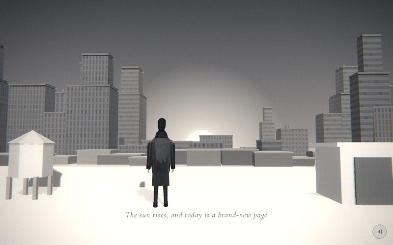

# 20 · bloom

> "The sun rises, and today is a brand-new page"
> Source: `src/app.js`, banner `/* 20 — sunrise over the skyline, seen from a rooftop */` · group: city · before/after: [sheet](../../assets/model-polish/city.jpg)

## At a glance
| | |
|---|---|
| Setting | Exterior, dawn. A flat concrete roof (top at y 2) with a parapet, a water tank and a stair head. Beyond it are a band of low roofs, a mid-rise grey city at z −40 to −80 (54–94 m from the camera), and the sun rising behind the city at z −110. The ground plane at y 0 is the street level |
| Tone | Light. `bg:'#9a9a9a'` (the dip colour). `scene.background = gradTex('#4a4a4c','#cfcbc4')`, from a dark grey sky at the top to a warm pale band at the horizon. `dark:()=>false`, so the caption is black with a white halo. Dips: the scene opens out of `#9a9a9a` (after the dark call scene), and for t > .9 it fades to field's `#030303` |
| Hero | Stand, at rest. `makePerson()` uses the default tones, at (2.2, 2, 8) with `rotation.y = π + .15`, facing the city and turned slightly. No rig calls: the default rest pose, nothing held. He stands on the roof slab top, 3 m behind the parapet |
| Motion | Scroll-driven sunrise. The sun disc and halo rise from y −8 to 24, and the halo brightens. The camera drifts in and tilts up. `time` is unused here |
| Camera | Position `(lerp(3.4,3,t), lerp(3.2,3.5,t), lerp(15,13.5,t))`, `lookAt(0, lerp(6,14,t), -60)`. That gives (3.4, 3.2, 15) at t=0, (3.2, 3.35, 14.25) at t=.5 and (3, 3.5, 13.5) at t=1: behind and to the right of him, 1.2–1.5 above the roof, pushing in 1.5 while the aim rises from y 6 to y 14 at 74 m. Default fov |
| Budget | scene 2652 tris (v40 642) · hero 1561 (v40 1093) · 207 meshes, 51 of them hero · 3 instanced (64 instances) · 3 lights · 1 sprite |

## Models
The counts come from replaying `rng(81)` / `rng(82)` and match the inventory exactly. Triangle split: city blocks 62 × 12 = 744 · lips 744 · masts 3 × 20 = 60 · tanks 6 × 24 = 144 · ground 2 · low-rise band 720 · sun 64 · roof slab, parapet and coping 36 · water tank 90 · stair head, cap, door and vent 48.

| Model | Built with | Geometry | Tone | Placement / contact | Notes |
|---|---|---|---|---|---|
| Sky | `gradTex('#4a4a4c','#cfcbc4')` as `scene.background` | canvas gradient | `#4a4a4c` top to `#cfcbc4` bottom | — | The dark top makes the white sun and halo read |
| Ground | `ground(0x8c8b88, 600)` | `PlaneGeometry(600,600)`, 2 tris | `0x8c8b88` | y = 0, street level | Must stay (owner rule; see Editing notes). From this camera it shows only as a thin strip between the parapet line and the low-rise band: at t=.5 the sight line over the coping meets y 0 near z −29 (approx.) |
| City blocks ×46 | `building(w,h,d,false,{col:0x6a6a6a, lobby:false, setback:h>9&&r2()<.55?h*.45:0, roof:h>6&&r2()<.45?(r2()<.6?'mast':'tank'):null})` | facade box, 12 tris | day facade tinted `0x6a6a6a`. Variants 14/16/16 | x = (r−.5)·120 (±60), z −40 to −80. w 3–9, d 3–9. h is **halved**: 13 central blocks (\|x\| < 18) are 2.5–5.8 tall so the sun clears them; the outer ones are 4–17. Base on y 0; only x and z are set | No podiums or doors (`lobby:false`); at 50–80 m they would be invisible |
| Setback blocks ×16 | `building()` setback = `h·.45` on blocks taller than 9 (55 % chance) | box + lip | same variant, `0x6a6a6a` | On the roof. With setbacks the tops reach 24.6 | All outer blocks: no central block is tall enough |
| Roof furniture: 3 masts, 6 tanks | `building()` roof (blocks taller than 6) | mast: box .3³ + open 4-sided tube; tank: plinth box + open 6-sided drum | mast `0x353535`; plinth `0x3a3a3a`, drum `0x616161` | On the top block | `renderOrder 2`. They give the skyline its silhouette |
| Parapet lips ×62 | `building()` | box `(w+2o) × min(.35,.08h) × (d+2o)` | `0x616161` | Roof edge of every block and setback | `renderOrder 1` |
| Low-rise band ×30 | local `InstancedMesh(BoxGeometry(1,1,1), M(0x5e5d5a), 30)`, scaled per instance | box, 12 tris | `0x5e5d5a` × per-instance `setColorAt` scalar: 1.3 for 7 of the 30 (`r2 < .2`), otherwise .88–1.12 | x = −72 + 4.9i + 0–2, z −33 to −39. w 3–8, h 1.03–2.5, d 3–7, standing on y 0 | Plain boxes with no facade: only their roofs show over the parapet. Instanced, so no shadows |
| Low-rise lips ×30 | local `InstancedMesh(BoxGeometry(1,1,1), M(0x7c7b78), 30)` | box scaled `(w+.3) × .22 × (d+.3)` at y `h+.02` | `0x7c7b78` (lighter) | From h−.09 to h+.13 on each block, 15 cm proud on every side | `lp.renderOrder = 1`. The lip's sides are only 15 cm in front of the block's sides at about 50 m, where the depth step is about .75, so draw order decides |
| Sun disc | `Mesh(CircleGeometry(7,64), B(0xfffdf6,{fog:false}))` | 64 tris, radius 7 | `0xfffdf6`, unlit, not fogged | (0, y, −110), behind every building | The only non-low-poly piece, unchanged from v40. Hidden by the ground while y < −7 |
| Sun halo | `glow(70,.7)`, `material.fog = false` | additive sprite, 70 × 70 | white; opacity animated .45 → .85 | (0, y, −108), 2 units in front of the disc | Keeps the default `depthTest`, so the ground and the buildings mask it (see Editing notes) |
| Roof slab | `box(40,.4,14, M(0xd4d4d4), 0,-.2,0)` in the `roof` group | box | `0xd4d4d4` | Group at (0, 2, 12): the top at world y 2, x ±20, z 5 to 19 | Fills the lower frame. The caption sits on it |
| Parapet | `box(40,.55,.3, M(0xbdbdbd), 0,.275,-7)` in `roof` | box | `0xbdbdbd` | World y 2 to 2.55, z 4.85 to 5.15 (the far edge of the slab) | |
| Coping | `box(40,.06,.42, M(0xdcdcdc), 0,.58,-7)` in `roof` | box | `0xdcdcdc` | World y 2.55 to 2.61, overhanging the parapet by 6 cm on each side | Its underside meets the parapet top at the same height; that face is hidden |
| Water-tank legs ×4 | local `InstancedMesh(BoxGeometry(.09,.55,.09), M(0x8a8a8a), 4)` in `roof` | box | `0x8a8a8a` | Roof-local (−1.3 ± .33, .275, −5 ± .33), i.e. world x −1.63 / −.97, z 6.67 / 7.33, from the roof top up to .55 | 3.5 m to his left and 1 m in front of him |
| Water-tank drum | `Mesh(CylinderGeometry(.5,.5,.85,6,1), M(0xb8b8b8))` in `roof` | closed 6-sided, 24 tris | `0xb8b8b8` | Roof-local y .525 to 1.375; its base is 2.5 cm into the leg tops | |
| Water-tank roof | `Mesh(ConeGeometry(.56,.34,6), M(0x8e8e8e))` in `roof` | 6-sided cone, 18 tris | `0x8e8e8e` | Roof-local y 1.37 to 1.71, 6 cm wider than the drum | |
| Stair head | `box(2,1.3,1.6, M(0xbdbdbd), 7.2,.65,-5.2)` in `roof` | box | `0xbdbdbd` | World x 6.2 to 8.2, y 2 to 3.3, z 6 to 7.6, on the right edge of the frame | |
| Stair-head cap | `box(2.2,.1,1.8, M(0xd0d0d0), 7.2,1.33,-5.2)` | box | `0xd0d0d0` | 10 cm overhang on each side; it sits 2 cm down over the top | |
| Stair-head door | `box(.8,1.05,.06, M(0x5c5c5c), 6.9,.52,-4.38)` | box | `0x5c5c5c` | On the camera face (roof-local z −4.4); 5 cm proud, back face 1 cm inside | The darkest piece on the roof |
| Vent | `box(.3,.9,.3, M(0x9a9a9a), 8.9,.45,-5.6)` | box | `0x9a9a9a` | Roof-local x 8.75 to 9.05, right of the stair head, on the roof top | Off the right edge at t=.5 on a 16:10 frame; the stair head itself is cut by the edge |
| Hero | `makePerson()` | hero rig, 1561 tris | trousers `0x2a2a2a`, coat `0x3a3a3a` | World (2.2, 2, 8) on the slab top. **Not** in the `roof` group | The key light from behind the camera lights his back |

## Lights and atmosphere
- `lights(scene,{hemi:[0xffffff,0x777777,.9], dir:[0xffffff,.8,[3,5,8]]})`:
  - `HemisphereLight(0xffffff, 0x777777, .9)`
  - key `DirectionalLight(0xffffff, .8)` from (3,5,8), normalised × 20 = (6.06, 10.10, 16.16). That is **behind the camera** (+z), although the sun is ahead (−z); kept from v40.
  - rim `.36` at (−3, 3, −12), from the sun side
  - The shadow box (±14 around the origin) covers the hero and the roof furniture.
- **Shadows:** the hero, the tank drum and roof, the door and the vent cast; the stair head and its cap are too big (radius ≥ 1.2). The legs and the low-rise band are instanced and skipped. The far blocks' masts and tanks also have `castShadow` set, but they are 50–80 m away, outside the shadow box.
- `Fog(0xb8b5b0, 40, 160)`: the roof is unfogged, the low-rise band (about 47–53 m) is slightly hazed and the city at 54–94 m more so. The sun and halo ignore fog.
- **Sun glow:** the disc is pure `0xfffdf6`, unlit. The film pass's glow taps (pixels above .8 brightness) bloom it further; glow is reduced in light scenes.

## Animation (`update(t, time)`)
- **Scroll-driven:**
  - `y = lerp(-8, 24, ease(clamp(t*1.1)))` sets both `sun.position.y` and `halo.position.y`. At t=.5 that is y ≈ 11.0; y reaches 24 at t ≥ .909.
  - `halo.material.opacity = .45 + t*.4`.
  - The camera, as above.
- **Time-driven:** nothing in the scene. `frame()` adds the global handheld drift.

## v40 → v41
See [model-polish/city.md](../model-polish/city.md): round 0, blocker 5 and the minors.
- **The city stood half underground in v40:**
  - v40 called `b.position.set(x,0,z)` after `building()`, so every block was centred on y 0 with half of it buried.
  - v41 sets only x and z and halves the nominal height. The visible silhouette is the same (the same `rng(81)` draws for x, h, w, d, z) and nothing is buried.
  - The sun still rises behind the same low gap in the centre.
- **Skyline detail** (new `rng(82)` draws):
  - 16 setbacks (`h·.45`), 3 masts, 6 tanks and lips on all 62 blocks.
  - No podiums: "at 50–80 m behind the low-rise band they are invisible".
- **Low-rise band:** new, to make the ground read as streets instead of a pale sea (an audit finding). In round 1 it was limited to h ≤ 2.5 (roofs only), got per-instance tones (one in five a step lighter) and an instanced lighter lip on each block.
- **Roof:**
  - The parapet went from `.5 × .15` to `.55 × .3`, plus a coping.
  - New water tank on four legs on the left, and a stair head with a cap, door and vent on the right, both outside the caption area.
- **Hero** (hero group): 1093 → 1561 tris.
- **Triangles:** scene 642 → 2652 (4.1×; v40 was 46 bare boxes, the sun and a two-box roof). Round 0 was 5221 and round 1 is 3745 in the notes' count, which adds the v40 hero (1093).
- **Shot lag:** round 0's `after_bloom_20.35` was really a frame of scene 19. All later shots used a lead-in.

## Editing notes
- **Never set y after `building()`.** That was exactly the v40 bug here. If you need taller blocks, change h, not the position.
- **Keep the centre low.** Blocks with \|x\| < 18 are drawn 2–6 tall so the sun's path at x 0 stays open. Changing that rule, or the number and order of `r()` draws, can put a tower in front of the sunrise.
- **The ground must stay visible.** The owner's 「建築物好像騰空身起 不行」 (buildings look like they float) was given on this sunrise scene and became the rule for every city scene. The low-rise band keeps the plane from reading as water. Don't remove the band or raise the parapet.
- **Halo `depthTest` stays on.** The tip for horizon lights (`depthTest:false` in ART-DIRECTION.md; plus `renderOrder 10` in ARCHITECTURE.md's `glow()` row) would paint the halo over the city and the roof. Here the masking is what puts the sun behind the skyline.
- **Roof pieces go in `roof`** with roof-local coordinates: the slab top is y 0 and the parapet is at z −7. The hero is outside the group at world y 2. Moving the group moves everything except him.
- **Caption band** (t .12–.75, lower middle): the caption lands on the bare slab below his feet. The tank (x −1.3) and the stair head (x 6.2–9) were placed at the sides so they stay out of it; keep new roof furniture there too.
- **16-bit depth:**
  - The far city and the low-rise lips sit at 50–90 m, where the depth step is about .75–2.4 m. Every overlap there is decided by `renderOrder`: building trim 1–2, `lp.renderOrder = 1`. Keep that on anything you add there.
  - The roof pieces are about 7–10 m from the camera (depth step about 1.5–3 cm) and use real offsets: the door is 5 cm proud.
- **Lighting idea, not done:** the key light comes from behind the camera while the sun is ahead. A warmer key from the sun side (−z) would backlight him, but the camera-facing (+z) facades, the parapet and the stair-head door would lose their direct light. Check the whole frame if you try it.
- **Standing idle:** none (see the ROADMAP's "Standing idle" item). Any breathing must be calm, with no trembling.
- **Key name:** `bloom` is historical; the scene is a sunrise. The ROADMAP suggests renaming it to `sunrise`, in `CAPTIONS`, `SCENES`, the tools and the docs at the same time.
- **Stale comment:** the code comment says the water tank stands "on a plinth", but it stands on four instanced legs.
- **Shoe soles:** the city group's bounding-box dump found the hero's lowest vertices at y −.02 / −.03 below his origin, i.e. 2–3 cm into the slab. That was measured on the city branch before the hero rebuild was merged, so re-check it with the v41 rig. It is a rig property, not this scene's.

## Check it
- Shots, with a lead-in from the end of scene 19 (without it, 20.35 can still show scene 19):
  `NODE_PATH=/opt/node-tools/node_modules WAIT=12000 node tools/shots.js 19.9 20.35 20.65 20.85`
- What to look at:
  - the sun clears the low centre blocks at 20.35 and is high and bright at 20.85
  - no building floats: there is a strip of ground or the low-rise band at every block's foot
  - the tank's legs and drum meet, and the stair-head door has no stripes
  - the caption sits on the bare roof
  - the hero's feet are on the slab
- **Budget:** `node tools/inventory.js`, then compare the `bloom` row with `docs/data/inventory-v41.json`.
