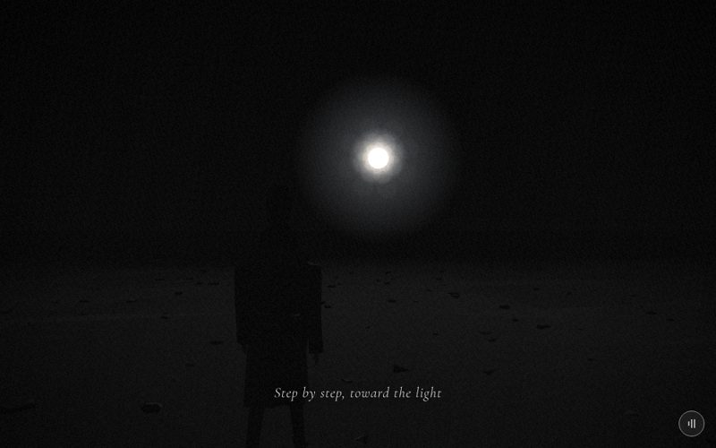

# 21 · field



> "Step by step, toward the light"
> Source: `src/app.js`, banner `/* 21 — walking on through the dark toward one light far ahead */` · group: water-ground · before/after: [sheet](../../assets/model-polish/water-ground.jpg)

## At a glance
| | |
|---|---|
| Setting | A void exterior: pure darkness. A barely visible faceted dark ground with scattered small stones, and one light (a disc with two halos) high ahead on the walking axis. The key is historical: there is no field, grass or flowers (the owner removed them, see Editing notes) |
| Tone | Dark. `bg:'#030303'`. `scene.background = gradTex('#000000','#0b0b0b')`, `Fog(0x040404,3,30)`. `dark:()=>true`: white caption with a dark halo, strong grain and vignette. Dips: fades in from its own `#030303`; for t > .9 it fades to minusone's `#000` |
| Hero | Stroll (walk in place), seen from behind. `makePerson()` with the default tones, `rotation.y = π` (faces −z, toward the light), at (0, 0, 2). `me.userData.stroll(t*14,{amp:.3, gaze:lerp(.02,-.12,t)})`: a negative gaze lifts his head toward the light as the scene goes on. He holds nothing. He is a child of `scene`, not of the moving `world` group |
| Motion | Walk in place with a **hand-made** group: `const world=new THREE.Group()` holds only the terrain and the stones; `worldGroup()` is not used here. `world.position.z = t*14` slides the ground 14 units toward the camera, and `stroll` gets the same `t*14`. The light grows with `k = smooth(0,1,t)` |
| Camera | Position `(lerp(.9,.5,t), lerp(1.5,1.7,t), z+3.6)` with `z = 2`, so the camera is at z 5.6, 3.6 behind him. `lookAt(0, lerp(1.5,1.8,t), z-12)` = (0, 1.5→1.8, −10). That is (.9, 1.5, 5.6) at t=0 and (.5, 1.7, 5.6) at t=1: a slow drift toward his axis and a lift of .2 while the look target rises toward the light. Default fov, plus the handheld drift |
| Budget | scene 7710 tris (v40 9410, 0.82×) · hero 1561 (v40 1093) · 58 meshes incl. the hero's 51 (v40 46) · 4 instanced (270 stones; v40 1 × 260) · 2 lights · 2 sprites · 11 materials (v40 9). The stones are 6340 tris (82 %) and the terrain 1320 |

## Models
| Model | Built with | Geometry | Tone | Placement / contact | Notes |
|---|---|---|---|---|---|
| Backstop plane | `ground(0x0a0a0a)`, `base.position.y = -.4` | `PlaneGeometry(400,400)`, 2 tris | `0x0a0a0a` | y −.4, static (in `scene`, not in `world`) | Fills the view beyond the terrain's edges. Featureless, so it does not need to slide |
| Terrain | `PlaneGeometry(44,60,22,30)`, `rotateX(-π/2)`, `translate(0,0,-20)`, heights from local `H(x,z)`, then `toNonIndexed()` and `computeVertexNormals()`; `M(0x0e0e0e)` | 22 × 30 cells of 2 × 2, 1320 tris, flat per face | `0x0e0e0e` | Local x ±22, z −50…10 (in `world`). Vertices are jittered ±.6 in x (only where 2.1 < \|x\| < 21.9) and ±.6 in z (interior rows), from `jr = rng(5)` | `H = ((vn(x/6,z/6)−.5)·.5 + (vn(x/2+7,z/2+3)−.5)·.18) · smooth(2,4,\|x\|)`: two octaves of hashed value noise (`hz`, `vn`), at most about ±.34. `smooth(2,4,\|x\|)` is 0 for \|x\| ≤ 2, and the x = 0, ±2 columns are not jittered in x, so **his strip \|x\| ≤ 2 is exactly flat at y 0** |
| Stone lumps ×90 | `InstancedMesh(loftGeo([[0,.12,.09,.3],[.035,.16,.12,.3],[.06,.1,.07,.3]],{sides:5}), sm, 90)` | five-sided loft, 30 tris each (2700) | `sm = M(0x262626)` × per-instance tone `.8 + r()*.45` (about `#1e`–`#2f`) | see "Stone placement" below | One material for all four stone meshes |
| Stone wedges ×70 | `TetrahedronGeometry(.08,0).scale(1.4,.45,1).translate(0,.025,0)` | 4 tris each (280) | same | same | |
| Stone chunks ×60 | `DodecahedronGeometry(.055,0).scale(1,.6,1.3).translate(0,.02,0)` | 36 tris each (2160) | same | same | |
| Stone chips ×50 | `loftGeo([[0,.22,.12,.2],[.03,.24,.14,.2],[.04,.18,.1,.2]],{sides:4,rot:π/4})` | four-sided loft, 24 tris each (1200) | same | same | |
| Stone placement (all 270) | `rng(91)`, per stone: `x = (r()-.5)*14`, pushed out of \|x\| < .25 by .3; `z = 8 - r()*44`; `s = .5 + r()*1.3`; tilt ±.15 on x and z, yaw 0–6.3; scale `(s, .8s, s)` | — | — | Local x ±7, z 8…−36, in `world`. y = `hy(x,z) - .006`, where `hy` raycasts straight down onto `terr`, so each stone sits on the actual facet (round 1: the gap is −.006 for all 270) | Shapes are built in the order 90/70/60/50; changing a count reshuffles every later stone |
| Light disc ("sun") | `Mesh(CircleGeometry(1.2,48), B(0xfffbef,{fog:false}))` at (0, 11, −70) | 48 tris | `0xfffbef`, unlit, unfogged | High above the horizon, straight ahead on his axis | Scale 1 → 1.5 |
| Halo (large) | `glow(24,.45)`, `fog=false`, `depthTest=false`, `renderOrder=10`, at (0, 11, −69) | additive `Sprite` | white radial gradient | — | Opacity .35 → .85. Without depth test it is drawn over everything it overlaps on screen, including the hero |
| Halo (small) | `glow(8,.8)`, `fog=false`, at (0, 11, −68) | additive `Sprite` | — | — | Opacity .6 → 1.0. Depth-tested |
| Hero | `makePerson()` | 1561 tris | trousers `0x2a2a2a`, coat `0x3a3a3a` | (0, 0, 2), facing −z, on the flat strip; the planted sole sits about .02 below y 0 (the rig's baseline) | Backlit, nearly black from the camera |
| Background / fog | `gradTex('#000000','#0b0b0b')`, `Fog(0x040404,3,30)` | — | — | — | The terrain and stones vanish within about 30 units of the lens |

## Lights and atmosphere
- **Hand-placed lights; no `lights()`, no shadows** (`castShadow` is never set):
  - `HemisphereLight(0x444444, 0x000000, .25)`: almost nothing.
  - key `DirectionalLight(0xfff6e6, .9)`, created at (0, 4, −12), then `key.position.z = -10` → (0, 4, −10), with `key.target` at (0, 0, 2) (him). Both the light and its target are added to the scene. It shines from ahead (the side of the light disc) toward him, so from the camera behind him he is a rim-lit silhouette. `update` overwrites its intensity every frame: `.5 + .9k`, so .5 → 1.4 (the inventory lists the constructor's .9).
- `Fog(0x040404, 3, 30)`. The disc and both halos have `fog:false`, so the light stays bright through the fog.
- **The light's growth** with `k = smooth(0,1,t)`:
  - disc scale 1 → 1.5
  - large halo opacity .35 → .85
  - small halo .6 → 1.0
  - key .5 → 1.4
- No rain, stars or points.
- **Film pass:** dark mode for the whole scene. The disc and halos are by far the brightest pixels, so they carry the glow.

## Animation (`update(t, time)`)
- **Scroll-driven only; `time` is not used:**
  - `world.position.z = t*14`: the terrain and stones slide toward the camera.
  - `me.userData.stroll(t*14,{amp:.3, gaze:lerp(.02,-.12,t)})`. One step is `2·sin(.3) = .591`, so 14 units is about 11.8 gait cycles (about 24 steps). Planted feet move with the ground.
  - The light's growth above.
  - The camera formula above.
- After `update()`, `frame()` adds the handheld drift (x ±.025, y ±.018, roll ±.004). That drift is the only time-driven motion in this scene.

## v40 → v41
Source: [model-polish/water-ground.md](../model-polish/water-ground.md) ("21 field" and round 1). Audit priority LOW ([audit](../model-polish/audit.md)): "Nothing wrong with the models; the hero is backlit and nearly black (known, lighting)". The audit's do-not-touch list: the darkness, the one light, no grass, the stroll and the camera.
- **v40:**
  - `ground(0x0a0a0a)` at y 0, static
  - 260 instanced `DodecahedronGeometry(.06,0)` stones (36 tris each, 9360 of the scene's 9410), `M(0x262626)`, fully random rotation, scale `(s, .5s, s)` with s .4–1.8, all at y .01, in the moving group
- **Round 0:**
  - The faceted terrain was added inside `world`, flat on his strip.
  - The plane moved to −.4 as a backstop.
  - The stones became four instanced shapes (90/70/60/50) with tone jitter, yaw and a small tilt, kept off \|x\| < .25.
- **Round 1:** each stone is raycast onto the triangulated terrain instead of the analytic `H()`. The gap went from −.067…+.053 to exactly −.006 for every stone.
- **Not changed:** the light disc, halos, key light, hemi, fog, `stroll` and camera. Apart from the ground and the stones, the block is byte-identical to v40.
- **Triangles:** 9410 → 7710 (0.82×, inventory). Field and crack (0.96×) are the two scenes in the group that got lighter; field lost the most. The notes quote 10503 → 8803 including the v40 hero.
- **Left as is (rounds 1–3):** the reviewers noted the terrain facets are invisible from the camera. The facets that face the key face away from the lens, so only a second light would show them, and the owner iterated this scene's darkness on purpose.

## Editing notes
- **Owner history:** this scene went 地板改草地 → 改成草地跟五彩花朵，但不要太複雜 → 改成往光源的地方走去 → 花海改成在黑暗前行 → 不要有草，光源上面一點 (ART-DIRECTION.md). The result is the standing rule: pure darkness, **no grass**, no flowers, and one light placed high (y 11 at z −70). Don't add ground cover, colour or bright detail; remove rather than restyle if asked to simplify.
- **Walk in place with a manual group.** Unlike crack, arrive and office, this scene builds `world` by hand and adds only the terrain and the stones to it. Anything new that should slide must go into `world`, not `scene`. The hero, lights, light disc, halos and backstop stay in `scene`. `world.position.z` and `stroll` share `t*14`; change them together.
- **Flat lane:** his feet need the strip \|x\| ≤ 2 at y 0. If you change `H`, keep the `smooth(2,4,|x|)` factor and the unjittered centre columns, or his soles will float or sink.
- **Stones near his feet:** stone centres are kept out of \|x\| < .25 only. A large chip (about .31 × .18 at s 1.8, half-diagonal ≈ .18) could in principle reach within about .07 of the axis, inside his foot line (feet at about x ±.1). In the current `rng(91)` layout the closest stone vertex is at \|x\| ≈ .22 (computed), but nothing checks this; widen the lane (for example to .45) if he ever gets a fill light or the stones change.
- **Extent:** the stones cover local z 8…−36. At t = 1 they reach world z −22, about 28 units from the lens, where the fog is about 90 %. The terrain reaches −36 at t = 1, beyond fog far. If the walk gets longer than 14, extend both.
- **Build-time raycasts:** 270 raycasts against the 1320-tri terrain in `build()` (load time only). They work because `world` is still at the origin when `hy()` runs; don't move `world` before the stones are placed.
- **rng:** `r = rng(91)` is used only by the stones (in the order 90/70/60/50 and x, z, s, rotations, tone per stone). `jr = rng(5)` jitters the terrain. The terrain's heights come from a hash (`hz`), not from an rng.
- **The hero reads almost black** (SCENES.md and ROADMAP item 2). The suggested fix is lighting, not models: a faint fill from behind the camera (the audit suggests hemi about .35). Keep it subtle. The light ahead must stay the protagonist.
- **The large halo ignores depth** (`depthTest:false`, `renderOrder 10`), so it is added over his head and shoulders where they overlap on screen. That is the ARCHITECTURE.md recipe that stops the ground clipping a horizon glow. If you make it bigger or move the light lower, check that it does not wash him out.
- **Caption band** (t .12–.75, lower middle): the caption sits over the dark ground and his legs. Nothing bright may go there. Stones are dark (`#1e`–`#2f`), and that is fine.
- **Key name:** `field` is historical (ROADMAP suggests renaming it `darkwalk`). Rename it in `CAPTIONS`, `SCENES`, docs and tools together, or not at all.

## Check it
```bash
NODE_PATH=/opt/node-tools/node_modules WAIT=9000 node tools/shots.js 20.9 21.35 21.5 21.65 21.85
```
- 20.9 is a lead-in: without it, the first 21.35 shot showed scene 20.
- **21.35 → 21.85:** the disc and halos grow and the rim on him brightens; his head lifts toward the light.
- Compare two frames: the stones move toward the camera with his steps, with no skating.
- Nothing bright in the lower middle; his feet on the dark strip.
- Brighten a crop (for example ×4 levels) to see the stones and his legs, since the frame is nearly black.
- **Gait:** `tools/gait.html` (from behind is the view this scene uses).
- **Budget:** `node tools/inventory.js`, then compare the `field` row with `docs/data/inventory-v41.json`.
