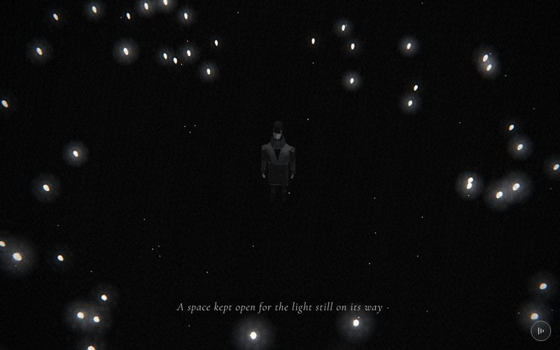

# 22 · minusone



> "A space kept open for the light still on its way"
> Source: `src/app.js`, banner `/* 22 — small lights gather into a ring around him, one place left empty */` · group: void-objects · before/after: [sheet](../../assets/model-polish/void-objects.jpg)

**The key is historical.** The scene is a ring of 60 small lights with one gap. ROADMAP suggests renaming `minusone → ring`; if you do, rename it in `CAPTIONS`, `SCENES` and the docs together. **There is no ground ring.** The owner had the thin ring under the lights removed ("不需要小圈圈"). Neither v40 nor v41 has it, and it must not come back.

## At a glance
| | |
|---|---|
| Setting | Void. Black with a sparse starfield, no ground and no fog. The hero stands alone at the origin while 60 small sky lanterns spiral in from the dark and settle into a ring of radius 1.6 at shin height, with one place left empty |
| Tone | Dark all scene. `bg:'#000'`, `scene.background = new THREE.Color(0)`, `dark:()=>true`. Dips: field's last 10 % fades to `#000`; for t > .9 this scene fades to **white** (`end`'s `#f4f4f4`), the story's last dip |
| Hero | **Stand.** `makePerson({body:0x5a5a5a,jacket:0x6a6a6a})`: the lightest `body`/`jacket` pair passed to `makePerson` anywhere, so he reads against black. `userData.head.rotation.x = −.3` (looking up a little). Default standing pose, no rig call per frame, no props |
| Motion | `k = ease(clamp(t·1.25))` gathers the lights: radius 6–14 → 1.6, height .5–6.5 → .35, while an extra angle unwinds, so they spiral in. The ring is complete at t = .8. Time-driven idle: each lantern bobs ±.05, turns slowly, and its halo pulses |
| Camera | `ca = lerp(.3,0,k)`, `dist = lerp(9,2.5,k)`; position `(sin ca·dist, lerp(2.5,9,k), cos ca·dist)`, `lookAt(0, lerp(1.2,.3,k), 0)`. Start ≈ (2.66, 2.5, 8.60): in front of him, slightly to his left (azimuth .3); end (0, 9, 2.5), a steep high angle about 74° down (not exactly top-down). It follows `k`, so it stops at t = .8. Default fov |
| Budget | scene 3600 tris (v40 4800) · hero 1561 (v40 1093) · 111 meshes · 0 instanced · 400 star points · 60 sprites · 3 lights · 8 materials |

## Models
| Model | Built with | Geometry | Tone | Placement / contact | Notes |
|---|---|---|---|---|---|
| Hero | `makePerson({body:0x5a5a5a,jacket:0x6a6a6a})` → `makeHero` | faceted lofts, 1561 tris, 51 meshes | trousers `0x5a5a5a`, coat `0x6a6a6a` | Origin, feet at y 0, standing on nothing | Default pose, head −.3. Receives and casts shadows (`buildAll`). The audit asks to keep him lighter than in other scenes |
| Sky lantern × 60 | `dot = loftGeo([[-.064,.034,.034,0],[-.03,.06,.06,0],[.016,.074,.074,0],[.048,.056,.056,0],[.066,.024,.024,0]],{sides:6})`, one shared geometry, 60 separate `Mesh`es | 5 rings × 6 sides: 48 side tris + 12 cap tris = **60 tris**; .13 tall, .034 across at the bottom, widest (.074) at the shoulder y .016, a small .024 top | `dm = M(0x8c8c8c,{emissive:0xffffff,emissiveIntensity:.75})`, one shared material | Final ring R 1.6, y .35 ± .05 | The code comment says "narrow open bottom", but `loftGeo`'s default `caps:true` closes both ends (60 tris includes the caps). Not instanced. Opaque standard material with a bounding radius < 1.2, so `buildAll()` puts them in the shadow pass (cast and receive). With no ground, their shadows can only fall on him |
| Halo × 60 | `glow(.55,.55)`, one sprite per lantern | additive sprite, scale .55 | white; opacity overwritten every frame to `.35 + .25·sin(time·3 + ph)` (.10–.60) | `g.position.copy(m.position)` | Default depth test, so a halo behind him is hidden by him |
| Stars | `stars(400,50,{seed:3})` | 400 `Points` | white, opacity .9, size 1.6 px, `fog:false` | shell of radius 30–50 | static |
| Background | `scene.background = new THREE.Color(0)` | — | `#000` | — | no fog |

**Ring layout** (from the code, computed):
- Lantern i gets slot angle `a = (i+1)/(N+2)·2π` with `N = 60`. That is 62 slots, pitch 2π/62 ≈ .101 rad (≈ .16 units of arc at R 1.6).
- Slots 0 and 61 are never used, so **the gap is three pitches wide** (≈ .30 rad, ≈ .49 units of arc between the two neighbouring lanterns).
- The gap is centred at ≈ −.05 rad, i.e. near (−.08, .35, 1.6). That is **directly in front of him** (he faces +z) and on the camera's side: it sits at the bottom of the end frame, between him and the viewer.

Per-lantern random values from `rng(12)`: `R0 = 6 + r()·8`, `y0 = .5 + r()·6`, `sp = 3 + r()·4` (rad), `ph = r()·6`.

## Lights and atmosphere
- `lights(scene,{hemi:[0x777777,0x050505,.4],dir:[0xffffff,.6,[1,6,2]]})`:
  - hemisphere `0x777777` over `0x050505`, intensity .4
  - shadow-casting key light .6 from high above, slightly right and in front (direction (1,6,2))
  - automatic rim light .27 from (−1, 3.6, −6)
- No fog. The stars use `fog:false` anyway.
- **Lantern glow:**
  - The emissive white at .75 plus the lights puts the upper, key-lit facets above the film pass's .8 glow threshold, so they bloom white. The lower facets stay grey.
  - The halo sprite adds the soft disc.
  - The facets are readable only when a lantern passes close to the camera (around t .3–.5, e.g. the large one low in the frame in the group's 22.35 shot). In the end frame each lantern is a few pixels and reads as a dot with a halo.
- **Film pass:** dark mode (strong grain and vignette).

## Animation (`update(t, time)`)
- `k = ease(clamp(t·1.25))`: 0 at t 0, about .72 at t .5, about .99 at t .75, 1 from t .8.
- **Each lantern:**
  - `ang = a + (1−k)·(sp + time·.25)`: a scroll-driven unwinding of `sp` plus a time-driven orbit of .25 rad/s that both vanish at k = 1, giving a spiral that lands exactly on the slot
  - `R = lerp(R0, 1.6, k)`
  - `y = lerp(y0, .35 + sin(time·1.5 + ph)·.05, k)`
  - position `(sin ang·R, y, cos ang·R)`; `rotation.y = ph + time·.3`, a slow turn so the facets catch the light, with no jitter
- **Halo:** follows the lantern; its opacity pulses `.35 + .25·sin(time·3 + ph)`.
- **Camera:** see At a glance. Scroll-driven through `k`, plus the global handheld drift.
- **From t .8 to 1:** only the idle motion (bob, turn, pulse) and the handheld drift move. The caption is already off (it shows for t .12–.75), and the dip to white starts at .9.

## v40 → v41
Source: [model-polish/void-objects.md](../model-polish/void-objects.md) ("22 minusone", Round 1; untouched in Round 2). Audit priority LOW ("none of substance; the lights are dots, the ring and gap read").
- **v40:** each light was `SphereGeometry(.05,8,6)` (80 tris) in unlit `B(0xffffff)`, with the same halo sprite, ring gather, gap and camera.
- **First pass:** a 6-sided faceted lantern loft (60 tris) in `M(0x8c8c8c, emissive white .42)`, plus the slow `rotation.y` turn per lantern.
- **Round 1:**
  - The ring looked dimmer than before, and the drop-shaped lantern read as a gem. Emissive went `.42 → .75` so each lantern blooms white again.
  - The profile was inverted into a sky lantern (天燈): narrow bottom (.034), wide shoulder near the top (.074), small cap.
  - The `before_minusone_22.35` shot was retaken with a 22.2 warm-up because the first one showed scene 21.
- **Untouched (audit "do not touch"):** the ring gather, the gap, the camera rise; no ground ring.
- **Triangles (inventory, hero excluded):** 4800 → 3600 (60 × 80 → 60 × 60). The scene got cheaper. The notes' 5893 → 4693 include the v40 hero (1093).
- The group's other item, `suitcase()` (scenes 1 and 3; see `docs/MODELS.md`), does not appear in this scene.

## Editing notes
- **Owner rules:**
  - **no ground ring** ("不需要小圈圈", ART-DIRECTION feedback history)
  - **no trembling:** keep the bob at ±.05 and the halo pulse as slow as it is
  - **the caption is verbatim**, and the text frames the gap as "room for the next light" (ART-DIRECTION)
- **The gap is what the scene is about.** It comes from `N+2` slots for `N` lights. If you change N, keep `(i+1)/(N+2)`, or the gap moves or disappears. To move the gap, rotate the whole ring by adding one constant to every `a`; leave the slot formula alone. It sits in front of him on the camera side; keep it visible in the end frame.
- **Shared geometry and material:** `dot` and `dm` are shared by all 60 lanterns. One edit changes all of them, and there are no per-lantern tones.
- **Lantern shading:**
  - Emissive .75 is tuned so the lit facets bloom while the lower ones stay grey. Lower values made the ring look dimmer than v40's white dots (Round 1).
  - `B()` would lose the facets.
  - The style rule caps it at 8 sides. Each extra loft ring costs 12 tris × 60 lanterns = 720 tris.
- **No ground:** he stands on nothing at y 0. The only floor-level element this scene ever had (the thin ring) was removed by the owner, so ask before adding any floor.
- **Composition:** in the t=.5 screenshot the lanterns are still spread over the whole frame, and one passes the lower middle near the caption. That is the gather in progress. By t .75 (k ≈ .99) the ring is nearly closed around him. In the group's 22.65 shot its lower edge sits just above the caption.
- **Standing idle:** ROADMAP lists `minusone` as a scene that would benefit from subtle breathing or a weight shift (no trembling).
- **Shadows:** the lanterns are in the shadow pass. A lantern passing between the key light (high above) and him could drop a tiny shadow on him; no review flagged one. If one ever shows as a speck, set `castShadow = false` on the lanterns inside `update()` (`buildAll()` runs after `build()`), the way scenes 12 and 14 do.

## Check it
```bash
NODE_PATH=/opt/node-tools/node_modules WAIT=12000 node tools/shots.js 21.9 22.2 22.35 22.5 22.65 22.85
```
- 21.9 and 22.2 are the warm-up (without 22.2, the group's 22.35 shot showed scene 21).
- **22.35:** a lantern passes close to the camera. Check that it reads as a lantern (shoulder near the top, small cap), not a ball or a gem.
- **22.5 / 22.65:** the spiral gathering, the hero readable against black, the lights not piling up on the caption.
- **22.85:** the closed ring, with the three-pitch gap at the bottom of the frame in front of him. The caption is already off.
- **Hero:** standing default pose only. After a `makeHero()` change, check it in `tools/pose.html` with `POSE = U => { U.head.rotation.x = -.3 }`, at `?0`, `?1` and `?2`.
