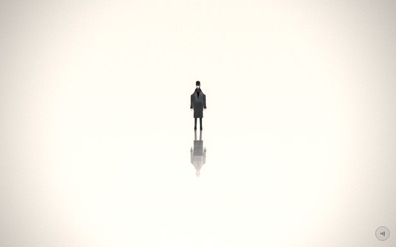

# 23 · end



> (no caption)
> Source: `src/app.js`, banner `/* 23 — ending: the walk and its reflection */` · group: hero (only `makeHero()` changed; the scene block is unchanged) · before/after: [sheet](../../assets/model-polish/hero.jpg)

The last scene. He stands still on white with a mirrored, semi-transparent copy of himself below him, and the camera pulls back from a low close shot to a small figure. From t > .72 the `#ending` overlay (title, "Walk again", note, About ↓) covers the lower part of the frame. Despite the banner ("the walk…"), **nothing walks**: the code comment says "he stands still with his reflection", and SCENES.md says "no walking".

## At a glance
| | |
|---|---|
| Setting | Void, white. No ground, no fog, no buildings: the figure, its mirrored copy and a fade veil over a vertical gradient |
| Tone | Light all scene. `bg:'#f4f4f4'`, `dark:()=>false`. Background `gradTex('#efefef','#fbfbfb')` (top → bottom). Light film pass (grain .035, vignette .35, glow ×.15); the drone filter is at 1400 Hz. Dip in: minusone's last 10 % fades to `#f4f4f4`, then this scene's first 10 % fades out of `#f4f4f4`. There is no dip out (last scene) |
| Hero | **Stand**, default relaxed stance, no rig calls, no props. `dad = makePerson()` (default tones) at the origin, facing +z (the camera). The reflection `ref = makePerson({mat:refMat})` with `ref.scale.y = −1` |
| Motion | Camera only: `k = ease(smooth(0,.75,t))` dollies straight back. Nothing else is animated (`time` is unused); the only idle motion is the global handheld drift added in `frame()` |
| Camera | `position (0, 0, lerp(2.6,14,k))`, `lookAt(0, lerp(1.2,0,k), 0)`. It sits at **y 0, the mirror plane**: it starts 2.6 away looking up at his chest and ends 14 away looking level at his feet (the mirror line). It stops at t .75 (k = 1). At t .5, k ≈ .87: z ≈ 12.5, lookAt y ≈ .16. Default fov 45° (62° on portrait screens) |
| Budget | scene **2** tris (v40 2) · hero **3122** = 2 × 1561 (v40 2186 = 2 × 1093) · 103 meshes (v40 87) · 0 instanced · 0 points · 3 lights · 9 materials (v40 8) |

## Models
| Model | Built with | Geometry | Tone | Placement / contact | Notes |
|---|---|---|---|---|---|
| Hero (`dad`) | `makePerson()` → `makeHero()` | 51 meshes (49 faceted lofts plus two hand-built plates: the coat's open-front strip and the fringe), 1561 tris (148 of them are hidden seated pieces: `seatB`, laps, knee flaps; see MODELS.md §2) | defaults: coat `0x3a3a3a`, trousers `0x2a2a2a`, collar/cuffs `0x1f1f1f` (coat × .55), shoes `0x101010` (derived), skin `0xa9a9a9`, hair `0x161616`, inner `0x0e0e0e`; per-facet ±9 % vertex-colour jitter | origin, facing +z. No floor: the soles end about 2 cm below y 0 (measured bbox in the default stance: y −.035 … 1.916, x ±.32) | Default stance from `makeHero`: weight on one leg (`legs[0].z −.035`, `legs[1].z .03`, `knees[1].x .08`), loose arms, head turned `−.12`, hands `grip(.18)`. Opaque `MeshStandardMaterial` parts with radius < 1.2, so `buildAll()` makes every part cast and receive shadows. Nothing else in the scene receives them |
| Reflection (`ref`) | `makePerson({mat:refMat})`, then `ref.scale.y = −1` | the same 51 meshes, 1561 tris, mirrored about y = 0 | `refMat = MeshBasicMaterial({color:0x2a2a2a, transparent:true, opacity:.55, side:DoubleSide})`: unlit, one tone; the hero's vertex colours are ignored because `refMat` has no `vertexColors` | below the hero, feet to feet. Both rigs are built identically and never posed, so the copy matches exactly | Transparent, so `buildAll()` leaves it out of the shadow pass. Each part blends on its own at .55, so parts that overlap on screen (sleeves over the coat, panels over the legs) come out darker, and the copy shows its inner structure instead of one flat silhouette (visible in the key image) |
| Fade veil | `PlaneGeometry(6,2.2)` + `MeshBasicMaterial({map:fadeTex, transparent:true, depthTest:false})`, `renderOrder = 2` | 2 tris (the scene's whole non-hero budget) | `fadeTex = canvasTex(4,128, …)`: a vertical gradient from `rgba(251,251,251,0)` at the top to `rgba(251,251,251,1)` at the bottom (`CanvasTexture` flips Y, so canvas top = plane top) | `position (0, −1.1, .6)`: spans y −2.2 … 0 and x −3 … 3, in front of both figures | Fades the reflection out toward its (mirrored) head. `depthTest:false` + `renderOrder 2` make it paint over everything behind it on screen, after the transparent copy. Its top edge (y 0) is fully transparent, so it never shows a line at the feet |
| Background | `scene.background = gradTex('#efefef','#fbfbfb')` | screen-space texture | `#efefef` (top) → `#fbfbfb` (bottom) | full frame, independent of the camera | The veil's bottom colour (251) matches the gradient's bottom stop |

## Lights and atmosphere
- `lights(scene,{hemi:[0xffffff,0xaaaaaa,1], dir:[0xffffff,.6,[2,4,5]]})`:
  - hemisphere: white sky, `0xaaaaaa` ground, intensity 1
  - key: directional .6 from direction (2,4,5) (normalised × 20), front-right-above, shadow-casting (±14 ortho, 1536 px map)
  - rim: directional .27 placed at (−2, 2.4, −9), behind-left
  - Inventory: Hemisphere 1.00, Directional .60, Directional .27.
  - The rig is close to the one in `aboutShots()` (`hemi 0x999999`, key .7), so the About illustration and the ending figure are lit alike.
- No fog, no particles, no sprites.
- **Film pass, light mode:** the `#efefef`–`#fbfbfb` background comes out almost white: the glow term (×.15 in light mode) still adds about .06–.09 to every pixel above .8 before the tone curve, so the warm grade pushes the frame centre to about (255, 252, 242) (sampled from the key image), and the vignette darkens the corners to about (200, 193, 185). The hero is the darkest thing in the frame.
- **Overlay:** `#ending` (`z-index:4`, `color:#111`, `justify-content:flex-end`, `padding-bottom:5vh`) holds the "Toward / THE LIGHT" title, the "Walk again" button, the end note and the About button. It toggles on when `i === n−1 && t > .72` (`frame()`).

## Animation (`update(t, time)`)
- `k = ease(smooth(0,.75,t))`: 0 at t 0, ≈ .87 at t .5, 1 from t .75.
- **Camera:**
  - `camera.position.set(0, 0, lerp(2.6,14,k))`; `camera.lookAt(0, lerp(1.2,0,k), 0)`.
  - Computed from those numbers with the landscape 45° fov: at t 0 the camera pitches up about 25°, so the frame runs from about ankle height (y ≈ .1 at his distance) to above his head, and the reflection is below the frame. The mirror line enters the frame at k ≈ .02 (t ≈ .15), just after the dip-in has cleared (t .1).
  - At k = 1 the mirror line is at the frame centre.
- `veil.position.z = .6` and `veil.scale.setScalar(lerp(1,1,k))` run every frame but change nothing. They are leftovers and can be removed.
- **Not driven by `update`:** the handheld drift from `frame()` (x ±.025, y ±.018, roll ±.004, time-based) and the `#ending` toggle at t > .72.
- **End of scroll:** `frame()` clamps progress to `n − 1e−4`, so t ends just short of 1. Since k = 1 from t .75, the last quarter is a still frame under the overlay.

## v40 → v41
- **The scene block is byte-identical** in `app_v40.js` and `src/app.js`. Everything that changed comes from `makeHero()` (group: hero, [hero.md](../model-polish/hero.md)); hero.md lists `after_end_23.5` among the regression shots.
- **Triangles:** hero 1093 → 1561 per figure, so 2186 → 3122 for the pair. Scene tris unchanged (2, the veil). Meshes 87 → 103: the hero went from 43 to 51 meshes (collar, turtleneck, dark cuffs ×2, seat B, lap ×2, knee flap ×2, with the old high collar dropped). Materials 8 → 9: the hero gained `mDark` for the collar and cuffs (6 → 7 materials). The reflection still uses one shared `refMat`.
- **What changed on the standing figure:**
  - sloped shoulders with no plateau, and a dark collar ring. The neck is now the inner tone `0x0e0e0e`; in v40 it was the skin tone
  - default trousers `0x1a1a1a` → `0x2a2a2a`; shoes derived (`0x101010`, v40 `0x121212`)
  - six-sided shoes with a sole lip
  - overlapping coat panels, so no split line down the back
  - a flat-topped hair shell and a fringe plate
  - darker skull facets on the crown and under the fringe
- **In the reflection** everything collapses to one translucent tone, so only the outline changes: shoulders, collar, shoes, hair top.

## Editing notes
- **Any pose applies to both rigs.** `dad` and `ref` are separate rigs. To add the standing idle ROADMAP asks for (breathing or a weight shift for `end`; **no trembling**, owner rule), apply the same joint rotations to `ref.userData` every frame, or the reflection detaches from the figure.
  - The cleanest approach is a small `pose(U, t)` function called for both.
  - `dad` is a leftover name from the father-and-son version (see MODELS.md, Legacy).
- **The reflection is mirrored geometry, not a render.** Geometrically that is what a planar mirror at y 0 shows from any camera height, so raising the camera does not break it. What it lacks is a surface: no floor, blur or fresnel.
  - ROADMAP suggests a real planar reflection (`Reflector` from three/examples). That script is not part of `three.min.js` r128: it would be a new dependency, and new dependencies need the owner's approval (AGENTS.md rule 2; the Artifact host only allows cdnjs, jsdelivr and unpkg).
- **Feet at the mirror line:**
  - The standing hero's soles sit about 2 cm below y 0 (the rig's hip .98 minus the .94 leg and the .06 sole, plus the stance spread; measured bbox min y −.035). The mirrored shoes therefore overlap the real ones by a few centimetres.
  - It does not read at these camera distances (key image).
  - If you add a floor plane, raise both figures by about .03, or the shoes sink into it. Don't change the rig: the boat in scene 16 is tuned to the sole height.
- **The veil ignores depth.** With `depthTest:false` it covers anything behind it on screen within x ±3, y −2.2…0 at z .6. Keep new objects out of that box, or give them a higher `renderOrder`.
  - At the widest framing (z 14), the computed visible half-width at the figure is about 9 units, so the veil's side edges fall inside the frame. Its colour (251) is close to the background there. No review flagged an edge; check the shot at 23.85 if you change the veil or the background.
- **Keep it light.** `#ending` uses dark text (`#111`) on the lower part of the frame, and `dark:()=>false` sets the caption, grain and sound mood. A darker end frame would need the overlay restyled.
- **Overlay clearance:** from t > .72 the overlay stacks up from 5vh above the bottom of the frame. The camera has stopped by t .75 with the mirror line at the frame centre; computed from the camera numbers, the figure fills roughly the band from the centre up to about 17 % of the frame height above it, and the reflection the same band below it (half-height 14·tan 22.5° ≈ 5.8 at the figure, landscape fov). Keep anything you add above the centre line or inside the veil, and check the overlay in the 23.85 shot.
- **No caption** (`CAPTIONS.end` is `""`). The ending text lives in `src/body.html` (`#ending`) and must stay English, hopeful and free of flower wording (owner rules). The owner pulled the flower motif from this scene ("不要花"; ART-DIRECTION feedback history), so don't add daisies or petals here.
- **Shadows:** the key light casts the hero's shadows onto himself only. A floor (large, opaque `M()` plane) would automatically receive them (`buildAll()`).

## Check it
```bash
NODE_PATH=/opt/node-tools/node_modules WAIT=12000 node tools/shots.js 22.6 22.9 23.05 23.3 23.5 23.85
```
- **22.6 / 22.9:** lead-in. A long jump lags, and 22.9 shows the dip from minusone to `#f4f4f4`.
- **23.05:** the low close start. He fills the frame from about the ankles up while the dip clears; the reflection is still below the frame (it enters at t ≈ .15).
- **23.3:** mid pull-back. Check the shoes at the mirror line and that the veil fades the copy with no visible top edge.
- **23.5:** compare with `assets/scenes/23-end.jpg`.
- **23.85:** final framing with the `#ending` overlay on. Check that the figure and reflection read clear of the overlay text and that no veil edge shows at the sides.
- **Figure only:** after a `makeHero()` change, check the default stance in `tools/pose.html` with `POSE = U => {}` at `?1` (front) and `?0` (side). The query is a bare digit: `pose.html` reads `+location.search.slice(1)`, so `?v=1` would be parsed as NaN and break the camera lookup. Serve the repo root first (`python3 -m http.server 8000`). Note that `pose.html` renders `makePerson({body:0x3a3a3a,jacket:0x555555})`, which is lighter than the defaults used here.
